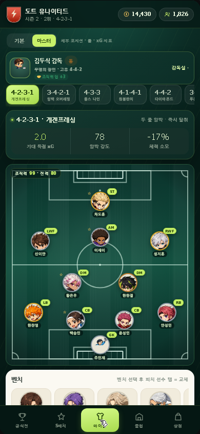
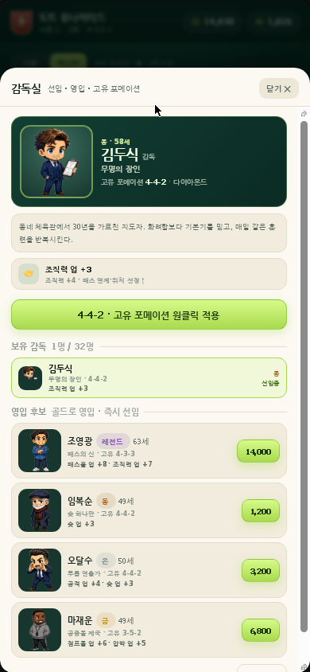
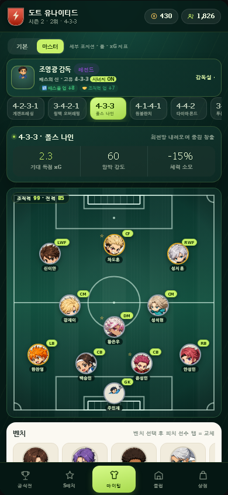
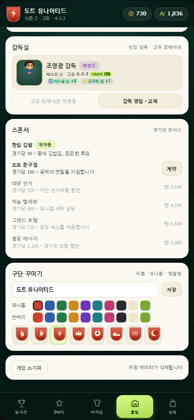
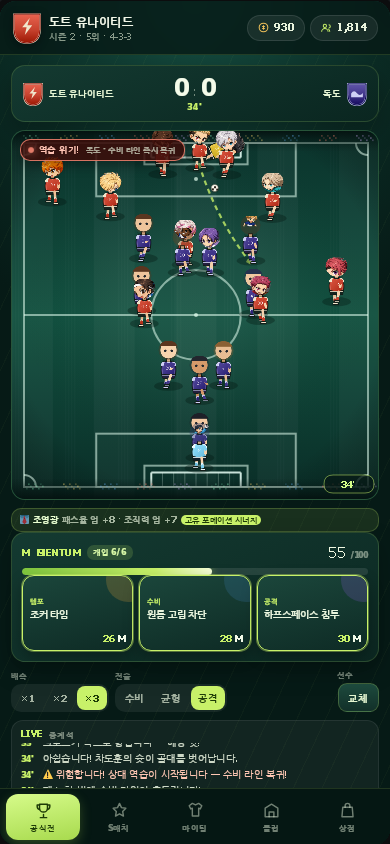
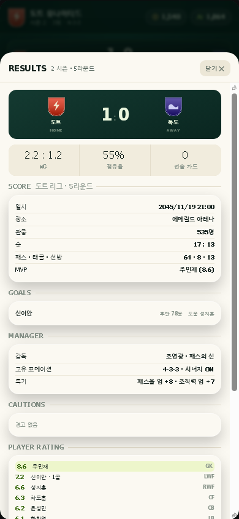

# 👔 도트싸커 v5 — 330명 고유 일러스트 · 32명 감독 전술

100% 한국어 · 100% 오리지널 가상 선수·감독으로 즐기는 **현대 전술 축구 구단 RPG**입니다.
v5는 **선수 일러스트를 36종 → 330종으로 전면 교체**하고(골키퍼/필드 풀 완전 분리), **고유 포메이션과 특기를 가진 감독 32명**을 새로 넣었습니다. 감독의 특기는 경기 AI와 전력 수치에 실제로 반영됩니다.

- 라이브: **https://hojin8811-dev.github.io/Dot-soccer/?v=5**
- 모바일 **390×844** 세로 화면 우선 설계 (가로 스크롤 없음 · 하단 5탭)
- 설치형 PWA (manifest + service worker) · 저장 키 `dot-soccer-v3-save` 그대로 이어받음 (v3·v4 세이브 자동 마이그레이션 → v5)
- 라이선스 클린: 실존 선수·구단·감독·엠블럼 없이 완전 오리지널 (선수 330명 + 감독 32명 전원 가상 창작)

| 마이팀 · 감독 카드 | 감독실 (영입·선임) | 고유 포메이션 시너지 |
| --- | --- | --- |
|  |  |  |

| 클럽 · 감독실 | 경기 중 감독 영향 | 결과서 · 감독 기록 |
| --- | --- | --- |
|  |  |  |

## v5에서 달라진 것

### 1. 선수 일러스트 330종 연동 (GK/필드 풀 정합)
- `assets/portraits/p01~p330.png`(400×400) + `head/p01~p330.png`(240×240) 를 코드에 연결. `DS.PIC_COUNT = 330`.
- **골키퍼 전용 40종** = `p06 · p15 · p20` + `p294~p330` (장갑 일러스트), **필드 전용 290종** = 나머지. `assets/portraits/pools.json`과 100% 일치(코드에서 자동 생성하므로 어긋날 수 없음).
- GK는 필드 일러스트를 절대 받지 않고, 필드 선수도 GK 일러스트를 받지 않습니다. 스쿼드·영입·스카우트·상대팀·세이브 마이그레이션 모든 경로에서 풀 준수 + 얼굴 중복 0.
- v4 세이브에 남아 있던 `pic`(예: GK였던 p33~p36, 필드가 쓰던 GK 일러스트)은 로그인 시 자동 교정됩니다.
- SD 스프라이트(피치 위 22명)의 헤어·피부 색도 `p37~p330`까지 번호 기반으로 자동 배정.

### 2. 감독 32명 — 고유 포메이션 + 특기 8종
- **동 8명 / 은 10명 / 금 9명 / 전설 5명** (전원 가상 창작, `assets/managers/m01~m32` 일러스트 매칭).
- 각 감독은 **이름 · 나이 · 등급 · 한 줄 스토리 · 고유 포메이션(현 8종 중 하나) · 특기 1~2개**를 가집니다.
- **특기 8종**: `조직력 업 · 공격 업 · 수비 업 · 패스율 업 · 슛 업 · 점프볼(공중볼) 업 · 압박 업 · 스피드 업`. 등급이 높을수록 수치가 큽니다(2~8).
- **고유 포메이션 원클릭 적용**: 감독실에서 버튼 한 번으로 감독의 포메이션으로 라인업을 재배치. 현재 포메이션이 감독의 고유 포메이션과 같으면 **시너지 ON**(전력 +3 · xG +0.08 · 실점 xG −0.06)이 붙습니다.
- **감독 고유 전술**: 특기 조합이 포메이션 지표(압박·라인·폭·템포)를 보정해, 같은 4-3-3이라도 압박형 감독과 수비형 감독의 블록 높이가 달라집니다.

### 3. 감독 특기가 실제 경기 AI에 반영
| 특기 | 경기 엔진에서 하는 일 |
| --- | --- |
| 조직력 업 | 패스 선택에서 전진·오픈된 동료를 우선, 패스 오차 소폭 감소, 조직력·전력 수치 상승 |
| 공격 업 | 슛 사거리·슈팅 시도 확률·xG 상승, 수비 라인 전진 |
| 수비 업 | 수비 라인 하강·밀착 마킹, 상대 슈팅 xG 감소, 태클 성공률 상승 |
| 패스율 업 | 패스 오차(−최대 40%)·패스 차단 확률 감소 |
| 슛 업 | 슈팅 정확도·결정력(xG) 상승 |
| 점프볼 업 | 코너킥·크로스 공중볼 xG·유효 슈팅 확률 상승 |
| 압박 업 | 압박 인원/반경, 태클 성공률, 상대 패스 차단 확률 상승 |
| 스피드 업 | 전 선수 이동 속도(최대 +12%), 역습·복귀 개선 |

실측(같은 선수단·4-2-3-1·8경기 평균, quickjs 엔진 시뮬레이션): 감독 없음 xG 1.70 → 슛/공격형 감독 2.40, 패스/조직형 2.10. 수비형 감독은 실점 2.0 → 0.88, 태클 10.2 → 16.4.

### 4. 감독 관리 UI (100% 한국어)
- **마이팀·클럽·경기 화면**에 선임 감독 카드(일러스트 · 등급 · 성향 · 고유 포메이션 · 특기 태그) 상시 표시.
- **감독실**: 현재 감독 상세(일러스트·스토리·특기 효과 수치), **보유 감독 선임/교체**(무료), **영입 후보 4명**(골드 1,200~14,000, 영입 즉시 선임), **후보 교체 300골드**.
- 시작 시 **기본 감독 1명**(김두식 · 조직력 업 +3 · 4-4-2)을 지급합니다.
- 경기 중에는 스코어보드 아래에 `👔 감독명 · 특기` 줄이, 결과서에는 **MANAGER 밴드**(감독·고유 포메이션·시너지·특기)가 표시됩니다.

### 5. 경기 엔진 수정 (v4부터 있던 '경기 멈춤' 버그)
- 아무도 받지 못한 패스가 **경기장 밖으로 무한히 날아가 경기가 정지**하던 문제를 수정했습니다(90분 내내 패스 10여 회로 끝나던 현상).
- 이제 아웃된 공은 스로인, 안쪽 루즈볼은 회수 대상으로 전환되고, 공이 월드 밖으로 크게 벗어나면 자동 회수하는 안전장치가 있습니다.
- 수정 후 16경기 연속 정지 0건 · 패스 66~100회 · 슛 5~16회/팀으로 정상 전개.

## 조작
- **모멘텀** — 패스·태클·슈팅·골로 게이지 충전 → 손패 3장 중 발동(경기당 6회).
- **배속 ×1/×2/×3 · 전술(수비/균형/공격) · 교체 5회** — 경기 중 언제든, 하프타임 자동 교체창.
- **감독실** — 마이팀 상단 감독 카드를 탭. 고유 포메이션 적용·감독 교체·영입.

## 검증 (390×844, 실제 배포본 v5)
- esprima 문법 검사 3파일 0 오류.
- 일러스트 풀: `pools.json` 대조 GK 40종 · 필드 290종 · 합계 330종 일치, v5 스쿼드 16명 풀 위반 0 · 얼굴 중복 0.
- v4 세이브 마이그레이션: `v=4` + 잘못된 `pic`(GK에 p33, 필드에 p06) 세이브 → v5 로드 시 자동 교정(위반 0 · 중복 0) · 기본 감독 자동 지급.
- 라이브 5탭 전부 가로 오버플로 0 (`screen` 368/368, `main` 390/390), 이미지 깨짐 0, **콘솔 오류 0**.
- 감독 영입(14,000골드 · 잔액 차감 확인) → 선임 → 4-3-3 원클릭 적용 → 시너지 ON → 공식전 2경기 완주(1:0 승, 슛 17:13, 패스 64, 결과서 MANAGER 밴드) 확인.
