# ⚽ 꼬마일레븐 FC v26 — 이름 변경 · 현대 전술 축구 구단 경영 RPG

**꼬마일레븐 FC** — 100% 한국어 · 100% 오리지널 가상 선수·감독으로 즐기는 **현대 전술 축구 구단 RPG**입니다. v26에서 게임 이름을 《도트싸커》에서 **《꼬마일레븐 FC》**로 바꿨습니다(세이브·링크·저장소 URL은 그대로).
**v24는 ‘친구 구단과의 대결’을 연 패치**입니다. 내 구단을 **구단 코드(`?vs=` 공유 링크 · 짧은 복사 코드)**로 내보내면, 받은 사람이 그 링크로 접속해 **내 선발 11·벤치 7·포메이션·전술 그대로**와 1:1로 붙습니다. 상대는 AI 감독이 지휘하고 나는 실시간 전술 카드·교체로 개입하며, **리그 승점·일정에는 영향이 없습니다**(치팅 방지를 위해 유저 간 거래는 넣지 않았습니다). 유소년 잠재력은 **70~92로 넓어져** 특급·원더키드는 드물게 나옵니다.
v21은 “**리그를 진짜 리그처럼**” 만든 패치입니다. 8팀 7라운드이던 리그를 **20팀 38라운드 더블 라운드 로빈**으로 넓혀 홈·원정을 한 번씩 치르고, 표에는 **UCL 1~4 / UEL 5~6 / 강등 18~20** 존과 **`3 / 38 라운드`** 표기가 붙습니다. 상점은 **이적시장**이 되어 매물의 이적료·주급·나이·등급·포지션·롤·주발을 보고 **협상해 영입**하거나 내 선수를 내놓아 자금을 만들고, 클럽 하우스에는 **U-18 유소년 아카데미**(발굴 · 포지션 지정 코칭 · 1군 승격/매각)가 들어섰습니다. 경기 후에는 출전 선수 전원이 **EXP**를 받아 **자동 레벨업**하고, 엔진은 **박스 안·1:1의 명확한 찬스를 주저 없이 때리며**, 자기 진영에서만 공을 돌리는 정체를 **전진 패스·돌파로 끊습니다**. 60Hz 시뮬레이션을 120Hz 화면에 그려도 끊기지 않도록 **서브프레임 보간**을 넣었습니다.

**v25는 ‘전술을 쓰면 피치가 바뀐다’를 눈으로 보이게 만든 패치**입니다. 전술 카드를 쓰는 순간 오프사이드 트랩 라인·압박 타겟 링과 압박 벡터·하프스페이스 침투 화살표·티키타카 삼각 패스선·중거리 조준 아크가 경기장 위에 실시간으로 그려지고, 컷인은 카드 일러스트 + 에이스 초상화로 바뀌며, 카드가 살아 있는 동안 상단 전술 스트립과 모멘텀 칩에 **남은 시간 게이지**가 계속 표시됩니다. 선수 연출도 살아나 질주 잔상·발밑 먼지, 발차기 스윙 아크와 충격파, 슬라이딩 잔디·마크, GK 다이빙 고스트와 방패 섬광, 골 세리머니 색종이, 스턴 별·땀방울·에이스 금빛 링이 들어갔습니다. 경기 시작은 **정렬된 킥오프 세리머니**로 확실하게 출발합니다. 실기 QA에서 나온 **컨디션 게이트(무료 팀 휴식·메디컬룸 회복 상향·회복 모달)**, **볼 주변 몰림 완화**, **유니폼 색=피치 링 통일**(→ v25b에서 파랑 대 빨강 고정 팔레트로 대체), **xG맵 좌우 반전 수정**, 그리고 UX 마찰(참스 배너 자동 닫힘·배속 유지·교체 적성·시즌/통산 기록 분리·원정 구장명·협상 완화·롤 진화 접기·2군 로그 정리)도 함께 정리했습니다.

- 라이브: **https://hojin8811-dev.github.io/Dot-soccer/?v=26&b=17**
- **844×390 가로 뷰포트** 기준 설계 (경기·마이팀 화면은 스크롤 없이 한 화면, 나머지 탭은 가로 다단 대시보드)
- 세로로 열면 **가로 회전 안내**가 뜨고, `manifest.orientation = landscape`
- 설치형 PWA · 저장 키 `dot-soccer-v3-save` 그대로 (v3~v26 세이브 자동 이어받기 — v23 세이브는 PvP 전적 0-0-0으로 이어받고, 42라운드로 깨진 세이브도 20팀 38라운드로 자동 복구)
- 라이선스 클린: 실존 선수·구단·감독·엠블럼 없이 완전 오리지널 (선수 500명 초상화 풀 + 감독 50명)

| 킥오프 전 상대 스카우팅 리포트 | 경기 중 터치라인 지시 드로어 | 지시 직후 피치 위 콜아웃 |
| --- | --- | --- |
| 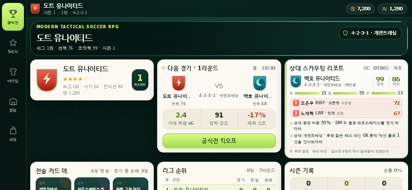 | 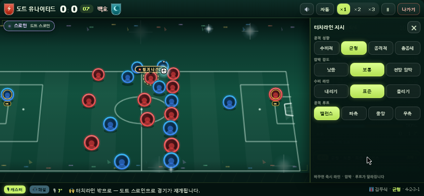 | 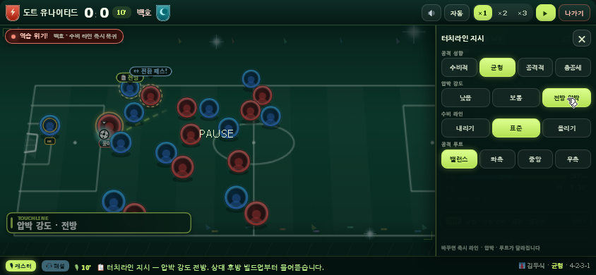 |

| 클럽 시설 — SD 일러스트 | 상점 — 스카우터 안내원 |
| --- | --- |
| 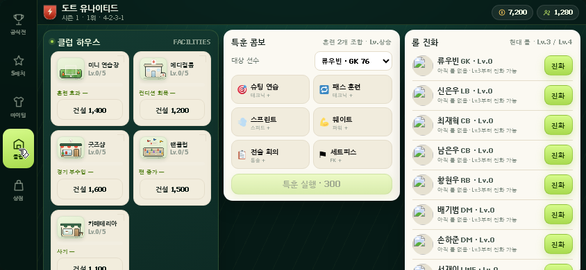 | 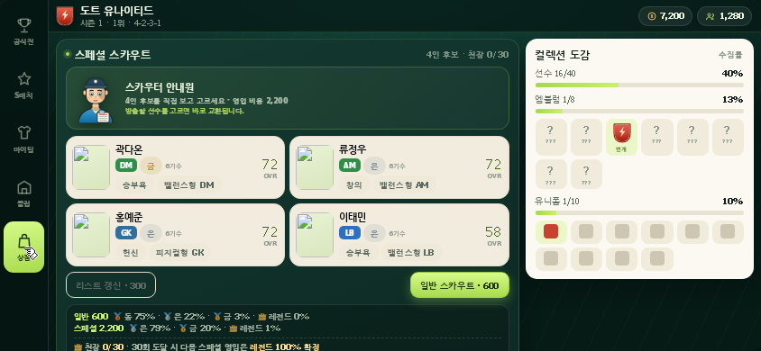 |

| v17 관람 연출은 그대로 — 방송 카메라 패닝 | 찬스 줌인 · 관중 플래시 | 골망 출렁임 + 코너 세리모니 |
| --- | --- | --- |
| 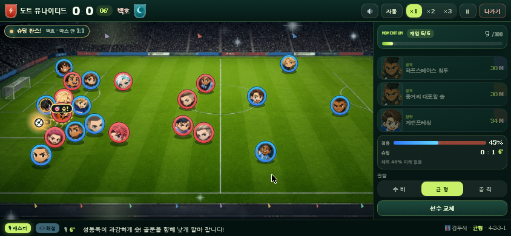 |  |  |

| 0.5배속 `📺 REPLAY` — 득점자·도움·xG 자막 + 건너뛰기 | 2인 중계 — 🎙 캐스터 / 🎧 해설 + 🔊 음소거 토글 |
| --- | --- |
| 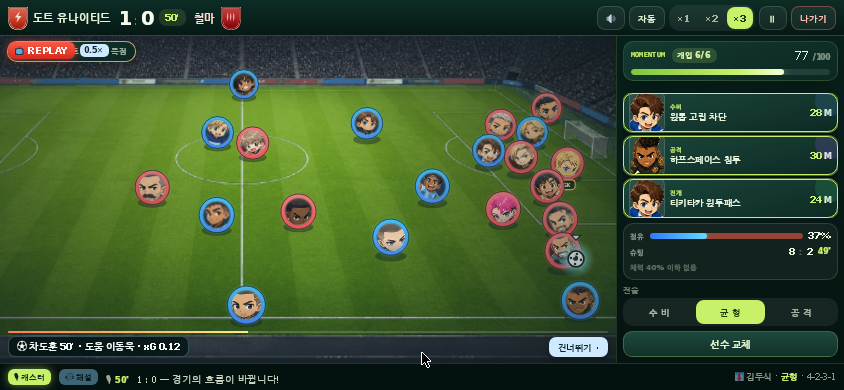 | 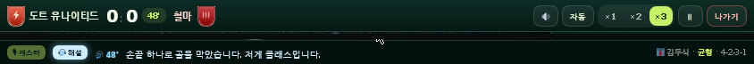 |

## v26 패치 — 게임 이름 《꼬마일레븐 FC》 (b=17)

게임 이름을 **《도트싸커》 → 《꼬마일레븐 FC》**로 바꿨습니다. 게임 내용·세이브는 그대로입니다.

- **표시 이름** — 브라우저 탭 `<title>`, iOS 홈 화면 이름(`apple-mobile-web-app-title`), `application-name`, PWA 매니페스트 `name`/`short_name`, 세로 회전 안내 문구까지 모두 `꼬마일레븐 FC`.
- **화면 최상단** — 상단 바에 게임 이름과 같은 구단명 `꼬마일레븐 FC`가 뜨고, 홈 히어로 큰 제목도 `꼬마일레븐 FC`입니다(구단명은 마이팀에서 바꿀 수 있습니다).
- **새 게임 기본 구단명** — `도트 유나이티드` → `꼬마일레븐 FC`. 기존 세이브 중 **구단명을 직접 바꾸지 않은 경우만** 옛 기본값을 새 이름으로 자동 이전하고(최근 경기 카드·결과서의 옛 홈팀 표기도 함께), 유저가 직접 정한 이름은 그대로 둡니다.
- **그대로 유지(중요)** — 세이브 키 `dot-soccer-v3-save`, 저장소 이름·URL `Dot-soccer`, PvP 공유 링크(`?vs=`), 진행도·선수·리그 기록. 옛 링크로 들어와도 같은 구단이 이어집니다.
- 캐시 버스터 `?v=26&b=17`, 서비스워커 캐시 `dot-soccer-v26-20261127d`.

| 홈 — 상단 바·구단명 《꼬마일레븐 FC》 | 세로로 열면 회전 안내도 새 이름 |
| --- | --- |
| 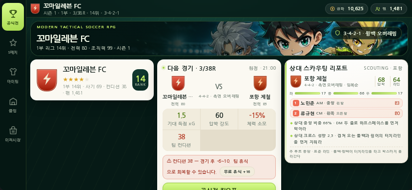 | 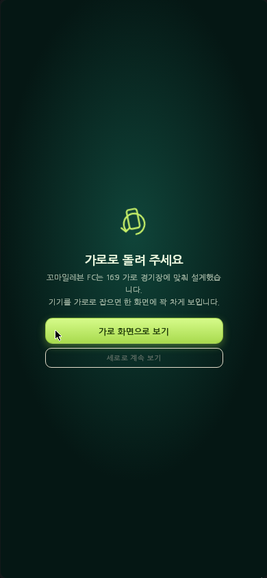 |

| 경기 — 스코어보드 팀 이름 | 결과서 — 홈팀 표기 |
| --- | --- |
| 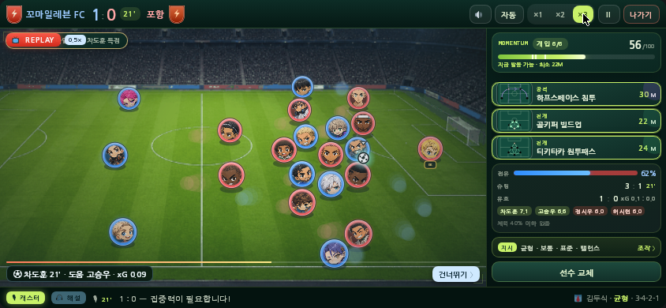 | 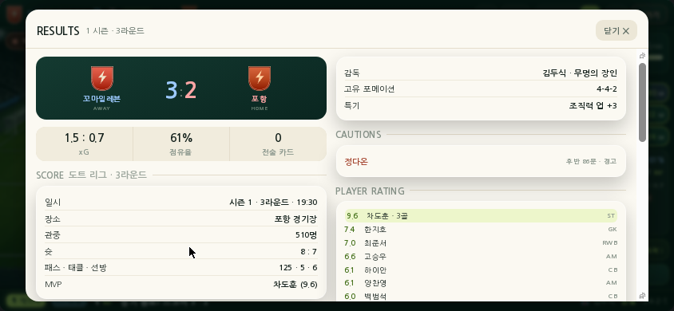 |

## v25b 패치 — 경기화면 파랑 대 빨강 고대비 통일 (b=13)

v25에서는 피치 위 선수 링을 유니폼 색으로 칠했습니다. 그런데 **초록·검정·흰색 유니폼 구단을 만나면 링이 잔디에 묻혀** 우리 선수가 어디 있는지 한눈에 보이지 않았습니다. v25b는 팀 색을 유니폼에서 떼어내 **고정 팔레트로 통일**합니다 — 홈(우리 팀)은 선명한 파랑 `#2f8dff`, 원정(상대)은 선명한 빨강 `#ff4b4b`. 어떤 구단과 붙어도 경기장 위에서는 늘 **파랑 대 빨강**입니다.

- **피치 링** — 22명 토큰의 두꺼운 링이 유니폼과 무관하게 파랑/빨강. 링 안쪽에 밝은 실선을 한 겹 더 넣어 초록 잔디 위에서도 윤곽이 또렷합니다. 링 색은 이제 유니폼 색을 읽지 않으므로, 두 팀이 같은 색 유니폼을 입어도 구분이 무너지지 않습니다.
- **스코어보드** — 상단 바 팀 이름과 점수 숫자(`2 : 1`)를 같은 파랑/빨강으로.
- **점유율 바** — 우리 점유는 `#2f8dff` 그라데이션, 상대 몫은 `#ff4b4b`.
- **결과서 xG맵** — 슈팅 원과 범례(`도트 5 · 산청 7슛`)까지 같은 두 색, 결과서 상단 팀 이름·점수도 같습니다.
- 색은 한 곳에서만 나옵니다(`js/match.js`의 `HOME_COL`/`AWAY_COL` → `DS.Match.teamColors`, CSS `--team-home`/`--team-away`). 피치·스코어보드·점유율 바·xG맵이 서로 어긋날 수 없습니다.

| 초록 유니폼 상대(산청)와의 경기 | 경기 중 — 파랑 대 빨강 | 결과서 xG맵 (파랑/빨강) |
| --- | --- | --- |
| 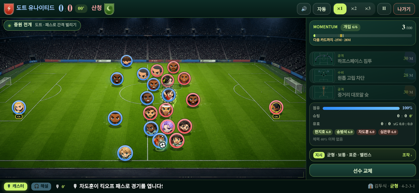 | 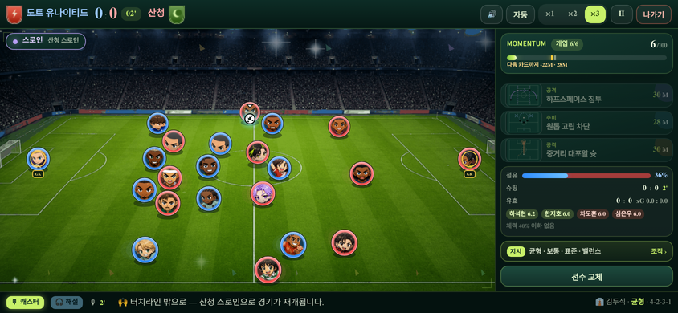 | 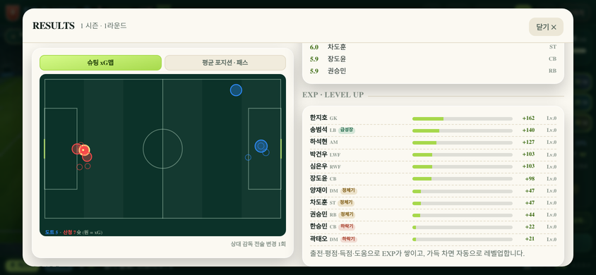 |

| 최악 케이스 — 양 팀 모두 초록·어두운 유니폼이어도 |
| --- |
| 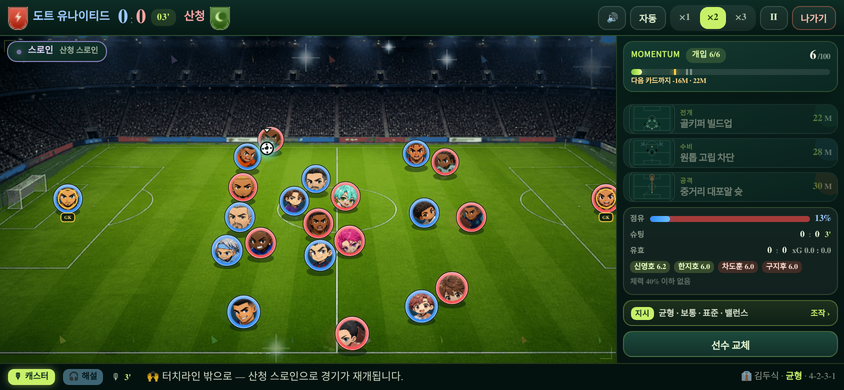 |

캐시 버스터 `?v=25&b=13`, 서비스워커 캐시 `dot-soccer-v25-20261127b`.

## v25 패치 — 실시간 전술카드 대입 · 캐릭터 연출 · 확실한 킥오프 (b=12)

| 킥오프 세리머니 | 전술 카드 컷인 (일러스트 + 에이스) | 압박 타겟 링 + 압박 벡터 |
| --- | --- | --- |
| 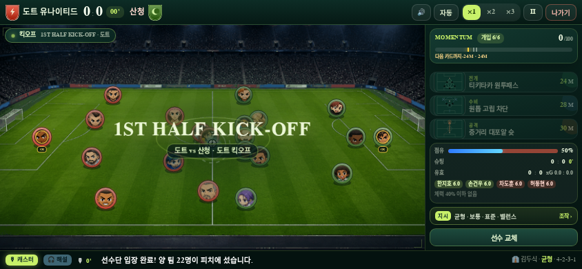 | 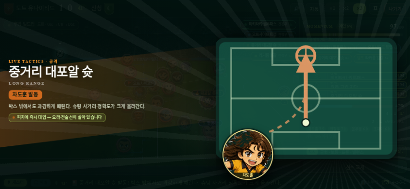 | 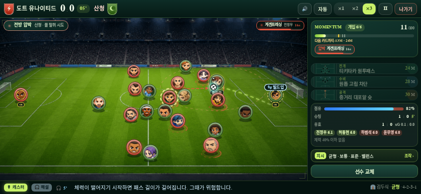 |

| 오프사이드 트랩 라인 | 활성 카드 HUD 스트립 (남은 시간) | 골 세리머니 색종이 |
| --- | --- | --- |
| 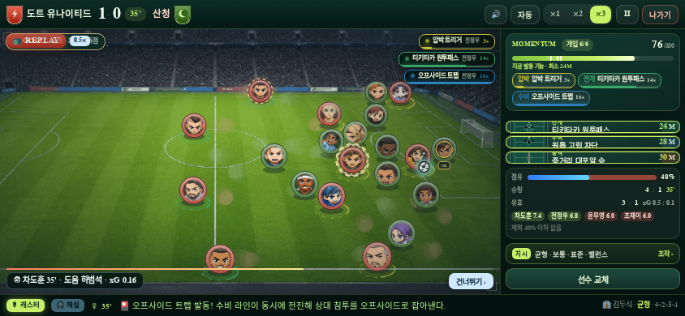 | 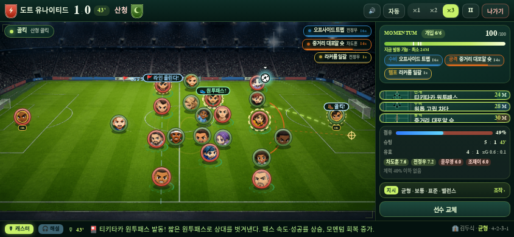 | 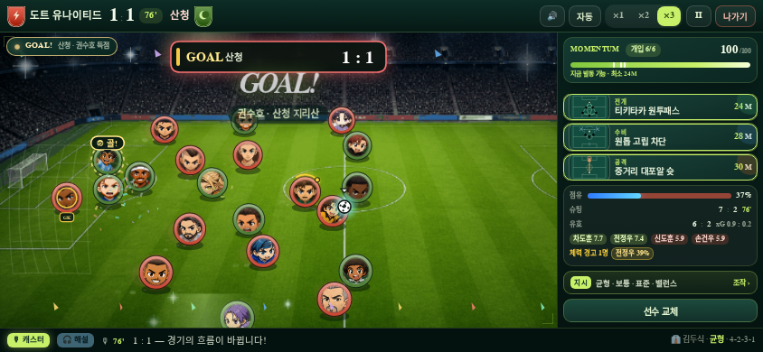 |

| 후반 킥오프 | 컨디션 회복 모달 (무료 휴식) | 결과서 xG맵 (좌우 반전 수정) |
| --- | --- | --- |
| 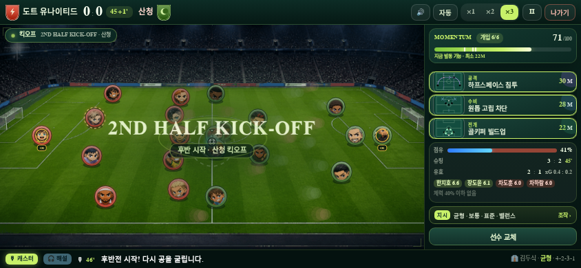 | 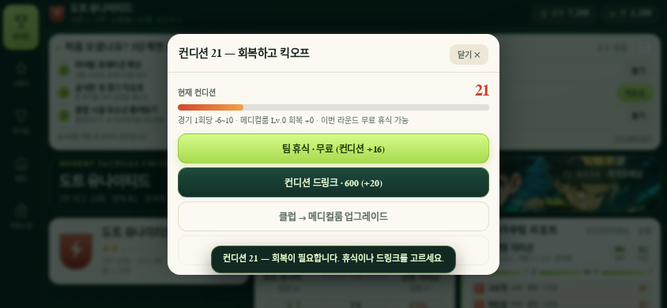 |  |

캐시 버스터 `?v=25&b=12`, 서비스워커 캐시 `dot-soccer-v25-20261127`.

### 1. 실시간 전술카드 대입 — 카드가 피치 위에 그려진다
1. **카드별 피치 오버레이** — `offside`는 수비 최종 라인을 가로지르는 점선 트랩 라인 + 전진 셰브런, `press`/`trigger`는 볼 소유자 타겟 링 + 전방 압박 선수 3명의 압박 벡터(트리거는 1·2번 번호 배지와 `PRESS ×2` 표식), `atk`/`through`는 윙어·공격수의 하프스페이스/뒷공간 침투 화살표(+스루패스는 상대 수비 라인 점선), `tiki`/`build`는 볼 소유자와 동료 2명의 삼각 패스 연결선과 변을 따라 흐르는 패스 점, `longshot`은 슈터 앞 슈팅 사거리 아크 + 골문 조준선/크로스헤어, `def`는 상대 최전방 포위 링과 차단 브래킷, `tempo`/`roar`는 전원 스피드 상승 파동, `setpiece`는 목표 지점 조준 링입니다. 색은 카드 고유 색입니다.
2. **컷인 & HUD 연계** — 컷인에 `DS.tacticArtHTML` 카드 일러스트 + 에이스 초상화 + "피치에 즉시 대입" 배지를 함께 배치했습니다. 경기 중에는 **피치 우상단 전술 스트립**(카드명·에이스·남은 초·게이지)과 **모멘텀 영역 카드 칩**(카드 색 테두리 + 남은 시간 게이지)이 계속 갱신됩니다.
3. **압박 트리거 2연속 압박** — 카드 설명대로 0.8초 뒤 한 번 더 압박이 붙습니다(2차 탈취 성공 시 스턴·잔디·슬라이딩 마크 연출). 헤드리스 12종 카드 발동 검증에서 `chain` 2회 이상 확인.

### 2. 캐릭터 연출 업그레이드
4. **액션별 시그니처 이펙트** — 달리기/드리블은 **모션 잔상 + 잔디 먼지**, 슈팅·크로스는 **발차기 스윙 아크 + 임팩트 충격파 링**(중거리·강슛은 불꽃·금빛 궤적), 패스는 **방향성 패스 파동**, 태클은 **잔디 뜯김·흙먼지 + 지면 슬라이딩 마크**, GK 다이빙은 **3단 고스트 잔상 + 글러브 섬광 + 선방 방패 링**, 골은 **점프 세리머니 + 환호 오라 + 색종이(콘페티)**.
5. **전술·상태 시각화** — 활성 카드의 영향을 받는 선수 발밑에 **카드 색 전술 오라 링**, 에이스는 **금빛 이중 링**, 스턴은 머리 위 어지럼 별, 피로 40% 이하는 땀방울이 떨어집니다. 파티클은 상한 300개로 캡을 두고 844×390에서 **60fps(평균 16.67ms)**를 유지합니다.

### 3. 확실한 킥오프 세리머니
6. 경기 진입·전반/후반 시작·득점 후 재개에서 양 팀이 **자기 진영 + 센터 서클 밖**에 정렬하고, 1.1초 동안 경기 시계와 선수 좌표를 **정지**한 채 휘슬·파동 링·`1ST HALF KICK-OFF`/`2ND HALF KICK-OFF` 배너를 보여 줍니다. 끝나면 센터 서클 키커가 **실제 첫 패스**를 하며 경기가 출발합니다(검증: 정지 중 시계 0 · 좌표 이동 0 · 진영 위반 0 · 킥오프 패스 1회).

### 4. 실기 QA 반영 — 진행·체감·표기
7. **컨디션 게이트 해소** — 라운드당 1회 **무료 팀 휴식(+16)**, 메디컬룸 회복량 Lv1 기준 +4 → **+7**, 컨디션 25 미만이면 조용히 막히지 않고 **회복 선택 모달**(휴식/드링크/메디컬룸/이 컨디션으로 킥오프)이 열립니다. 홈 화면에 경고 배지와 원터치 무료 휴식 버튼, 클럽에 '팀 컨디션·회복' 카드를 추가했습니다.
8. **몰림 완화** — 공 쪽 압축 계수(kx·ky)와 거리 감쇠를 줄이고, 폭 지표·박스 슬롯 간격·줄 간격·최소 분리 거리를 키웠습니다. 계측(동일 매치 8,000프레임): 볼 반경 18 이내 평균 **4.45 → 3.89명**, 25 이내 **6.86 → 6.00명**, 좌우 폭 표준편차 **25.5 → 26.1**, 양쪽 측면 동시 사용 96%.
9. **색·좌표 일치** — 피치 링 색을 **유니폼 색**에서 뽑아 스코어보드·엠블럼과 통일(두 팀이 사실상 같은 색일 때만 원정을 대비색으로 대체). 결과서 **슈팅 xG맵 좌우를 반전**해 경기 화면과 같은 방향(홈이 오른쪽 골문 공격)으로 맞추고, xG맵 색도 유니폼 색을 씁니다.
10. **UX 마찰 정리** — 상황 바 자동 닫힘(7.5초), 하프타임 후 **×3 배속 유지**(검증: 하프타임 전 3 → 후반 3, 버튼 on), 교체창 **포지션 적성 배지(◎○△×)**, 홈 **시즌 기록 / 통산 전적 분리**, 결과서 날짜를 **현재 시즌·라운드**로, 원정은 **상대 구장명**(예: 창원 경기장), 이적시장 협상 **실패 시 가격 유지 + 최대 3회 재시도**, 클럽 **롤 진화 대기 11명 접기**, 2군 로그 중복·빈 줄 제거, xG맵 범례 여백 보정, 상단 칩 '금화/팬' 라벨, 지시 라벨 중복(균형/보통/표준/밸런스) 정리.

## v24 패치 — 비동기 PvP(유저 대전) · 유소년 잠재력 확장 (b=11)

| 유저 대전 — 내 코드/도전 (S매치 탭) | 내 구단 코드 · 공유 링크 | 프리셋 라이벌 도전장 |
| --- | --- | --- |
| 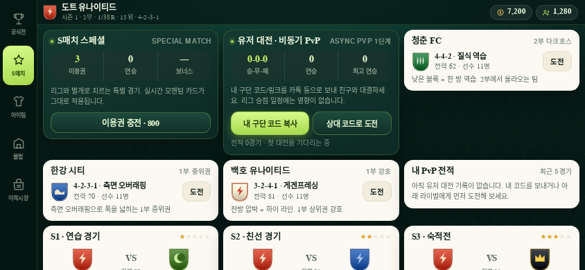 | 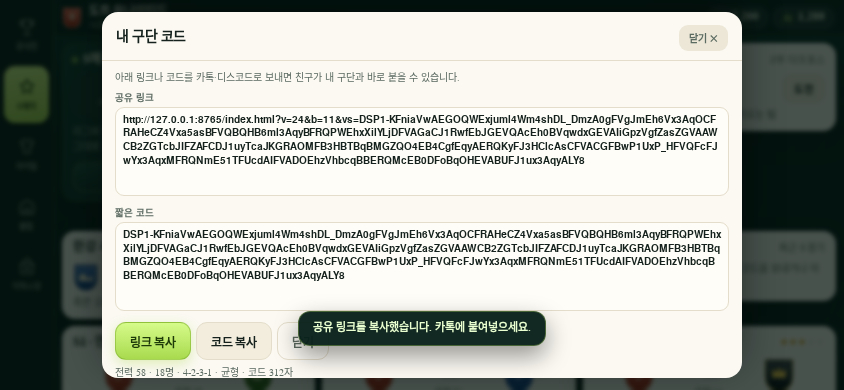 | 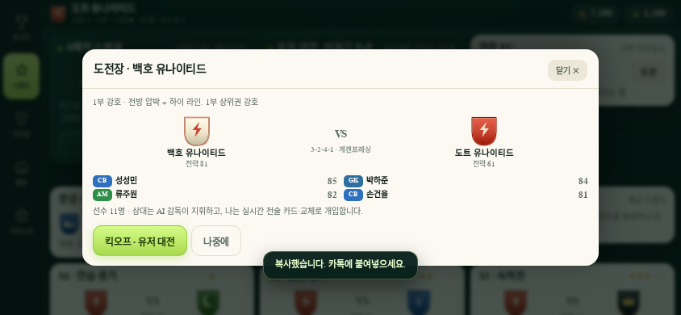 |

| `?vs=` 링크로 도착한 도전장 | 유저 대전 결과서 (PvP 전적) | 유소년 잠재력 등급 (70~92) |
| --- | --- | --- |
| 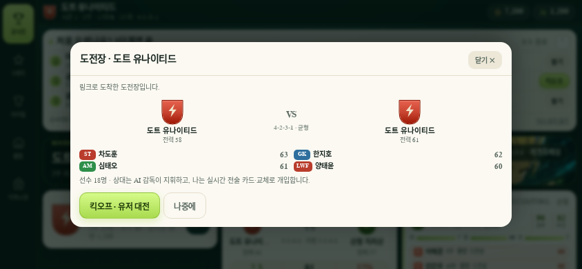 | 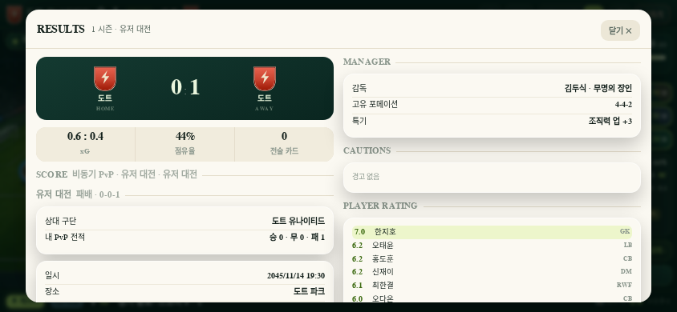 | 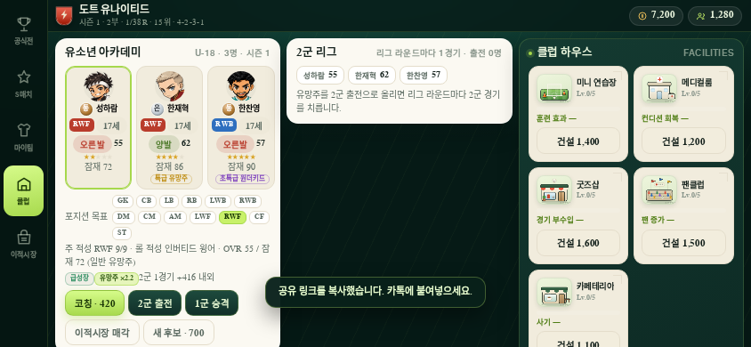 |

내 구단을 **코드 하나로 보내고, 받은 코드로 바로 붙는** 비동기 PvP 1단계입니다.
캐시 버스터 `?v=24&b=11`, 서비스워커 캐시 `dot-soccer-v24-20261127a`, 신규 모듈 `js/pvp.js`.

1. **구단 코드 · 공유 링크** — `exportSquadCode()`가 구단명·리그/전력·포메이션·전술과 **선발 11 + 벤치 7**(이름·포지션·스탯·등급·레벨·롤·주발·개성·초상화 ID)을 **URL-safe Base64 + 체크섬(FNV-1a)** 으로 압축합니다. 18명 기준 **코드 312자**, 공유 링크는 `?v=24&b=11&vs=DSP1-…` 형태입니다. `S매치 > 유저 대전`에서 **[내 구단 코드 복사]** 를 누르면 클립보드에 링크가 복사되고(실패하면 코드/링크를 길게 눌러 복사하는 폴백 모달), **“카톡 등으로 보내 친구와 대결하세요”** 안내가 붙습니다.
2. **코드로 도전 · `?vs=` 자동 인식** — **[상대 코드로 도전]** 에 코드나 링크를 붙여넣으면 구단 카드(포메이션·전술·전력·주요 선수)가 뜨고, `?vs=` 링크로 접속하면 **도전장이 자동으로 열립니다**. 잘못된 코드는 `코드가 손상되었습니다(체크섬 불일치)` 처럼 이유를 알려 줍니다.
3. **치팅 상한 클램프** — 읽는 쪽에서 스탯 1~10 · 레벨 0~63 · 선수 11~18명으로 **강제 클램프**하고, 전력은 코드에 싣지 않고 **선수 스탯에서 다시 계산**합니다. 검증: 전설 등급 10/10/10 레벨 40 · 유소년 출신 10/9/9 레벨 45는 **클램프 0건**(그대로 통과), 스탯 15 · 레벨 63으로 위조한 코드는 **44개 값이 상한으로 조정**되어 OVR 99에서 멈춥니다.
4. **챌린지 매치** — 상대의 실제 선수·포메이션·전술로 기존 `js/match.js` 엔진을 그대로 돌립니다(상대는 AI 감독 지휘, 나는 카드·교체 개입). 리그 라운드·승점·S매치 이용권과 **완전히 분리**되어 `S.totals`(시즌 기록)도 건드리지 않습니다. 보상은 티켓 없이 반복 가능한 점을 감안해 리그의 **0.9배**, 경기 EXP는 **0.8배**로 눌러 두었습니다(무한 파밍 방지).
5. **내 PvP 전적 · 최근 대결** — 승/무/패·연승·최고 연승·최근 5경기를 `localStorage`에 남기고, 결과서에 `유저 대전 승리 · 1-0-0` 밴드가 붙습니다.
6. **프리셋 라이벌 3팀** — 코드가 없는 혼자 테스트 유저를 위해 **2부 다크호스(전력 62) / 1부 중위권(70) / 1부 강호(81)** 를 실제 코드 포맷으로 구워 넣었습니다(같은 검증 경로를 통과).
7. **`PvpRegistry` 확장 포인트** — `uploadSquad` · `fetchRivals` · `reportResult` 세 메서드 인터페이스를 `js/pvp.js` 안에 분리했습니다. 지금은 localStorage 로컬 모드이고, Firebase/Supabase 무료 키를 붙일 때 `DS.Pvp.setRegistry(백엔드)` 한 줄로 전체 유저 랭킹전으로 전환됩니다.
8. **유소년 잠재력 풀 확장 (70~92)** — 기존 77~82 균등 추첨을 **구간 확률 추첨**으로 바꿨습니다: 일반 70~78 **62%** · 준수 79~84 **27%** · 특급 85~88 **8.5%** · 초특급 원더키드 89~92 **2.5%**. 6,000명 샘플 실측 **62.4 / 26.4 / 8.5 / 2.7%**. 잠재 별 표시도 구간과 1:1(★2 70~78 · ★3 79~84 · ★4 85~88 · ★5 89~92)로 맞추고, 특급·원더키드 카드에는 등급 태그가 붙습니다.
9. **새 게임 대진표 정리** — 새 게임 상태를 만들 때 이전 플레이의 리그 소속 매핑이 남아 21팀·42라운드가 되지 않도록 `defaultState()`에서 표·대진표를 다시 만듭니다(항상 AI 19 + me = 20팀 38라운드).

## v23 패치 — 감독 육성 · 유소년 2군 · 나이 곡선 (b=10)

감독 50명에게 **육성 특성**을 주고, 유소년 아카데미 유망주를 **2군 리그**에 내보내 실전으로 키우게 했습니다. 경기 EXP는 **나이 곡선**을 따라 급성장·성숙기·정체기·하락기로 갈리고, 32세가 넘으면 시즌마다 피지컬이 빠집니다.
캐시 버스터 `?v=23&b=10`, 서비스워커 캐시 `dot-soccer-v23-20261127a`.

1. **감독별 육성 특성 (50명 전원)** — 감독마다 `growth`가 붙습니다: **유소년 EXP +30~36%**(m07·m11·m16·m21·m35·m40·m46), **선수 EXP +5~30%**(등급이 높을수록), 그리고 레벨업 능력치 분배 가중(**공격·스피드 / 수비·파워 / 기술·테크닉 / 균형**). 감독실·감독 목록·클럽 감독 카드에 `🌱 육성:` 줄로 표시되고, 1군·2군 경기 EXP와 레벨업 스탯 분배에 실제로 적용됩니다.
2. **유소년 EXP ×2.2** — 유소년 출신 표식(`originYouth`)을 승격 후에도 유지합니다. 아카데미와 유소년 출신 선수는 1군·2군 경기에서 **기본 EXP ×2.2**(감독 youthMult와 곱연산)를 받고, 선수 카드·벤치 카드·유소년 카드·결과서 EXP 내역에 `유망주 ×2.2` 배지가 붙습니다.
3. **유소년 2군 리그** — 클럽 > 유소년에서 유망주를 `2군 출전`으로 올리면, 리그 라운드를 한 경기 치를 때마다 2군도 같은 라운드를 치릅니다. 평점·골·도움·획득 EXP·OVR 변화·레벨업이 `2군 리그` 카드와 결과서에 남고, 최근 4경기 스코어 로그가 쌓입니다. 아카데미 유망주는 **OVR 55~62 · 잠재 77~82**로 들어와 2군에 꾸준히 나가면 **38R 68~72 · 76R 74~78**까지 자랍니다(감독 육성 특성에 따라 ±).
4. **나이 성장 곡선 · 노화** — 16~21세 급성장 EXP **×1.35**, 22~27세 성숙기 ×1.0, 28~31세 정체기 **×0.45**, 32세+ 하락기 **×0.2**. 시즌이 바뀌면 1군·아카데미 전원이 한 살을 먹고, 32세 이상은 스피드·파워가 **-1~-2** 떨어집니다(파생 스피드 40 하한). 클럽 화면 `노화 리포트`와 새 시즌 토스트로 알립니다.
5. **이적시장 롤 · 금은동 원형 배지** — 매물이 포지션·등급·나이에 맞는 **실제 롤**(포처·메짤라·레지스타·스위퍼 키퍼 등)을 달고 나옵니다(기존 세이브 매물도 자동 보정). 클럽의 선발 11인·롤 진화·특훈·유소년·2군 목록과 선수 상세에 **금·은·동·전설 원형 배지**가 붙습니다.
6. **리그 42라운드 부전승 버그 수정** — 2부에 AI가 20팀 들어가 21팀·42라운드가 되고 1라운드가 부전승(`이번 시즌 일정이 끝났습니다`)이던 문제를 고쳤습니다. `DS.TEAMS`는 1부 20 + 2부 19 = 39팀(우리 구단 포함 40팀)이고, `load()`가 21팀·42라운드 세이브를 **20팀 38라운드로 자동 복구**합니다. 승격·강등 뒤에도 정원(우리 리그 19 AI + me, 반대 리그 20 AI)을 유지합니다.

## v22 패치 — 1·2부 리그 · 승격/강등 (b=9)

리그를 **1부 20팀(전력 72~92) / 2부 20팀(전력 56~72), 총 40팀**으로 나눴습니다. 경기 엔진 · 모멘텀 · 유소년 · 롤 진화 · 이적시장 · v21b UI는 그대로 두고 리그·스쿼드·카드 표시를 확장했습니다.
캐시 버스터 `?v=22&b=9`, 서비스워커 캐시 `dot-soccer-v22-20261127a`.

1. **1부 / 2부 리그** — 새 게임은 **2부에서 출발**합니다. 순위표 카드에 **1부/2부 탭**이 생겨 두 리그를 전환해 볼 수 있고, 2부에는 **승격권(초록) 1~2위 · PO(파랑) 3~6위** 라인이, 1부에는 기존 **UCL · UEL · 강등** 라인이 그려집니다. 38라운드가 끝나면 2부 **1~2위 자동 승격 + 3~6위 승격 플레이오프(4강 → 결승) 우승 1팀**이 올라가고, 1부 **18~20위 3팀**이 내려옵니다. 시즌 결산 모달이 승격/잔류/강등 결과와 플레이오프 스코어, 다음 시즌 중계권·스폰서 배율을 보여줍니다. 1부에서는 **중계권(경기당 90 → 260)** 과 **스폰서 배율(×1 → ×1.6)** 이 적용됩니다.
2. **동(브론즈) 초기 스쿼드 18명** — 새 게임 1군이 **선발 11 + 벤치 7 = 18명**의 동 등급(OVR 54~63)으로 시작하고 팀 전력은 **58~62**입니다. 이적시장 영입 · 유소년 승격 · 훈련으로 키우는 재미가 커집니다.
3. **벤치 7명** — 마이팀 벤치 슬롯과 경기 중 `[선수 교체]` 모달이 7명으로 늘고, 모달에 **남은 교체 5/5회 · 최대 5회 · 벤치 7명**이 표시됩니다. 경기당 교체는 5회로 제한됩니다.
4. **전술 카드 고유 일러스트** — 손패 3장 · 홈 덱 · 덱 편성 화면에서 선수 얼굴 대신 **카드마다 다른 전술보드 SVG**(게겐프레싱 전방 압박 화살표, 하프스페이스 침투 루트, 원톱 고립 포위망, GK 빌드업 삼각형, 티키타카 패스망, 중거리 슛 궤적 등 12종)가 표시됩니다. `assets/tactics/{cardId}.webp` 를 넣으면 **그 이미지가 자동으로 우선** 표시되고, 없으면 SVG로 폴백합니다.
5. **모멘텀 눈금 라벨 겹침 보정** — `22M · 30M · 34M` 처럼 코스트가 가까우면 실제 글자 폭을 재서 **줄을 나누고(최대 3줄) 좌우로 밀어** 최소 3px 간격을 지킵니다.

| 새 게임 — 2부 리그 · 브론즈 18명 | 순위표 1부/2부 탭 (승격·PO 라인) | 교체 모달 — 벤치 7명 · 5회 |
| --- | --- | --- |
| 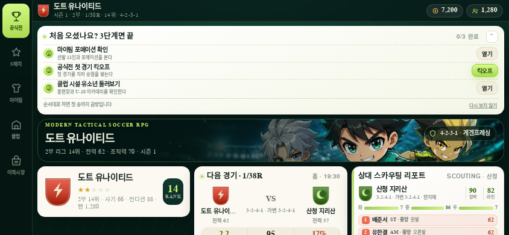 | 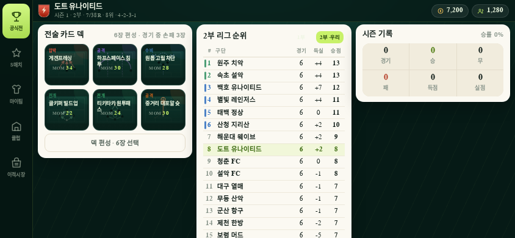 | 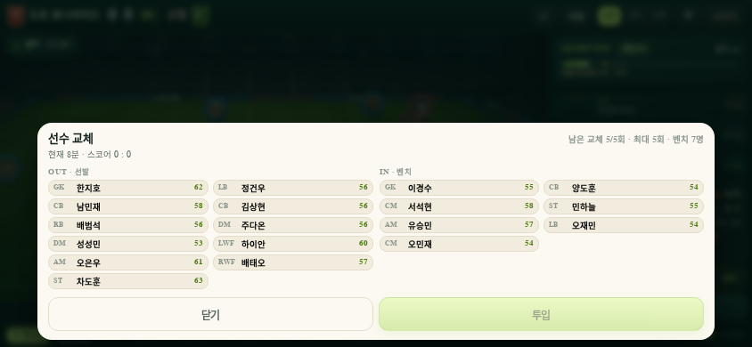 |

| 시즌 결산 — 승격/강등 · 보상 상향 | 전술 카드 고유 일러스트 (덱 편성) |
| --- | --- |
| 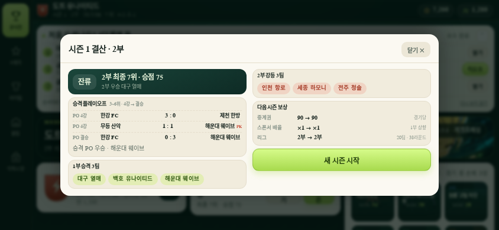 | 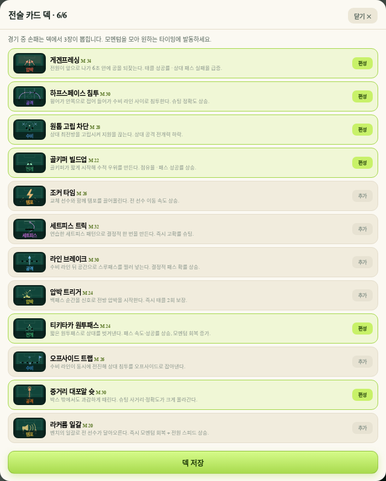 |

### 전술 카드 이미지 넣기
`assets/tactics/{cardId}.webp` (예: `gegen.webp`, `tikitaka.webp`, 12종) 를 넣고 `assets/tactics/manifest.json` 의 `images` 배열에 cardId를 추가하면, 게임이 내장 SVG 대신 그 이미지를 먼저 표시합니다. 목록에 없으면 내장 SVG 일러스트가 그대로 쓰입니다.

## v21b 패치 — UI/UX 6종 (b=8)

경기 엔진 · 세이브 · 20팀 리그 · 이적시장 · 유소년 로직은 그대로 두고 **표시와 상태 조건만** 고친 패치입니다. 캐시 버스터를 `?v=21&b=8`로, 서비스워커 캐시를 `dot-soccer-v21-20261127b`로 올려 이전 v21(b=7)과 구분됩니다.

1. **S매치 시작 버튼 문구** — 보유 3장일 때 세 버튼이 모두 `S매치 시작 · 이용권 3장`이라 1판에 3장이 나가는 것처럼 보였습니다. 이제 **`S매치 시작 · 1장 (보유 3)`** 으로 소모량과 보유량을 분리했고, 0장일 때도 `… 1장 (보유 0)` + 비활성으로 같은 형식을 유지합니다.
2. **클럽 > 롤 진화 잠금** — Lv.0 선수 11명의 `[진화]`가 모두 눌리던 문제. 지금 레벨에서 열 수 있는(현재 롤과 다른) 롤이 하나도 없으면 **`disabled` + 점선 잠금 스타일 + `Lv.3` 라벨**로 잠그고, 조건을 채우면 `진화`/`변경`으로 활성화합니다. 선발 11명 목록·선수 상세의 진화 버튼도 같은 규칙입니다.
3. **경기 화면 밀도** — 넓은 화면에서 피치 캔버스가 중간 높이(16:9)에 멈춰 아래에 큰 빈 배경이, 우측 패널에는 카드와 스탯 박스 사이에 구멍이 남았습니다. 이제 피치는 **16:9를 유지한 채 위에 붙고**, 남는 세로 공간은 **선발 11인 체력·평점 미니 바**(얼굴 · 포지션 · 체력 바 · 평점, 4열)가 채웁니다. 우측 패널은 높은 화면에서 **전술 카드가 높이를 나눠 갖고**(카드 설명까지 표시) 스탯 박스가 바로 붙습니다. 세로 화면(390×844)은 **피치 위 / 사이드 아래**로 쌓고 상단 바를 2줄로 풀어 겹침을 없앴습니다.
4. **개막 전 순위표** — 0경기 0승점일 때 가나다순이라 전력 1위(한성 레전드)가 19위로 보였습니다. **전 팀 0경기면 전력(OVR) 내림차순 · 동률 시 가나다순**으로 초기 순위를 잡고, 1경기부터는 기존 승점 → 득실 → 다득점 정렬을 그대로 씁니다.
5. **모멘텀 게이지 눈금** — 손패 카드의 코스트를 게이지 위 숫자(`24M 30M 34M`)와 **바 위 틱**으로 표시하고, 바로 아래에 **`다음 카드까지 -15M`**(최소 카드가 이미 열리면 `지금 발동 가능 · 최소 24M`, 개입을 다 쓰면 `이번 경기 개입 완료`)를 한 줄로 안내합니다. 틱은 지금 쓸 수 있는 가장 싼 카드가 노란색으로 깜빡입니다.
6. **홈 초보자 3단계 가이드** — 공식전 홈 맨 위에 접이식 배너(`① 마이팀 포메이션 확인 → ② 공식전 첫 경기 킥오프 → ③ 클럽 시설·유소년 둘러보기`). 마이팀/클럽 탭을 열거나 첫 킥오프를 하면 자동으로 `완료`로 바뀌고, **접기 · 이어서 보기 · 다시 보지 않기가 세이브(localStorage)에 남습니다**. 이미 경기를 치른 세이브에서는 처음부터 접힌 상태입니다.

부수 수정: 첫 프레임에서 공 좌표가 `NaN`이 되어 `createRadialGradient` 예외가 콘솔에 찍히던 문제(서브프레임 보간 기준값 `px/py`가 첫 스텝 전에 비어 있던 것)를 시작 시점 초기화 + 보간 가드로 막았습니다.

검증: `1920×1080` · `844×390` · `390×844`에서 문서 가로 넘침 0, 콘솔 오류 0, 6개 항목 동작/렌더 확인. 844×390에서 리그 1경기(×3 배속, 하프타임 교체 화면 포함)를 90분 완주해 스코어·평점 11명·xG·순위표 20행 반영까지 확인했고, 옛 세이브(8팀 표 · `guide` 없음)가 20팀 38라운드로 재편되며 가이드가 숨겨진 채 부팅되는 것도 확인했습니다.

| 초보자 3단계 가이드 | 클럽 롤 진화 잠금 | 경기 화면 밀도 (1920×1080) |
| --- | --- | --- |
| 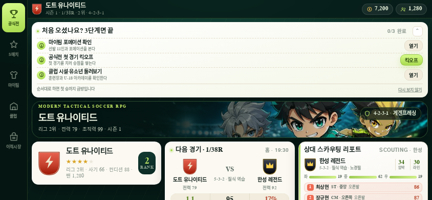 | 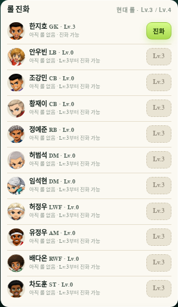 | 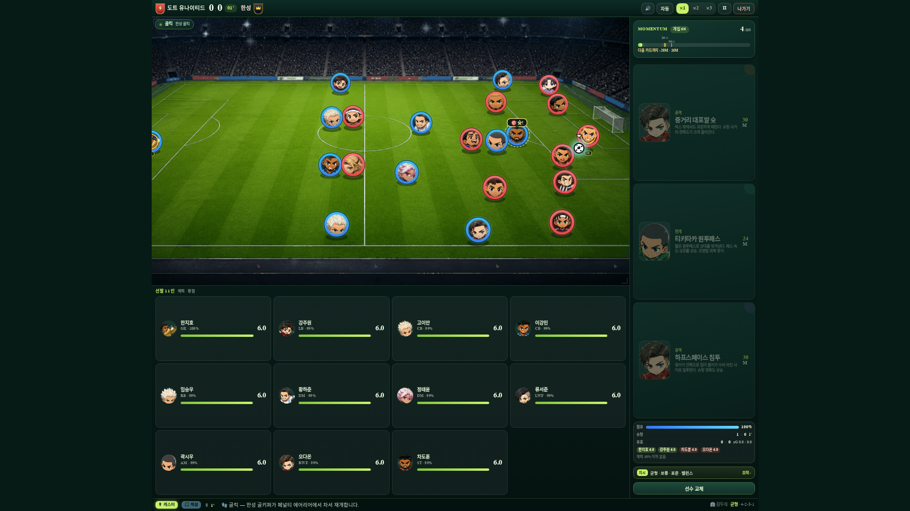 |

| 모멘텀 카드 눈금·안내 | S매치 이용권 표기 (보유 0) | 경기 레이아웃 (844×390) |
| --- | --- | --- |
| 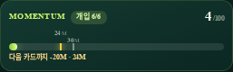 | 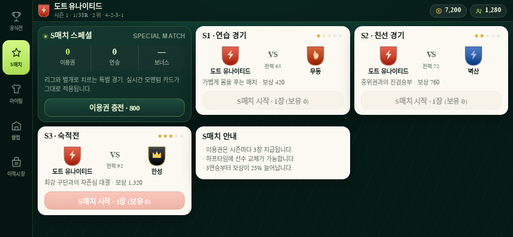 | 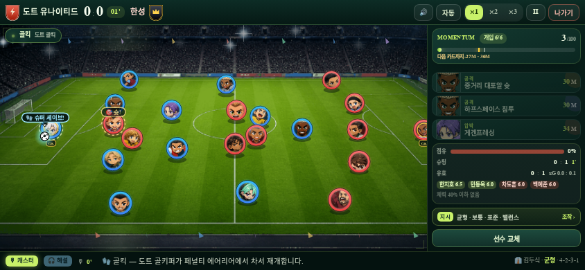 |

## v21 패치 — 리그·이적시장·유소년·EXP, 그리고 “찬스를 놓치지 않는” 엔진

### 0. 사용자 스크린샷 버그 2건
- **마이팀 빈 피치**: 토큰 좌표를 화면 px로 박아 두고 리사이즈/재렌더 때 그 px를 다시 %로 읽어 위치가 무너졌습니다. 이제 정규화 좌표를 `data-u` / `data-v`로 들고 다니고, 레이아웃 전(높이 0)에는 다음 프레임에 다시 그려 어떤 포메이션(4-1-3-2 포함)에서도 **11개 토큰이 제자리에** 섭니다.
- **감독·선수 초상화 밑단 잘림**: 감독실 큰 카드가 상반신이 프레임 아래에서 잘린 전신 일러스트를 쓰고 있었습니다. **head 크롭**으로 바꾸고, 카드 속 전신 초상화는 `object-fit: contain`(하단 정렬)으로 고정해 **어느 카드에서도 밑단이 잘리지 않습니다**. 감독 head 크롭 32장은 264×196 규격으로 재생성(프레임 안에 투명 띠 없음 — `v21check.py art`가 검사).

### 1. 프리미어리그 포맷 — 20팀 38라운드 (`js/game.js`, `js/data.js`)
- 우리 구단 + **19개 구단**(벽산·한강·독도·청춘·철마·별빛·백호 + 설악·해운대·무등·전주·울산·수원·인천·대구·제주·부산·태백·한성). 전력 65~92.
- **더블 라운드 로빈 38라운드**: 전반 19라운드를 Circle Method로 짜고, 후반 19라운드는 홈/원정을 뒤집어 역순으로 붙입니다. 모든 상대와 **홈 1·원정 1**, 총 380경기.
- 승점 3/1/0 · 타이브레이커 **승점 → 득실 → 다득점**. 표에 **UCL 1~4(파랑) · UEL 5~6(초록) · 강등 18~20(빨강)** 존바가 붙습니다.
- **`현재 / 38 라운드`**가 헤더(`3/38R`), 다음 경기 카드(`다음 경기 · 4/38 라운드`), 리그 표 머리에 모두 나옵니다.
- **세이브 마이그레이션**: 8팀 7라운드 세이브는 표를 20행으로 늘리고 대진표를 38라운드로 재생성합니다. 다른 팀 수의 리그 성적은 새 포맷으로 옮길 수 없어 **표는 1라운드에서 새로 시작**하고, 자금·선수단·누적 기록(시즌 합계·커리어·로그)은 그대로 남습니다.

### 2. 이적시장 (상점 → 이적시장, `js/game.js` · `js/data.js`)
- **라운드마다 새 매물 8건** (시즌+라운드 시드 고정 → 같은 라운드에는 같은 목록). 매물마다 **이적료 · 주급 · 나이 · 등급 · 포지션 · 롤 · 주발 · 원소속**.
- **협상**: 68% 확률로 이적료 −8~16%, 실패하면 +6% (한 번만). **매물 갱신** 400.
- **내 선수 내놓기 / 즉시 방출**: 이적료는 OVR·나이·등급·레벨로 계산(`DS.marketValue`). 내놓은 선수는 다음 라운드에 55% 확률로 다른 구단이 데려가고, 즉시 방출은 92% 가격에 바로 정리합니다. 선수단 12명 미만으로는 팔 수 없습니다.
- 컬렉션 도감·아이템은 화면에서 빠지고(도감 데이터는 유지), 상단 탭 이름이 **이적시장**으로 바뀝니다.

### 3. 유소년 아카데미 (클럽 하우스 첫 카드)
- **U-18 후보 3명**이 시즌마다 들어오고, 700으로 새 후보를 부를 수 있습니다. 후보는 15~18세 · 낮은 현재 능력 · **잠재력(pot 58~95)** · 주발 · 포지션 적성을 갖습니다.
- **포지션 목표 코칭**: 13개 포지션 중 목표를 골라 코칭(420 + 레벨×90). 해당 적성 +2~3, 주 능력치 상승, 적성이 7 이상이면 **포지션 전환**까지. EXP도 쌓여 유소년이 직접 레벨업합니다.
- **1군 승격**(선수단 20명 한도) 또는 **이적시장 매각**(가치의 80%).

### 4. 경기 EXP · 자동 레벨업 (`finishMatch()`)
- 출전한 전원(선발·교체)이 **출전 70 + (평점−5.5)×55 + 골×80 + 도움×45** EXP를 받습니다(리그 ×1 · 챌린지 ×1.3 · S매치 ×0.9).
- 임계치 `520 + 레벨×420`을 넘기면 **자동 레벨업**하고 포지션 가중치에 따라 능력치가 오릅니다(잠재력에 닿으면 둔화). 결과서에 **EXP · LEVEL UP** 밴드(진행 바 · `▲` 표기)가 추가됩니다.

### 5. 경기 엔진 — 찬스를 놓치지 않는다 (`js/match.js`)
- **명확한 찬스 슈팅**: 박스 안 0.72(기존 0.52) · 18m 0.46 · 그 밖 0.24. 근접 압박(`pressure<2.2`) 감점은 **박스 밖 15m 이상**에만 적용해, 1:1·박스 안에서 패스로 새지 않습니다. 마크가 비었으면 +0.10.
- **자기 진영 정체 탈출**: 공을 가진 팀이 진행도 42% 미만에서만 돌리면 `ownHalfT`가 쌓이고, 2.6초를 넘으면 **백패스가 잠기고**(`backPass` 차단), 3.4초를 넘으면 마크가 덜 붙은 **앞선 동료로 전진 패스**, 없으면 **전진 돌파**를 강제합니다. 패스 스코어링도 정체 중에는 전진 패스에 +2.4, 백패스 −14로 뒤집힙니다.
- **서브프레임 보간**: `alpha = acc / stepDt`로 그리기 직전 좌표만 `px,py,pz → x,y,z` 사이를 보간하고 끝나면 되돌립니다(시뮬 상태 불변). 120Hz에서 프레임 2개당 스텝 1개, 알파 0.5가 실측됩니다.
- **FM급 HUD**: 점유율 · 슈팅 · **유효슈팅** · **xG** · **라이브 평점 상·하위**가 경기 사이드바에 실시간으로 붙습니다.
- 감독 **50명**(m33~m50 추가: 동 5 · 은 6 · 금 5 · 전설 2), 초상화 풀 **500종**(GK 70 · 필드 430).

### 6. 검증 (`qa-dotsoccer/v21check.py`)
- 게임: 20팀/38라운드/190쌍 · 11토큰 · 이적시장(영입·협상·내놓기·방출) · 유소년(코칭·승격) · EXP 레벨업 · 세이브 마이그레이션 · 감독 50/초상화 500.
- 엔진: 90분 완주·오류 0 · 박스 슈팅 · 정체 최장 시간 · 120fps 보간 · HUD 필드.
- 기존 `spcheck.py`(세트피스 d=0.0) · `v19check.py` · `v20check.py` · `regress.py` · `smoke.py` · `reportmap_test.py`도 그대로 통과.

## v20 패치 — 경기 중 직접 지시하는 4가지

### 1. 라이브 터치라인 지시 — `M.setTouch()` · `M.touchState()` · `TOUCH_DEF`
- 경기 사이드바에 **한 줄 지시 바**(`지시 균형 · 보통 · 표준 · 밸런스 ›`)가 있고, 누르면 사이드바 위로 **드로어**가 올라옵니다. 드로어는 27% 사이드바만 덮어 **피치를 가리지 않고**, 27px 높이 버튼 4×3~4칸이라 가로 844×390에서도 엄지로 누를 수 있습니다.
- 네 가지 지시가 매 프레임 엔진에 반영됩니다.

| 지시 | 값 | 즉시 바뀌는 것 |
| --- | --- | --- |
| **공격 성향** | 수비적 / 균형 / 공격적 / 총공세 | `shapeOf()` — 블록 간격(9.4~20.4) · 폭 · 전진 인원(1~3명) · 풀백 전진(2~24) · `lineYOf()` 깊이(−12~+17) |
| **압박 강도** | 낮음 / 보통 / 전방 압박 | `pressConfig()` — 압박 지표(−15~+17) · 트리거 반경(17.3~26.2) · 붙는 인원(1~2, 총공세+전방 압박에서 3) |
| **수비 라인** | 내리기 / 표준 / 올리기 | `lineYOf()` ±9 · `blockOf()`의 **공 기준 상한**까지 함께 밀려 공 위치에 묻히지 않습니다 |
| **공격 루트** | 밸런스 / 좌측 / 중앙 / 우측 | `attackTarget()` 목표 x 당김(0.14~0.72) · `passBall()` 레인 가중치(±11) · `assignRuns()` 침투 방향 |

- 값이 바뀌면 **피치 왼쪽 아래에 `TOUCHLINE · 압박 강도 · 전방` 지시 보드**가 2.6초 뜨고(즉시 또렷하게, 끝에서만 페이드), 선수 머리 위 `📋` 말풍선 · 링 이펙트 · 캐스터 멘트가 함께 나옵니다.
- 기존 3단 전술 버튼(`M.setTactics`)도 같은 상태를 쓰도록 합쳐서, 저장된 전술과 지시가 어긋나지 않습니다.

### 2. 포지션 · 현대 롤 · 주발이 실제 플레이를 바꾼다 — `isInverted()` · `footSideOf()` · `shotFoot()`
- **인버티드 윙어**(주발이 자기 측면의 반대 발, 또는 롤 `inverted`): 중원·측면 전개에서 터치라인(3.2) 대신 **하프스페이스(33) → 박스 앞(39)** 으로 접어 들어오고, 드리블도 안쪽으로 꺾습니다. 슛 사거리 +5, 박스 앞 슈팅 확률 +0.10.
- **전통 윙어 / 윙백**(같은 발, 롤 `wingback`): 터치라인(3.2 / 96.8)을 끝까지 지키고 크로스 성향 ×1.3, 컷백·오버래핑 지점으로 올라갑니다.
- **DM(레지스타 · 볼플레잉 수비수)**: 빌드업 때 CB 사이(y +7.5)로 내려와 안전한 전진 패스 각을 만들고, `passBall()`이 그에게 +7 가중치를 줍니다.
- **B2B · 메짤라 CM**: 공이 최종 3분의 1에 들어오면 하프스페이스에서 **늦은 박스 침투**(골문 앞 13.5).
- **CF(폴스나인)** 는 라인 사이로 내려와 연결하고, **ST(포처·타겟)** 는 CB를 붙잡고 오프사이드 라인 끝자락에서 뒷공간을 노립니다(ST 침투 가중치 +8, CF −4).
- **주발**: 슛 위치가 강발 쪽이면 파워(정확도 +0.05, xG +0.015), 반대쪽이면 감아차기(정확도 +0.015, 중거리는 −0.045)로 갈리고, 감아찰 때는 **먼 골문 쪽으로 조준**이 틀어집니다. 계측은 `M.v20().shots = {strong, curl, both, weakLong}`.

### 3. 상대 스카우팅 리포트 — `DS.scoutReport()` · `prepareOpp()` · `scoutHTML()`
- `renderHome()`(공식전)과 `renderMatchIdle()`(경기 탭)의 킥오프 카드 옆에 **상대 리포트**가 붙습니다: 포메이션 · 감독 철학 · 압박/라인 지표 · **좌/중/우 공격 비중 바** · **위험 선수 2명**(포지션·측면·주발·OVR) · **카운터 팁 2개** · 주 루트/라인 요약.
- 리포트는 **킥오프에 실제로 스폰되는 그 스쿼드**로 만듭니다. `prepareOpp(kind)`가 원정 스쿼드를 한 번 만들어 캐시하고, `startMatch()`가 그 배열을 그대로 `awayPlayers`로 넘기기 때문에 “리포트의 선수”와 “피치의 선수”가 항상 같습니다.
- 팁은 실제 수치에서만 나옵니다 — 예: `상대 오른쪽 측면 비중 35% · 왼쪽 윙백을 내려 그쪽을 닫아라`, `상대 게겐프레싱 · 후방 짧은 패스 대신 GK 롱킥·직선 롤로 1선을 건너뛰어라`, `경계: 오은우(RWF·오른쪽·OVR 72) — 풀백 1:1과 안쪽 커버를 겹쳐라`.

### 4. 시각 통일 — 도트 제거 · SD 일러스트 · 전술판 프레임
- `js/data.js`의 **시설 도트(26×22)** 와 **스태프 도트(20×26)**, **초상화 픽셀 폴백(20×26)** 을 모두 없애고, 같은 규칙(위에서 내려오는 빛 · 왼쪽 밝은 면 · 짙은 잉크 외곽선 · 그라데이션)의 **고해상도 벡터풍 캔버스 아트**로 바꿨습니다: `Art.facilityFig()`(124×100, 5종) · `Art.staffFig()`(96×112, 스카우터/코치/메디컬) · `Art.portrait()`는 SD 스프라이트(`Art.chibi()`)를 그대로 씁니다.
- 클럽 하우스는 이모지 아이콘 대신 **시설 SD 일러스트 카드**, 상점은 **스카우터 안내원 초상**이 들어갑니다.
- 프리매치(스카우팅 카드) · 라커룸(`.sq-card` · `.sq-syn`) · 선수 카드(`.pcard`) · 전술판(`.sq-pitch` · `.pitch-wrap`)에 **같은 헤어라인·코너 틱**을 넣어 한 벌의 전술판으로 보이게 통일했습니다.

### v20 검증 — `qa-dotsoccer/v20check.py` (헤드리스 · quickjs)
| 항목 | 측정 | 결과 |
| --- | --- | --- |
| 수비 라인 지시 | 4백 블록 라인 내리기 **98.7** vs 올리기 **92.1**, 실제 평균 위치도 같은 방향 | ✅ |
| 압박 지시 | 압박 인원 낮음 **0.97** vs 전방 **1.70**명, 트리거 반경 **17.3** vs **22.6** | ✅ |
| 공격 루트 지시 | 좌측 지시 좌측 점유 **44.5%** vs 우측 지시 **19.5%** (우측은 48.7% vs 16.5%) | ✅ |
| 총공세 | `shape=allout` · 압박 상한 **3** · 라인 지시 79 → **63** | ✅ |
| 인버티드 vs 전통 윙어 | 터치라인 체류 **92.9% → 26.9%**, 하프스페이스 체류 **0% → 40.2%**, 윙어 슛 3 → **5** | ✅ |
| 롤 | 레지스타 드롭 · B2B 늦은 침투 · 폴스나인 드롭 · 포처 뒷공간 모두 **>0 프레임** | ✅ |
| 스카우팅 | 6개 포메이션×철학에서 리포트의 포메이션/철학/1순위 위험 선수가 실제 스쿼드와 **일치** | ✅ |
| 세트피스 발사 위치 | 84건 **d = 0.0** (위반 0) | ✅ |
| 기존 QA | `spcheck` 65건 위반 0 · `v19check` 8경기 90분 완주 · `regress` v18↔v20 6경기 · `smoke` · `reportmap` PASS | ✅ |
| JS 오류 | 전 시뮬레이션 **0건** | ✅ |

- 캐시: `sw.js` `dot-soccer-v19b-20261126` → **`dot-soccer-v20-20261126`**, `?v=19&b=52` → **`?v=20&b=1`**.

## v19b 핫픽스 — 세트피스는 '규칙 위치'에서 시작한다 (스로인 · 코너 · 프리킥 발사 위치 버그)

플레이 중 **스로인·프리킥·코너킥이 엉뚱한 위치에서 올라오던** 문제를 고쳤습니다. 원인은 세트피스 실행 코드가 공을 **키커 발밑으로 순간이동**시키던 것이었습니다 — `executeSetpiece()`의 `ball.x = passer.x`(스로인·골킥) · `ball.x = taker.x`(간접 프리킥), `launchContest()`의 `ball.x = by.x`(코너·간접 프리킥). 재개까지 주어지는 시간은 스로인 1.1초 · 간접 프리킥 1.6초 · 코너 2.4초뿐이라, 키커가 아직 터치라인·코너 플래그로 걸어가는 중이면 그 선수가 서 있던 **피치 한가운데나 반대 측면에서** 공이 출발했습니다.

- 이제 공은 세트피스 성립 순간의 지점(터치라인 교차점 · 코너 플래그 `(2.4|97.6, 2.2|117.8)` · 파울 지점 · 골킥 지점)에 **그대로** 있고, 키커를 그 자리로 스냅합니다(`passer.x = originX` … + `separate()`로 겹침 방지). 재개 패스는 `kickPass(p, q, type, origin)`의 `origin`에서 출발합니다.
- 반경 안에 받아 줄 동료가 없을 때 `giveBall()`로 공을 아무 선수 발밑으로 옮기던 두 번째 경로도 없앴습니다 — 가장 가까운 동료에게 **세트피스 지점에서** 연결합니다.
- 계측: `DS.Match.v18().spLaunch`가 세트피스별 `{type, x, y, ox, oy, d}`를 남깁니다. `x/y` = 실제 발사 지점, `ox/oy` = 세트피스 성립 순간의 공 위치, `d` = 둘 사이 오차입니다.
- 캐시: `sw.js` 캐시 `dot-soccer-v19a-20261126` → **`dot-soccer-v19b-20261126`**, `?v=19&b=51` → **`?v=19&b=52`** (돌아온 유저도 새 `js/match.js`를 받습니다).

### 검증 (헤드리스 시뮬레이션 · 4경기 90분 완주 · 스타일 wingplay/counter/tikitaka/direct)
| 항목 | 수정 전 (v19a) | 수정 후 (v19b) |
| --- | --- | --- |
| 발사 위치 위반 | **35 / 72건** — 코너가 미드필드 (79.9, 50.4)에서, 스로인이 x=13.9에서 올라감 | **0 / 57건** |
| 스로인 최대 오차 | 87.8 (터치라인 → 피치 안쪽) | **0.0** (`x = 1` 또는 `99` 고정) |
| 코너 최대 오차 | 115.3 (반대편 골대 앞에서 코너 크로스) | **0.0** (코너 플래그 고정) |
| 간접 프리킥 최대 오차 | 57.5 | **0.0** (파울 지점 고정) |
| 프리킥 · PK 오차 | 0.0 (원래 정상) | **0.0** |
| JS 예외 / 90분 완주 | 0건 / 8경기 | **0건 / 8경기** (v19check 8경기 + v18↔v19 6경기) |

## v19 패치 — FM급 전술 4종

v18의 좌표·블록 엔진(3줄 블록 · 1~2인 존 압박 · 일자 하이 라인 · 교차점 스로인 · GK 배급)은 **그대로 두고**, 그 위에 "감독이 실제로 지시하는 것 같은" 네 가지를 얹었습니다.

### 1. 전술 스타일별 공격 패턴 + 탈취 후 5초 전환(Transition) — `onTurnover()` · `transitionThrough()` · `transitionRuns()` · `attackTarget()` · `kickPass()`
- **5초 전환 창**: 볼을 뺏는 순간 `trans = {side, t: 5.0, kind}`가 열리고, 팀의 감독 철학(`DS.TACTIC_STYLES`)이 전환 방식을 정합니다 — `counter`·`direct` → **vertical**, `tikitaka` → **triangle**, `gegenpress` → **press**, `wingplay` → **wide**, `hybrid3241` → **invert**.
  - **역습·직선 롱볼**: 전환 창 안에서 `transitionThrough()`가 공보다 앞선 동료를 찾아 **세로 스루패스**를 찌릅니다(`decide()`에도 별도 분기). 실패해도 `transitionRuns()`가 최대 2명을 수비 라인 등짝 공간으로 동시에 출발시킵니다.
  - **티키타카**: 볼을 받은 뒤 첫 터치 템포를 0.24초 늦추고(`giveBall()`), 지원 삼각 거리를 20% 좁혀(`assignSupport()` — `supportGap × 0.8`) 짧은 삼각 패스 각을 만듭니다.
- **측면 오버래핑(`wingplay`)**: 윙어는 전 구간에서 터치라인(2.2 / 97.8)에 붙고, 풀백·윙백이 볼 쪽 바깥으로 **겹쳐 올라갑니다**(`v19t.overlap`). 측면에서 볼을 잡으면 45% 확률로 **컷백**(`kickPass(type='cutback')` — 페널티 스팟 앞으로 낮게 깔아 자르기)을 선택합니다.
- **가변 3-2-4-1(`hybrid3241`)**: 빌드업·중원 전개 중 풀백이 **DM 옆 중앙(50±8.5)으로 인버트**되고(`v19t.invert`), 윙어는 폭(5.5 / 94.5)을 지켜 3-2-4-1 대형이 실제로 만들어집니다.
- **게겐프레싱**: 볼을 잃은 직후 **3초만 '2+1' 카운터프레스 버스트**(최대 3명)를 쓰고, 그 뒤에는 v18의 **1~2인 압박 상한**으로 돌아와 3줄 블록을 다시 세웁니다(`trans.t > trans.t0 - 3` 조건).
- **원투(월 패스)**: 공격 진영에서 미드필더·공격수가 짧은/전진 패스를 주면(`kickPass` → `oneTwo`), 준 선수가 앞 공간으로 러닝을 시작하고 리시버가 잡는 순간 마크가 없으면 **리턴 패스**(`kickPass(type='wall')`)로 벽을 무너뜨립니다.

### 2. AI 상대 감독의 실시간 맞대응 — `aiPostureTick()` · `effTactic()`
- 경기 **55 · 70 · 80분**에 스코어를 다시 읽습니다. 두 골 이상 뒤지면 55분에, 한 골 뒤지면 70분에 **`attack`**(라인 +10, 전진 인원 +1, 압박 +12)으로, 두 골 앞서면 55분에, 한 골 앞서면 70분(마지막 20분)에 **`defense`**(라인 −12, 블록 간격 12.6 → 9.4, 압박 인원 2 → 1)로 바꿉니다. 스코어가 다시 팽팽해지면 `balanced`로 돌아옵니다.
- 포스처는 `effTactic(side)`를 통해 `shapeOf()` · `lineYOf()` · `blockOf()` · `pressConfig()` · `stagePush()` · `decide()`에 그대로 반영되므로, **눈앞에서 상대 대형·라인·압박 인원이 달라집니다**.
- 바뀌는 순간 **전광판 배너 `🔄 상대 감독 전술 변경` + 상황 배너 + 캐스터/해설 멘트**로 알려 줘서, 유저가 전술 카드로 맞받아칠 수 있게 했습니다.

### 3. 코너·간접 프리킥 세컨볼 전개 — `launchContest()` · `resolveContest()` · `secondBall()`
- v18까지 코너·간접 프리킥은 **확률 한 번**(`ball.shot`)으로 슛/선방/골이 끝났습니다. v19는 실제로 **박스 안 경합 지점으로 로프트 볼을 띄우고**(`ball.kind = 'contest'`, 포물선), 도착하는 순간 공중볼 승부를 해소합니다.
  - **공격 승리** → 그 자리에서 **헤더 슛**(거리 기반 xG, `stats.atk`·`jump` 반영). 골이면 그대로 골, 막히면 **세컨볼이 박스 안에 살아 있습니다**(`secondBall()`, 62%).
  - **수비 승리** → **헤더 클리어런스**. 공이 필드로 살아 나가 세컨볼 다툼이 되고, 아군에게 떨어지면 곧바로 **역습**(`play.counterT = 3.4`).
  - 빗나간 헤더도 50% 확률로 세컨볼 → 후속 슛·중거리슛으로 이어집니다.
- 직접 프리킥·페널티킥은 v18처럼 **한 번에 끝나는 날카로운 마무리** 그대로이고, 아웃오브플레이·스로인 불변식(교차점 시작, 패스 클램프)은 손대지 않았습니다 — 경합 지점 좌표도 항상 피치 안쪽으로 클램프합니다.

### 4. 경기 후 FM식 전술 리포트 — 2D 슈팅 xG맵 · 평균 포지션/패스 연결망 — `js/match.js` + `js/game.js` + `css/style.css`
- **계측**(`M.report()`): 슈팅 로그 `{side, x, y, xg, onTarget, isGoal, min, scorer, set}`(최대 48개, 일반 슛·세트피스 헤더·PK 모두), **평균 포지션**(오픈 플레이 0.3초마다 전 선수 좌표 누적, GK 제외), **패스 연결망**(`from → to` 누적, 상위 10쌍). `M.stats()`에는 `xg`·`shotLog`·`aiPosture`·`secondBalls`가 추가됐습니다.
- **표시**: 상세 결과서에 `TACTICAL MAP` 카드가 추가되어 **슈팅 xG맵**(원 크기 = xG, 골은 채우고 금색 테두리, 유효슛은 반투명, 빗나간 슛은 외곽선만 — 홈 파랑 / 원정 빨강)과 **평균 포지션 · 패스 연결망**(HOME/AWAY 토글, 포지션·이름 라벨, 패스 빈도에 비례하는 굵기의 연결선)을 **탭으로 전환**합니다. 844×390 가로에서 2단 결과서 칼럼 안에 그대로 들어가며 가로 스크롤이 생기지 않습니다.

### 검증 (헤드리스 시뮬레이션 · v18↔v19 동일 조건 6경기 + 스타일 8경기)
| 항목 | v18 | v19 |
| --- | --- | --- |
| JS 예외 | 0건 | **0건** (모든 경기 90분 완주) |
| GK 드리블(프레임/말풍선) | 0 / 0 | **0 / 0** (불변식 유지) |
| 동시 압박 인원 최대 | 2.0명 | 2.17명 (**게겐프레싱 3초 버스트에서만 3명**) |
| 수비 시 좌우 폭 평균 / 최소 | 77.9 / 68.2 | 78.0 / 65.0 |
| 수비 22단위 창 최다 인원 | 6.17명 | 6.00명 |
| DF–MF 라인 간격 | 16.4 | 16.9 |
| 일반 패스 라인 아웃 | 0건 | **0건** |
| 스로인(경기당) | 1.67 | 2.83 (터치라인 교차점 유지) |
| 경기당 패스 / 슈팅 / 골 | 128.0 / 11.5 / 1.00 | 130.0 / 9.7 / 1.33 |
| 전환 창(경기당) | — | 1~12회 · 전환 스루패스 0~5회 |
| 원투(시도/성공) · 컷백 | — | 10~21 / 2~6 · 0~7회 |
| 세트피스 경합 → 헤더/세컨볼 | — | 경합 0~4 · 헤더 0~4 · 세컨볼 1~4 |
| AI 포스처 전환 | — | 55′·70′·80′ 판단 · defense 시 블록 간격 12.6→**9.4**·압박 2→**1** |
| 상세 결과서 미니피치 | — | 슈팅 xG맵 · 평균 포지션 10+10명 · 패스 연결 상위 10쌍 |

### 라이브 검증 (https://hojin8811-dev.github.io/Dot-soccer/?v=19)
- GitHub Pages `pages-build-deployment` **success** (commit `013cb67` 배포분).
- 브라우저 세션에서 **공식전 90분 완주**(×3 배속 · 하프타임 교체 화면 → 후반 시작) · **콘솔 예외 0건**(`window.__DS_ERRS` 빈 배열).
- 경기 결과 1 : 0 · 슛 7:3 · **xG 1.2 : 0.8** · 전환 창 홈 12 / 원정 8회 · 원투 성공 5회 · 컷백 2회 · 원정(측면 오버래핑) 오버래핑 러닝 3,189프레임 · 세트피스 경합 1회 → 세컨볼 1회 · 80분 상대 감독 `attack` 전환 1회.
- 상세 결과서: `TACTICAL MAP` 카드에서 **슈팅 xG맵 ↔ 평균 포지션·패스맵 탭 전환**, 팀 약칭(도트/별빛) 토글, 결과서 2단 칼럼 안에서 **가로 스크롤 0**(`scrollWidth - clientWidth = 0`, 문서·모달·시트 본문 모두).
- 스크린샷: `preview/v19/`(없으면 `qa-dotsoccer/live-report-v19.png`, `live-report-v19-posmap.png`).

## v18 패치 — 전술 엔진 4대 수정

호진님이 v17 화면을 보며 정리한 인수인계서의 네 항목을 그대로 구현했습니다. 화면·연출·데이터는 건드리지 않고 `js/match.js`의 목표 좌표 계산만 다시 세웠습니다.

### 1. 골키퍼는 드리블하지 않는다 — `decide()` · `gkDistribute()` · `dribble()`
- **원인**: `decide()`에 `isGK` 분기가 없어 GK도 필드 플레이어와 똑같이 패스 실패 후 `dribble()`로 들어가 `💨 돌파!`를 외쳤습니다.
- **수정**: `decide()` **최상단**에서 `if (isGK(p))` → `gkDistribute()`로 분기하고, `dribble()` 앞에도 GK 가드를 세워 다른 경로로 불려도 막습니다. GK는 ① 좌우로 벌어진 **CB·풀백·DM 숏패스 빌드업**(`gkShortTarget()` — 거리 6~34, 좌우 각도·오픈도 점수화) ② 문전 압박(7단위 이내)이거나 숏패스 각이 없으면 **전방 MF/FW 롱킥**(`gkLongTarget()` + `kickPass(p, q, 'longkick')`) ③ 둘 다 없으면 안전 클리어만 합니다.
- **결과**: 5경기 평균 GK 돌파 **20.6프레임 → 0프레임**, `💨 돌파!` 말풍선 **326회 → 0회**, 경기 패스 112.2 → 121.4개. GK가 공을 잡으면 0.4~0.6초 안에 배급합니다.

### 2. 3줄 블록 + 1~2인 존 압박 — `blockOf()` · `groupLanes()` · `defendTarget()`
- **원인**: 수비수가 '공 좌표'와 '마크 상대'만 보고 목표를 잡아, 상대가 자기 진영에서 빌드업할 때도 10명이 공 쪽으로 빨려 들어가 한쪽 터치라인에 뭉쳤습니다.
- **수정**: 수비 팀 전체가 **같은 3줄 기준선(DF–MF–FW)**을 공유합니다. `blockOf()`가 매 프레임 라인 깊이(포메이션 line 지표·감독 철학·전술 버튼·카드 + 공의 위협도)와 DF–MF 간격(`bankYOf`)을 계산하고, `groupLanes()`가 라인 안 **최소 좌우 간격(DF 9.5 / MF·FW 9.0)**을 보장합니다. 공 쪽 이동은 라인당 최대 6단위(`pull`), 맨마킹은 좌우 ±4·깊이 ±3.5로 묶어 대형이 무너지지 않습니다.
- **압박 제한**: `pressConfig()`·`assignPressers()`가 **최대 2명(압박자 1 + 커버 1)** 만 붙고(게겐프레싱 스웜도 2명), 나머지 8~9명은 자기 구역과 터치라인 폭을 지킵니다.
- **부수 수정**: 원정팀 `zoneFor()`의 좌우 범위가 미러링되지 않아 원정 풀백·윙백이 중앙으로 찌그러지던 버그를 고쳤고(원정 4-4-2 수비 폭 51 → 78), 포지션 이름으로 화면 x를 지정하던 `attackTarget()`·`doGoalKick()` 규칙도 `sideX()`로 미러링했습니다.
- **결과**: 수비 시 좌우 폭 평균 **65.6 → 78.0**(최소 36.2 → 67.9), 22단위 창 최다 인원 **7.4 → 6.2명**, DF–MF 라인 간격 24.0 → **15.7**(설계값 12.6), 동시 압박 인원 최대 **2.8 → 2명**.

### 3. 오프사이드 트랩이 유지된다 — `offsideTrap()` · `blockOf()` · `drawTrapLine()`
- **원인**: `offsideTrap()`이 `p.y += ±5`를 한 번 밀 뿐이었고(게다가 호출부가 없었습니다) 다음 프레임 `defendTarget()`이 목표를 덮어써 1프레임 만에 사라졌습니다.
- **수정**: `buffOf('offside') > 0`인 **16초 내내** `blockOf()`가 DF 라인을 공통 하이 라인(추가 +9)으로 잡고, `defendTarget()`이 그 줄을 그대로 목표로 삼습니다. 트랩 중 4백은 **완전히 같은 y**(마킹·볼 오프셋 무시)로 서고, `offsideTrap()`은 발동 연출만 담당합니다. 피치에는 `🚩 OFFSIDE TRAP · 일자 하이 라인` 점선(`drawTrapLine()`)이 그려져 유지 여부가 눈에 보입니다.
- **결과**: 트랩 중 수비 라인 평균 y **74.5 → 67.7**(더 높은 라인), 4백 y 편차 **0.85~1.65단위**(사실상 일자), 카드 한 장당 실제 오프사이드 선언 0~2회.

### 4. 스로인은 교차점에서, 패스는 라인 안에서 — `crossSpot()` · `doThrowIn()` · `kickPass()`
- **원인**: 스로인이 공 위치를 4~96·6~114로 클램프한 값에서 시작했고, 패스는 오차 적용 뒤 목표가 라인 밖으로 나갔습니다. 게다가 패스가 목표 지점을 지나 `dur+0.25초`까지 계속 날아가 목표가 라인 근처면 최대 16단위를 더 가서 그대로 아웃됐습니다.
- **수정**: `crossSpot()`이 공의 속도 벡터로 `x=0/100`·`y=0/120` 경계와의 **정확한 교차점**을 역산하고, `doThrowIn(side, spot)`이 그 지점에서 스로인을 시작합니다(예: x=100, y=90.2). 코너킥도 골라인 교차점 x로 좌/우를 정합니다. `kickPass()`는 오차 적용 뒤 목표를 **x 4~96 · y 4~116**으로 클램프하고 v15~v17의 '7% 고의 라인 아웃'을 없앴으며, 패스는 **목표 지점에서 멈춥니다**.
- **라인 밖으로 나가는 공**은 빗나간 슛과 **태클로 튕긴 공**뿐입니다. 태클 성공의 30%에서 공이 터치라인으로 흘러(`knockLoose()`) 실제 스로인으로 이어집니다.
- **결과**: 일반 패스 라인 아웃 **0건**(클램프 5건/경기), 스로인 좌표 = 교차점(오차 0.1단위).

### 검증 (헤드리스 시뮬레이션 · 5경기 완주 × v17/v18 · 4-2-3-1/4-4-2/4-3-3/3-5-2/5-2-2-1 · gegenpress·tikitaka)
| 항목 | v17 | v18 |
| --- | --- | --- |
| JS 예외 | 0건 | **0건** (5경기 모두 90분 완주) |
| GK `💨 돌파!` | 20.6프레임 · 말풍선 326회 | **0 / 0** |
| GK 배급 | — | 숏패스 2.0 · 롱킥 0.2 (경기당) |
| 동시 압박 인원(최대) | 2.8명 | **2.0명** |
| 수비 시 좌우 폭(평균/최소) | 65.6 / 36.2 | **78.0 / 67.9** |
| 수비 22단위 창 최다 인원 | 7.4명 | 6.2명 |
| DF–MF 라인 간격 | 24.0 | **15.7** |
| 오프사이드 트랩 유지 | 1프레임 | **16초 내내 일자 하이 라인**(4백 편차 0.85~1.65) |
| 일반 패스 라인 아웃 | 7% 확률 고의 아웃 | **0건** |
| 스로인 시작점 | 4~96·6~114 클램프 값 | **터치라인 교차점 그대로** |
| 경기당 패스 / 슈팅 | 112.2 / 12.8 | 121.4 / 10.8 |

인게임 계측 API: 브라우저 콘솔에서 `DS.Match.v18()` — GK 배급 통계, 3줄 블록 라인·폭·몰림, 트랩 일자성, 스로인 교차점을 한 번에 돌려줍니다.

## v17 패치 — TV 생중계 관람 업그레이드

호진님이 v16 화면을 보며 **"넣자"** 고 고른 넷을 한 번에 구현한 관람 패치입니다. 경기 엔진(AI·규칙·판정)은 v16 그대로 두고, **보는 경험만** 바꿨습니다.

### 1. 동적 중계 카메라 (`js/match.js updateCamera()`)
- 공의 화면 좌표를 초점으로 삼아 `1.035`배 기본 프레임에서 부드럽게 따라가는 **패닝**을 깔았습니다(초점 보간 지수 3.6/s).
- **찬스 줌인**: 박스 진입 `final` 단계 **1.17배**, 측면 돌파 1.085배, 역습 1.10배, 슈팅 순간 **1.20배**(슛 목표 지점 가중 60%), 코너·PK **1.22배**, 프리킥 1.14배, 골 세리모니 **1.24배**.
- 초점은 항상 `W/(2z) … W−W/(2z)` 로 클램프해서 **844×390 프레임 밖으로 골대·공이 잘리지 않습니다**. 줌은 `ctx.scale` 하나로 피치·선수·공·이펙트에 동시에 걸리고, 카메라 흔들림도 같은 변환에 합쳐 카메라 전체가 울립니다.

### 2. 골 세리모니 · Net Ripple · 3초 리플레이
- **Net Ripple**: 골 순간 골문 위치에 그물 격자와 충격 링을 1.15초 그립니다. 그물이 공에 밀려 들어갔다 돌아오는 모양입니다(`drawNetRipple()`).
- **세리모니 1.8초**: 득점자가 가장 가까운 코너로 달려가고 동료 3명이 반경 4~5단위로 따라붙어 뛰었습니다(`applyCelebration()`).
- **리플레이**: 20fps(0.05초)로 최근 **3.6초 / 73프레임**의 선수 좌표·포즈·카메라를 링 버퍼에 담고, 골 순간 직전 **1.6초(33프레임)를 3.0초 동안 0.5배속**으로 되감습니다. 화면 캡처가 아니라 **좌표를 다시 그리는 방식**이라 844×390에서도 선명하고 메모리를 거의 쓰지 않습니다.
- 자막은 `⚽ 득점자 n' · 도움 어시스트 · xG 0.74`, 배지는 `📺 REPLAY` + `0.5×`, 하단 진행바와 **[건너뛰기 ›]** 버튼.
- 배속과 무관하게 리플레이는 실제 시간 3초로 흘러가고, **×2/×3에서도 건너뛰기가 즉시 먹히며** 끝나는 순간 카메라·포지션·경기 시계가 깔끔하게 복귀합니다(90분 완주 3경기에서 시계·포지션 오차 0).

### 3. Web Audio 경기장 사운드 + 🔊/🔇 토글
- 외부 음원 없이 **노이즈 버퍼 + 바이쿼드 필터 + 엔벨로프**로 합성했습니다. 단순 사인 삑삑이가 아니라 대역을 건 잡음을 얹어 자연스럽게 만들었습니다.
- **관중 웅성거림**: 갈색잡음 2초 루프 → 520Hz 로우패스 + 0.09Hz LFO로 숨쉬는 앰비언스(별도 2.4kHz 하이패스 레이어 추가).
- **주심 휘슬**: 2,080Hz 사인 + 2,860Hz 트라이앵글 + 27Hz 비브라토 + 노이즈 퍼프. 킥오프·파울·오프사이드·PK·하프타임·경기 종료.
- **공 차기**: 118→58Hz 몸통음 + 1,150~2,100Hz 밴드패스 노이즈(패스 0.22 / 태클 0.34 / 슛 1.0으로 강도 구분).
- **골포스트·크로스바 팅**: 1,046·1,568·2,093Hz 3중 감쇠.
- **함성·탄식**: 슈팅 순간 함성이 올라오고(밴드패스 380→1,800Hz 스윕), 골에는 2.6초 폭발, 빗나감·선방에는 내려가는 탄식.
- 모바일 정책 대응: `AudioContext`는 **킥오프 클릭(사용자 제스처)** 에서 열고 `resume()`하며, 상단 바 `🔊/🔇` 토글은 `localStorage('dot-soccer-mute')`에 저장됩니다.

### 4. 살아있는 관중석 · 캐스터/해설 2인 중계
- 찬스·골에서 관중 에너지가 올라가면 **카메라 플래시**(스프라이트 1장을 재사용해 44개까지), **응원 깃발 16개**가 좌우로 흔들리고, 에너지 0.42 이상에서는 **사람 파도**가 관중석을 가로지릅니다.
- 하단 티커를 `🎙 캐스터` + `🎧 해설` 2인으로 나누고, 말하는 쪽 라벨만 밝아집니다. 해설은 캐스터 라인 **0.95초 뒤**에 들어가 티키타카가 됩니다 — 슈팅·선방·골·코너·오프사이드·퇴장·하프타임마다 전술 코멘트가 붙고, 잠잠한 시간에도 11종 전술 읽기를 섞습니다.
- 부수 수정: 새 경기를 시작하면 이전 경기의 배속(×2/×3)이 남던 버그를 고쳐 **항상 ×1로 시작**합니다.

### 검증 (844×390 가로 뷰포트 · 실플레이 3경기)
| 항목 | 실측 |
| --- | --- |
| JS 콘솔 오류 | **0건** (3경기 완주, `window.__DS_ERRS` 빈 배열) |
| 카메라 줌 범위 | 기본 **1.035** → 찬스 **1.179** → 슈팅 1.20 → 코너/PK **1.22** → 세리모니 **1.24** |
| 리플레이 링 버퍼 | **73프레임** 상주(3.6초) · 재생 **33프레임 / 3.0초 / 0.5×** |
| 골 세리모니 | 득점자 1명 + 동료 **3명** · 1.8초 · Net Ripple 1.15초 |
| 관중석 피크 | 에너지 **1.00** · 플래시 동시 **31~34개** |
| 가로·세로 오버플로 | **0px** (`scrollWidth 844 / clientWidth 844`, `scrollHeight 390 / clientHeight 390`) |
| 리플레이 스킵 후 상태 | 시계 50' 그대로 · 포지션 킥오프 리셋 · 카메라 1.035 복귀 · 오버레이 DOM 제거 |

## v16 패치 — 피치 위 22명 '겹침 0' · 박스 슬롯 분산 · 수비 복귀 정상화

호진님이 v15 실플레이 화면을 보내며 **"골키퍼랑.. 공격수3명이 달라붙어있네ㅡㅡ 상대편도 이게 너가 말한 움직임 축구야?"** 라고 지적한 장면을 근본부터 고친 패치입니다. 원인은 세 가지였습니다.

1. **분리 로직이 애초에 겹침을 허용**했다 — v8~v15의 최소 간격은 화면에서 `토큰 지름 × 0.70`, **공을 가진 선수 쌍은 × 0.26**이었습니다. 지름보다 가까이 붙는 게 정상값이었던 셈입니다.
2. **공격수 전원이 같은 좌표를 향했다** — 파이널 서드에서 최전방이 모두 `골문 - 13` 한 점을 노려 GK·수비와 한 덩어리가 됐습니다.
3. **공을 잃어도 수비 라인이 볼 뒤로 돌아오지 않았다** — 역습을 맞으면 DF가 볼보다 골문 쪽에 서 있어야 하는데 목표 자체가 없었습니다.

| 전 프레임 Hard Separation — 9명 경합도 겹침 0 | 4배 확대 — 원이 닿기만 하고 겹치지 않는다 |
| --- | --- |
|  | 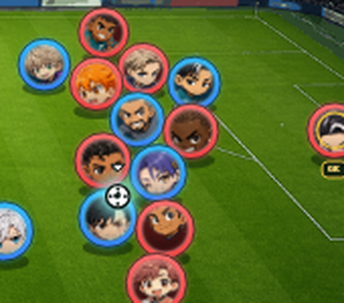 |

| 킥오프 전체 대형 | 골킥 빌드업 | 역습 전환 — 수비 라인 복귀 |
| --- | --- | --- |
| 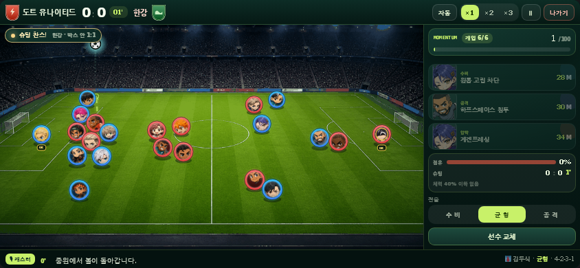 |  |  |

### 1. 전 프레임 Hard Separation — 겹침 0 (`js/match.js separate()`)
- 모든 필드 플레이어·GK 쌍(공 소유자 포함)에 **최소 중심 거리 = 토큰 지름 × 1.18**을 매 틱 끝에서 **4회 relaxation**으로 강제합니다. 화면 픽셀 기준으로 재고, 원근 투영(`sepRates`)으로 피치 좌표계 `dx·dy`에 되돌려 밀어냅니다.
- 포메이션 기본 좌표가 미러링으로 겹치는 경우(예: 4-2-3-1 AM ↔ 4-4-2 DM이 같은 지점)는 킥오프 전에 `relaxBases()`가 기본 좌표 자체를 한 번 떼어 놓습니다.
- 코너킥·PK·스로인처럼 여러 명이 한 곳에 서는 세트피스는 **3×3 격자**(가로 15단위·깊이 6단위)에 앉혀 처음부터 겹치지 않게 배치하고, 키커가 공 위치로 순간이동하는 순간에도 분리를 한 번 더 돌립니다.

### 2. 박스 타겟 슬롯 · GK 보호 · 오프사이드 라인
- 박스에 들어가는 무명 공격수는 **니어 포스트 / 페널티 스팟 / 파 포스트 / 아크 정면** 네 자리로 고정 배정(기본 위치 순, 프레임마다 자리가 바뀌지 않음)됩니다. 공을 몬 1명만 자유롭게 슈팅 각을 잡습니다.
- **GK 보호 반경**: 공을 몬 선수 외에는 상대 GK 중심 **1.6 지름** 안에 들어가지 못합니다(목표 좌표 + 실제 위치 양쪽에서 강제). 6야드 박스 안으로 빨려 들어가는 것도 막습니다.
- **오프사이드 라인 준수**: 위치 기준선을 '상대 최후방 2번째 선수(GK 포함)'로 잡아, 오프볼 공격수는 라인에서 1.8단위 안쪽에 머뭅니다. 라인을 넘는 것은 침투 러닝이 걸린 순간뿐입니다.
- `뒷공간!`·`침투!` 말풍선은 **문구당 한 번에 1명**만 뜨고, 그려질 때 겹치면 위로 쌓입니다.

### 3. 공수 전환 · 수비 복귀
- 볼 소유가 바뀌면 그 팀 **CB·DM·FB의 목표가 '볼보다 자기 골문 쪽 3.2단위'**로 강제되고(골라인 4.5단위 앞까지), 복귀 중에는 **1.26배 속도**로 달려옵니다. 복귀 유예도 1.4초 → 2.1초로 늘렸습니다.
- 태클 판정은 월드 거리 5.2에서 **화면 거리 1.30 지름**으로 바꿨습니다(겹치지 않는 새 간격에서도 어깨를 댈 수 있게). 성공 확률 계수를 낮춰 경기당 태클 8~14회로 v15(11회)와 비슷하게 유지했습니다.

### 검증 (844×390 라이브 · `?v=16&b=48`)
| 항목 | 실측 |
| --- | --- |
| 90분 전 프레임 토큰 겹침 | **0쌍 / 2,422,497쌍 (0.0000%)** · 최악 중심거리 1.08 지름 (10,487프레임) |
| 라이브 브라우저 2경기 (최종 빌드 포함) | **0쌍 / 3,024,578쌍** · 최악 1.089 지름 (14,066프레임) |
| 상대 GK 반경(1.5 지름) 내 공격수 2명+ | **0프레임** (오픈 플레이·코너 포함, 동시 최대 1명) |
| 6야드 박스 안 비소유 공격수 | **0프레임** |
| PK·코너 등 세트피스 격자 | 2명+ GK 밀집 0프레임 · 박스 안 공격수 동시 최대 4명 |
| 볼을 잃은 뒤 DF/DM 4명이 볼 뒤로 복귀 | 중간 **0.0초** · 최대 2.8초 (34회 전환) |
| 경기 밸런스 | 슈팅 7~11 · 태클 7~14 · 4경기 0-0~3-1 |

## v15 패치 — 진짜 축구 규칙(오프사이드 · 세트피스 · 추가시간) + 대진표 수정 + 스카우트 확률

호진님이 v14를 보고 **"업사이드도 안들어가 있는데 이게 축구인가..ㅜㅜ"**, **"진짜 축구 규칙을 따르고 전술 변화. 그에따른 각기다른 움직임"**, **"경기가 너무 빨리 끝나 지켜보는 맛도 있어야지"** 라고 한 지시를 한 번에 반영한 패치입니다. 앞서 킵해 둔 **대진표 중복 매칭 버그 수정**과 **스카우트 확률 피라미드 개편안**도 함께 들어갔습니다.

| 🚩 오프사이드 — 부심 깃발·점선 라인·간접 프리킥 | 🧤 골킥 — GK + CB 벌리기 | 스카우트 확률 공개 + 천장 N/30 |
| --- | --- | --- |
| 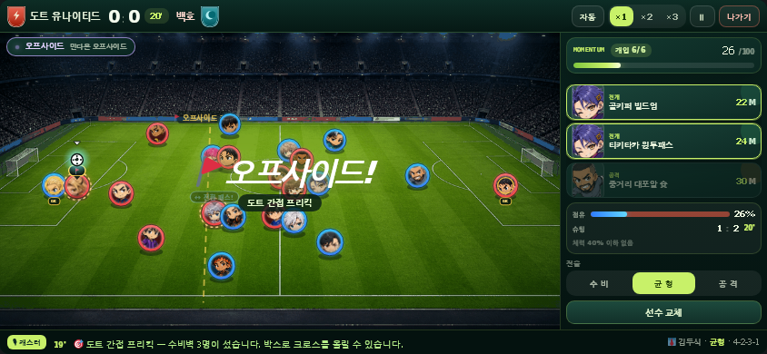 |  | 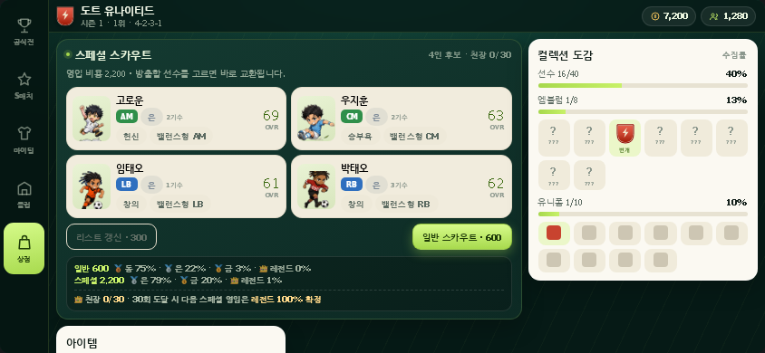 |

| 리그 순위 — 1라운드 후 8팀 전원 1경기 | 90+ 추가시간 · 오프사이드 | 결과서 (카드·퇴장 반영) |
| --- | --- | --- |
| 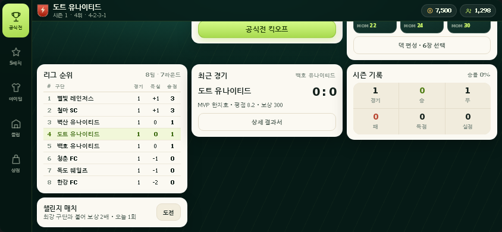 | 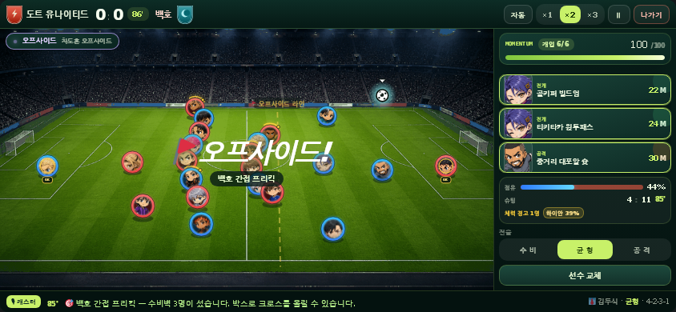 | 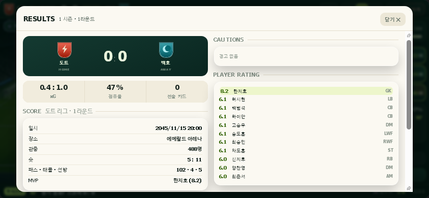 |

### 1. 진짜 축구 규칙 (`js/match.js`)
- **오프사이드**: 패스 출발 순간 공격수가 ①상대 진영 ②공보다 앞 ③상대 골키퍼를 뺀 최후방 수비수보다 앞서면 판정. **부심 깃발 + 점선 라인 2.8초 표시**, 그 선수가 공에 관여하는 순간 휘슬 → **상대 간접 프리킥**으로 그 자리에서 재개. 스로인·골킥·코너킥 재개 패스는 면제.
- **세트피스 실제 위치 정렬**: 스로인(터치라인 밖 투척 · 주변 동료 접근) · 골킥(GK가 페널티 에어리어, CB 양옆 벌리기, 상대 최전방 압박 준비) · 코너킥(코너 플래그 키커 + 양 팀 박스 헤더 대형, 수비는 골대 쪽에 정렬) · 직접 프리킥(3인 수비벽 + 키커) · 간접 프리킥(연결) · **페널티킥(키커 vs 골키퍼 1:1, xG 0.74)**. 대기 1.1~2.9초 동안 대형이 눈에 보입니다.
- **카드·퇴장**: 다이렉트 레드(박스 안 10%·위험 지역 7%·일반 3%)와 경고 누적. 퇴장 선수는 실제로 피치에서 빠져 **10명 대 11명**으로 경기가 이어지고, GK 퇴장 시 야수가 장갑을 낍니다.
- **추가시간**: 세트피스·골·카드로 쌓인 지연 시간으로 전반 `45+1'~3'`, 후반 `90+2'~4'`를 산정해 **경기 시계에 표시하고 실제로 그만큼 더 진행**합니다.

### 2. 공 없는 움직임 · 전술 체감
- 빌드업: **CB 좌우 벌리기 · DM 내려와 삼각 각 · 윙백 전진**.
- 측면 돌파: 볼 쪽 **윙백 오버래핑**(터치라인까지), 반대편 윙어는 **박스 먼 쪽으로 침투**해 컷백·세컨볼 대기.
- 스트라이커: **오프사이드 라인을 타며 좌우로 흔들다가** 뒷공간 대각선 침투(가끔 오프사이드, 성공하면 1:1).
- 수비는 라인을 넘어서지 않고(라인 존중), AI는 이미 오프사이드인 동료에게 패스를 넣지 않습니다(타이밍).
- 전술 버튼(수비/균형/공격)·감독 전술 변경 시 라인·폭·압박이 즉시 달라집니다.

### 3. 경기 호흡 (×1 배속)
- `MATCH_SECONDS` **96 → 168** — ×1 배속 한 경기 **약 189초(3분 9초)**, ×2/×3은 그대로 빠르게.
- 패스 `d*2.9(40~90) → d*2.15(30~66)`, 슛은 거리 기반 비행시간(0.34~0.95초), 액션 간격 0.34~0.60초, 스태미나 소모는 경기 길이에 맞춰 보정.

### 4. 리그 대진표 라운드 로빈 버그 수정 (`js/game.js`)
- 원인: 회전 배열(7개)에서 `arr[j] vs arr[n-2-j]` 페어링이 한 팀을 매 라운드 누락 → 그 팀 대신 플레이어가 늘 홈, 특정 팀 2경기.
- **표준 Circle Method**로 교체 — 8팀 **7라운드 × 4경기 = 28경기**, 매 라운드 전 팀 정확히 1경기, 중복 페어 0, **홈/원정 3~4회 균형**(도트 3홈/4원정).
- **기존 세이브 마이그레이션**: `fixturesValid()` 검사로 깨진 대진표를 감지해 자동 재생성(라운드·순위표 보존, 로그 기록). 결과서의 HOME/AWAY 라벨도 원정 경기에 맞게 표시.

### 5. 스카우트 확률 피라미드 + 30회 천장 (`js/data.js`, `js/game.js`)
- **일반(600)**: 🥉동 75% · 🥈은 22% · 🥇금 3% · 👑레전드 0%
- **스페셜(2,200)**: 🥈은 79% · 🥇금 20% · 👑레전드 1%
- **천장**: 스페셜 영입 1회당 +1 → **30 도달 시 다음 후보 1장이 레전드 100% 확정**(👑 천장 확정 칩), 영입 후 0으로 리셋. 4만 회 시뮬레이션 검증(일반 75.3/21.8/3.0/0, 스페셜 78.9/20.1/1.0).
- **확률·천장 UI 공개**: 스페셜 카드 헤더에 `천장 N/30`, 버튼 아래에 일반/스페셜 등급별 실제 확률과 천장 룰 문구를 항상 표시합니다(구글 플레이 심사 대응).

### 6. 헤드리스 계측 (6경기 평균 · 4-2-3-1 vs 4-4-2)
| 항목 | 값 |
| --- | --- |
| 득점 | 2.3 (홈 1.3 / 원정 1.0) |
| 슈팅 | 9.0 / 7.7 · xG 1.4 / 0.8 |
| 패스 / 태클 / 선방 | 116 / 13 / 8 |
| 오프사이드 | 5.0 (양 팀 합) |
| 스로인 / 골킥 / 코너 / 프리킥 / PK | 2.8 / 12.3 / 2.0 / 0.8 / 0.7 |
| 퇴장 | 0.2 |
| 경기 시간 (×1) | 189초 · 추가시간 45+1~3 / 90+2~4 |

## v14 패치 — 원형 토큰 한 단계 더 축소 · 감독 전략전술 + 변칙 포메이션

호진님이 v13을 보고 **"원을 조금만 더 줄이고 감독에 따른 전략전술 그리고 감독마다 똑같은 포메이션보다 변칙 포메이션도 또 그에따른 움직임이 달라지면 좋을거 같아"** 라고 지시한 패치입니다.

### 1. 피치 원형 토큰 추가 축소 (`js/match.js`)
- 토큰 반지름 비율 `TOKEN_R` **0.55 → 0.43**. 844×390 라이브 실측 **지름 20.0~25.8px** (v13은 25.6~33.0px) — 약 22% 축소.
- 팀 링 두께 `r*0.26 → r*0.22`, 글로우 `r*0.30 → r*0.22`, 공 소유자 펄스 링 `1.16/1.34 → 1.15/1.29`, GK 이중 링·`GK` 뱃지·이름표·체력 게이지·말풍선 글자까지 같은 비율로 슬림하게 다시 맞췄습니다.
- 결과: 잔디가 넓게 보이고 패스 레인·삼각 지원 각이 토큰에 가리지 않습니다.

### 2. 감독 전용 변칙 포메이션 6종 (`js/data.js`)
정통 8종(`4-2-3-1`·`3-4-2-1`·`4-3-3`·`4-1-4-1`·`4-4-2`·`3-5-2`·`5-3-2`·`4-2-2-2`) 옆에 **`anom` 포메이션 6종**을 추가했습니다. 각 포메이션은 `morph` 값으로 **공격 시 대형 변형**을 지시합니다.

| 키 | 이름 | morph (공격 시) | press/line/width/tempo |
| --- | --- | --- | --- |
| `3-2-4-1` | 박스 미드필더 | DM·풀백이 중앙 4각으로 좁힘 + 윙백 하이 | 82 / 76 / 58 / 82 |
| `3-4-1-2` | 더블 볼란테 | 두 6번이 중앙으로, 윙백 전진 | 70 / 64 / 66 / 72 |
| `4-1-3-2` | 전방 다이아 | 2선 다이아 · 풀백 인버티드 | 72 / 68 / 50 / 76 |
| `5-2-2-1` | 더블 10번 | 두 10번 하프스페이스 · 윙백 하이 | 58 / 52 / 64 / 66 |
| `3-3-1-3` | 비엘사식 초공격 | 윙 3명 최전방 고정 | 94 / 88 / 84 / 92 |
| `4-2-4` | 클래식 초공격 | 윙 2 + 투톱 폭주 | 80 / 74 / 96 / 88 |

### 3. 감독 32명 — 전술 철학(`tacticStyle`) + 1줄 특징 + 두 번째 포메이션
- 7종 철학: **게겐프레싱 · 티키타카 · 질식 역습 · 측면 오버래핑 · 가변 3-2-4-1 · 직선 롱볼 · 균형**.
- 32명 전원이 `formation`(고유) + `alt`(두 번째) + `tacticStyle` + `tacticLine`(1줄 특징)을 가집니다. 변칙 포메이션을 고유로 가진 감독 8명(예: 한지예·윤소라 `3-2-4-1`, 하태봉 `5-2-2-1`, 남궁혁 `3-3-1-3`, 백만호·유일한 `4-2-4`), 나머지는 `alt`로 변칙을 보유합니다.
- **마이팀 포메이션 목록**: 정통 8종 + 현재 감독이 보유한 변칙 포메이션 칩이 **보라색 `감독 전용`** 으로 추가되고, 감독 고유 포메이션이면 `감독 고유`로 표시됩니다. 고유 포메이션 적용 시 기존 시너지(`시너지 ON`)가 그대로 붙습니다.
- **상대 팀에도 감독이 있습니다**: 7개 구단에 감독을 배정해 상대 포메이션·전술이 고정됩니다 — 벽산 강태오(게겐프레싱 4-2-3-1) · 한강 윤소라(가변 3-2-4-1) · 독도 남궁혁(비엘사 3-3-1-3) · 청춘 노경필(질식 역습 5-3-2) · 철마 하태봉(질식 역습 5-2-2-1) · 별빛 문세진(측면 오버래핑 3-4-2-1) · 백호 백인호(게겐프레싱 4-2-3-1).

### 4. 전술 철학이 실제 좌표·패스·압박을 바꾼다 (`js/match.js`)
| 철학 | 라인 | 패스 | 압박 | 전환 |
| --- | --- | --- | --- | --- |
| 게겐프레싱 | 라인 +8 | 짧은 종패스 | **볼 상실 직후 3명 즉시 압박**(반경 무시) | 탈취 후 빠른 전진 |
| 티키타카 | 라인 +4 | 삼각 지원 7.4 · 최대 패스 42 · 짧은 패스 가중 +1.7 | 압박 -4 | — |
| 질식 역습 | 라인 **-10** · 두 줄 간격 8.2 | 롱패스 · 스루 +1.9 | 압박 -10 | **탈취 직후 전방 롱패스 60%** |
| 측면 오버래핑 | 폭 +14 | 크로스 ×2.3 | — | 윙어 터치라인 고정 |
| 가변 3-2-4-1 | 라인 +6 | 짧은 패스 +0.9 | 즉시 압박 2명 | **공격 시 DM·풀백 중앙 4각 / 수비 시 3-2 두 줄** |
| 직선 롱볼 | — | 최대 패스 66 · 롱볼 가중 +1.7 | — | 탈취 후 롱패스 40% |
- 경기 화면 하단 캐스터 바 우측에 **`👔 감독명 · 전술 철학 · 포메이션`** 이 항상 떠 있습니다.

### 5. 844×390 라이브 계측 (감독 전술별 실제 플레이 차이)
헤드리스 엔진으로 **철학별 2경기씩**(상대는 균형 4-4-2 고정) 돌린 평균입니다.

| 철학 (포메이션) | 평균 수비 라인 y | 짧은 패스 비중 | 평균 패스 거리 | 스루패스/경기 | 크로스/경기 | 압박 이벤트 | 높은 압박 | 즉시 압박 | 탈취 후 롱패스 | 슈팅 | xG |
| --- | --- | --- | --- | --- | --- | --- | --- | --- | --- | --- | --- |
| 게겐프레싱 (4-2-3-1) | **73** | 17% | 35.6 | 4.5 | 3.5 | 31.5 | 16.5 | **25.0** | 1.5 | 15.0 | 1.7 |
| 질식 역습 (5-2-2-1) | **96** | 16% | **46.7** | 11.5 | 0 | 26.0 | 7.0 | 0 | **7.5** | 8.0 | 1.2 |
| 티키타카 (4-3-3) | 82 | **65%** | **20.8** | 4.0 | 2.0 | 26.0 | 20.0 | 0 | 0 | 10.0 | 1.3 |
| 측면 오버래핑 (3-4-2-1) | 77 | 16% | 36.2 | 5.0 | **9.0** | 23.0 | 12.0 | 0 | 2.5 | 6.5 | 0.8 |
| 가변 3-2-4-1 (3-2-4-1) | **77** | 60% | 24.4 | 8.0 | 0 | 32.0 | 17.0 | **33.5** | 2.0 | 7.5 | 0.9 |
| 직선 롱볼 (4-2-4) | 81 | **1%** | **53.5** | 11.0 | 7.5 | 20.0 | 12.0 | 0 | 4.0 | 15.5 | 1.8 |
| 균형 (4-4-2) | 86 | 55% | 28.8 | 3.5 | 0.5 | 34.5 | 19.0 | 0 | 1.5 | 14.0 | 2.4 |

- 수비 라인 y는 홈 골문(120)에서 얼마나 깊게 내려앉았는지 — **역습 96 vs 게겐프레싱 73 = 23월드 단위(피치 길이의 약 19%)** 차이.
- 철학별 2경기 평균이라 편차가 있지만(슈팅·xG), **라인·패스 거리·즉시 압박 수**는 매 경기 같은 방향으로 갈립니다.
- 라이브 실경기(844×390, v14, 3-2-4-1 티키타카 vs 3-3-1-3 게겐프레싱) 계측: 패스 평균 거리 **19.0 vs 37.7**, 압박 이벤트 **28 vs 62**, 높은 압박 **15 vs 52**, 즉시 압박 **0 vs 39**, 수비 라인 **71 vs 68**, 슈팅 **5 vs 12** — 2:1 승. 콘솔 오류 **0**, 90분 완주.

| 3-2-4-1 · 감독 전용 칩 | 경기 — 토큰 축소 + 캐스터 바 `조영광 · 티키타카 · 3-2-4-1` | 감독실 — 전술 철학 + 변칙 포메이션 | 90분 결과 |
| --- | --- | --- | --- |
| 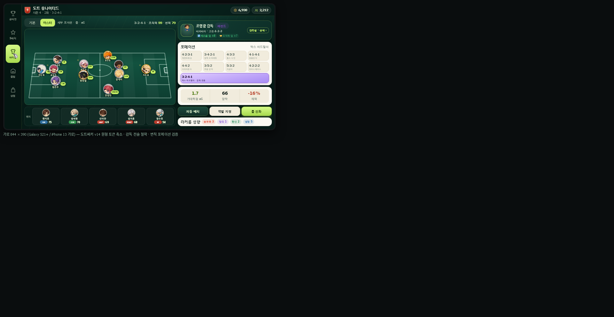 |  |  | 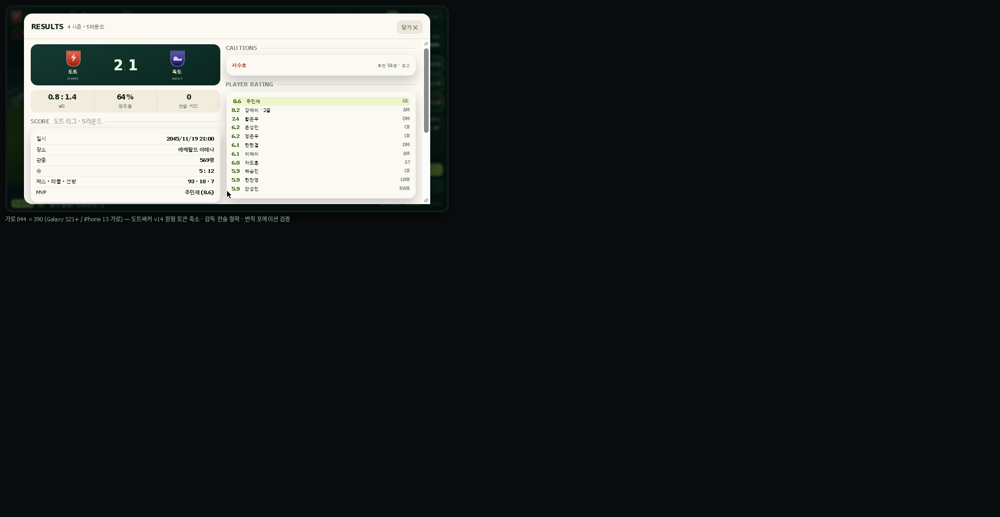 |

- 검증 랩: `preview/verify-844x390-v14.html` · 캐시 버스터 `?v=14&b=46` · 서비스워커 캐시 `dot-soccer-v14a`.

## v13 패치 — `LWB`·`RWB` 하프라인 정렬 · 주발(왼발/오른발/양발) 좌우 적성 · 새 앱 아이콘

호진님이 v12를 보고 **"LWB . RWB 는 중앙선에 맞추고 왼쪽은 왼발잡이 오른쪽은 오른발잡이들 한테 적성 주기"** 라고 지시했고, 이어서 **"아이콘 이미지도 이쁘게 만들기"** 요청까지 함께 반영한 패치입니다.

### 1. `LWB`·`RWB`를 하프라인 위로 (`js/data.js` `APT_LAYOUT`)
- 두 윙백의 세로 위치를 **`y=50%`(피치 절반 선)** 로 올렸습니다. `CM`(y=40%)과 `DM`(y=56%) 사이, 즉 `CM` 두 자리와 `DM` 사이의 중앙선에 정확히 걸립니다.
- 원(27px)은 라벨 높이 때문에 상자 중심이 선보다 3.8px 위로 떠 있었습니다. `aptcell halfline` 클래스를 두어 **원 중심이 하프라인에 0.16px 오차로 앉도록** 보정했습니다(측정값).
- 다른 원과의 겹침 없음: `LWB`(7%, 50%) — `CM`(37%, 40%) / `LB`(17%, 71%) 사이, `RWB`(93%, 50%) — `CM`(63%, 40%) / `RB`(83%, 71%) 사이.

### 2. 주발 `왼발` / `오른발` / `양발`
- 모든 선수에게 `foot` 속성을 부여합니다. 새 선수는 주 포지션에 맞춰 뽑습니다.
  - `LWF·LWB·LB` → 왼발 72% / 양발 18% / 오른발 10%
  - `RWF·RWB·RB` → 오른발 72% / 양발 18% / 왼발 10%
  - 중앙·`GK` → 오른발 68% / 왼발 22% / 양발 10% (현실 축구 비율)
- **적성 반영**: 왼발잡이는 `LWF·LWB·LB` +2, 오른발잡이는 `RWF·RWB·RB` +2. 반대쪽은 -2, 인버티드 윙어(`RWF`/`LWF`)만 -1로 살짝 허용. 양발은 좌우 모두 +1.
- **좌우 순서 보장**: 왼발잡이는 같은 줄에서 **왼쪽 적성 ≥ 오른쪽 적성**, 오른발잡이는 그 반대가 항상 성립합니다(어울리지 않는 반대쪽만 내림). 3,000명 생성 + 800명 마이그레이션 검증에서 위반 0건.
- **기존 세이브**: `id + 이름` 시드로 **결정적** 배정(새로고침해도 주발이 바뀌지 않음). 측면 선수는 주 발·양발만 받아 주 포지션 적성과 어긋나 보이지 않게 했고, 저장된 좌우 적성은 한 번만 보정한 뒤 로드 때마다 순서만 정돈합니다.
- **PLAYER DETAIL**: 포지션 뱃지·성향 옆에 주발 뱃지 — 왼발 파랑 · 오른발 빨강 · 양발 초록.

### 3. 새 앱 아이콘 (`icons/`)
- 2.5등신 축구 에이스 + 짙은 에메랄드/라임 스타디움 + 라임 엠블럼 링, 텍스트 없음.
- `icons/icon-512.png` · `icons/icon-192.png` · `icons/apple-touch-icon.png`(180) · `icons/icon-maskable-512.png`(안전 영역 80%, manifest `purpose: maskable`).
- `?v=13` · 캐시 버스터 `b=42` (`index.html`·`sw.js`·`manifest.webmanifest` 동시 갱신, 서비스워커 캐시 `dot-soccer-v13d`).

| 844×390 라이브 — RWB 안성민 (`오른발`) | 적성 피치맵 — LWB·RWB가 하프라인 위 | LWB 한찬영 (`양발`) — 좌우 모두 준수 |
| --- | --- | --- |
|  |  |  |

| 새 앱 아이콘 512 |
| --- |
|  |

## v12 패치 — 적성 피치맵 `CM`·`CB` 좌우 2자리, `DM`은 `CM` 뒤쪽 정중앙

호진님이 v11을 보고 **"Cm도 좌우 2자리 cb도 좌우 2자리"** 라고 지시한 것을 반영했습니다. 적성 피치맵이 실제 축구처럼 **좌·우 한 자리씩 짝을 이뤄** 그려집니다.

- **`CM` 좌우 2자리**: 왼쪽 `CM` x=37% · 오른쪽 `CM` x=63% (`LWB`·`RWB` 줄, y=40%) — 두 원 모두 해당 선수의 `CM` 적성 수치를 표시합니다.
- **`CB` 좌우 2자리**: 왼쪽 `CB` x=38% · 오른쪽 `CB` x=62% (`LB`·`RB` 줄, y=71%) — 두 원 모두 `CB` 적성 수치입니다. `LB`는 17%, `RB`는 83%로 벌려 겹침을 없앴습니다.
- **`DM` 후방 배치**: `DM`은 `CM` 두 자리 **뒤쪽 정중앙** x=50%, y=56% — 중앙축(`AM` 25 → `DM` 56 → `GK` 87)이 그대로 한 줄로 섭니다.
- **최전방/측면**: `ST` 41% / `CF` 59%, `LWF` 11% / `RWF` 89%, `LWB` 7% / `RWB` 93% (v11 좌표 유지).
- 구현은 `js/data.js`에 **표시용 슬롯 `APT_MAP_SLOTS`(15칸)** 를 추가하고 `js/game.js`의 `aptMap()`이 그 슬롯을 그리게 했습니다. 오른쪽 자리는 `side:'R'`로 x를 100 기준 뒤집어 그리므로 좌우가 항상 정대칭입니다. **포지션 목록(`APT_LIST`)·적성 계산은 13종 그대로**라 스카우트·포메이션·성장 로직에는 영향이 없습니다.
- `?v=12` · 캐시 버스터 `b=38` (`index.html`·`sw.js`·`manifest.webmanifest` 동시 갱신).

| 844×390 라이브 — CM 강재이 | 적성 피치맵 확대 (CM 2자리·CB 2자리·DM 후방) | CB 백승민 — CB 두 자리 모두 9 |
| --- | --- | --- |
|  |  |  |

## v11 패치 — 선수 상세 적성 피치맵 정렬

호진님이 `PLAYER DETAIL` 스크린샷을 보내며 **"Cm cb 좌우 cd는 cm 뒤쪽"** 이라고 짚은 것을 반영했습니다. 중앙 포지션이 한 축에 서지 않고 `CM` 왼쪽·`DM` 오른쪽으로 나란히 어긋나 있던 적성 피치맵을 **중앙 세로축(x=50%) 한 줄**로 다시 배치했습니다.

- **중앙축**: `AM` → `CM` → `DM` → `CB` → `GK` 다섯 개를 모두 `x=50%`에 세로로 세우고, `DM`은 `CM` **뒤쪽(우리 골대 쪽)** 에 놓았습니다. 세로 간격은 15~16%(37.5~40픽셀)씩 고르게 배분해 원·라벨이 서로 겹치지 않습니다.
- **좌우 대칭**: `ST/CF`(41/59), `LWF/RWF`(11/89), `LWB/RWB`(7/93), `LB/RB`(23/77)를 `x=50%` 기준 정대칭으로 맞추고, `CM`은 `LWB·RWB` 줄, `CB`는 `LB·RB` 줄, `AM`은 `LWF·RWF` 줄에 정확히 올렸습니다.
- **여백**: `ST/CF`를 1% 내려 상단 테두리를 침범하지 않게, `GK`를 2% 올려 라벨이 피치 안쪽에 들어오게 정돈했습니다. 하프라인(50%)과 `DM` 원 사이도 1.5픽셀 띄웠습니다.
- `?v=11` · 캐시 버스터 `b=37`(`js/data.js` `APT_LAYOUT` 한 곳만 수정 — 13개 포지션 전부 같은 렌더러가 씁니다).

| 844×390 라이브 — PLAYER DETAIL | 적성 피치맵 확대 |
| --- | --- |
|  |  |

## v10에서 달라진 것

### 1. 몸통 삭제 → 원형 초상화 토큰 (`js/match.js`)
- 피치 위 22명의 `pitch-bodies` 스프라이트 렌더링을 **전부 제거**하고, `assets/portraits/head/pNN.png`(330종 고유 두상)를 **원형 클립** 안에 그리는 토큰 렌더러로 교체했습니다. 반지름 `SPR_H × 0.55`(844×390에서 28px), 원근 스케일 자동 적용, 정면 유지.
- **얼굴 중심 크롭**: 두상 PNG마다 다른 프레임을 정규화했습니다. 알파 상단 띠의 무게중심으로 **머리 가로 중심(fx)** 을 찾고, 세로는 `min(가로,세로) × 0.86`·`+0.17` 오프셋으로 **눈·얼굴이 원 가운데** 오게 잘라 330명 전원이 같은 비율로 보입니다(팔·몸통이 섞인 그림도 OK).
- 토큰 구성: 지면 그림자 → 팀 톤 원판 → 초상화(원형 클립 + 안쪽 입체 음영) → 흰 하이라이트 선 → **팀 링** → 바깥 경계선. 링 두께 `r × 0.26`, 발광은 은은하게(`r × 0.30`) 줄여 이웃 토큰과 뭉개지지 않습니다.

### 2. 파랑/빨강 팀 구분 + GK 뱃지
- **홈 = 파랑**, **원정 = 빨강** 두꺼운 링(위→아래 그라디언트)에 같은 색 글로우. 잔디·관중 위에서도 0.1초 안에 편이 갈립니다.
- **골키퍼**: 링 안쪽 **금색 이중 포인트** + 발밑 **`GK` 금색 뱃지**. 필드 선수와 절대 헷갈리지 않습니다.
- **공 소유자**: 토큰 `1.12×` 확대 + **시안/골드 펄스 링** 두 겹 + 발밑 이름표.
- **체력 40% 이하**: 링 바깥 **노랑(25~40%) / 빨강(25% 미만)** 게이지 아크 + 우상단 경고 점.

### 3. 전술이 대형을 바꾼다 — 두 줄 블록 vs 오버래핑 (`shapeOf`)
| 전술 | 수비 라인 | 두 줄 간격 | 폭 | 압박 인원 | 침투 러닝 |
| --- | --- | --- | --- | --- | --- |
| **수비** | 낮게(자기 골 쪽 −12) | **9.4**(컴팩트) | 0.84(좁게) | 1명 | 3.0~5.6초 간격 · 1명 |
| **균형** | 중간 | 12.6 | 1.0 | 2명 | 2.0~4.2초 · 1명 |
| **공격** | 높게(+10) | 16.2 | 1.10(넓게) | **3명** | **1.1~2.5초 · 2명 동시** |

- **수비**: 수비 라인을 기준으로 중원·최전방을 일정 간격에 다시 세워 **4-4 / 5-3 두 줄 블록**을 만듭니다. 마킹에 끌려 라인이 무너지지 않도록 블록 라인을 마지막에 재적용하고, 폭도 함께 좁힙니다.
- **공격**: **풀백·윙백이 터치라인을 타고 하프라인을 넘어 오버래핑**하고, AM/CM이 **2선에서 박스 앞까지 침투**합니다. 압박 인원 3명 고정, 침투 러닝 2명 동시.
- 엔진 계측(수비 시점 평균): 수비 라인 **95 → 86 → 72**, 압박 인원 **1 → 2 → 3명**, 침투 러닝 시작 **6 → 5 → 23회**(수비→균형→공격). 같은 포메이션이라도 전술만 바꾸면 화면이 확 달라집니다.

### 4. 오프더볼 — 삼각 패스 각 · 뒷공간 침투
- 볼 소유자 주변에 **좌·우·앞 3방향 지원 선수**를 골라 각각 다른 각도로 벌립니다(가장 가까운 2명 → 방향이 겹치지 않는 3명). 피치에 **얇은 점선 패스 각**과 지원 선수 발밑 표식이 뜹니다.
- 전방 공격수·중원은 상대 수비 라인 뒤 대각선 공간으로 **침투 러닝**(공격 전술이면 2명 동시, 러닝 시간 1.9초)을 반복합니다.

### 5. 경기 연출 — 패스 궤적 · 슛 트레일 · 골 전광판
- **패스**: 짧은 패스는 거의 직선, 긴 패스만 잔잔한 커브. 시작이 투명한 그라디언트 + 발광 + 점선 + **받는 선수 자리 원 · 화살촉**.
- **슈팅**: 트레일 반경 3.2→**4.4**(장거리 6.0), 황금/주황 2단 그라디언트로 강렬하게. 골문을 벗어나면 작게, **선방 순간엔 세게** 카메라가 흔들립니다(`kickCam`).
- **골**: 화면 흔들림(3.6) + 기존 컷인/배너 + **상단 전광판** — `GOAL / 팀 / 스코어`가 위에서 슬라이드 인 했다가 2.4초 뒤 사라집니다.
- **선방·태클·패스 순간** 해당 토큰이 **가볍게 튀어 오르고**(`fxPop`) 발밑에서 팀 컬러 **원형 파동**(`fxRing`)이 퍼집니다.

### 6. 태클이 실제로 일어난다 (v10 수정)
- v9까지 **태클 0회**였습니다. 원인은 화면 기준 분리(separation)가 수비수를 볼 소유자에게서 5유닛 이상 떼어 놓아, 태클 판정 반경(3.1)에 닿지 못한 것입니다.
- **볼 소유자 ↔ 수비수 쌍만 이격을 풀고**(최소 26%), 판정 반경을 5.2·거리 가중으로 바꿨습니다. 결과: 경기당 **태클 9~14회**, 파울·경고도 함께 발생합니다(RESULTS의 `패스 · 태클 · 선방`에 표시).

### 7. 로딩 게이트 정리
- 전신 일러스트 프리로드를 경기 시작 경로에서 제거하고 **두상 22장만** 기다립니다(최대 9초). 인원 표시도 `원형 초상화 n / 22명 준비`로 바뀌어, 느린 회선에서도 얼굴이 먼저 뜹니다.

## v9에서 달라진 것

### 1. 피치 전용 '공 없는 팀 통일 유니폼 몸통' 스프라이트 (`assets/pitch-bodies/`)
- `images` CLI로 **머리 없이 카라에서 잘린 2.5등신 치비 축구 몸통**을 6포즈 생성: **달리기 A/B · 킥 · 태클 · GK 대기 · GK 다이빙**. 프롬프트에서 공·머리·그림자를 빼고 크로마 그린 배경으로 뽑은 뒤, 초록 키잉(디스필)으로 알파를 뽑아 **공 0개 · 배경 투명**을 확인했습니다.
- 흰 유니폼만 팀 컬러로 염색(명암은 셀 셰이딩 그대로 살림)해 **4세트 = 24장**: 홈 필드 **파랑** · 원정 필드 **빨강** · 홈 GK **형광 라임** · 원정 GK **보라**(GK는 오렌지 장갑 유지).
- 결과: 피치 위 22명이 **같은 편끼리 완전히 같은 유니폼**을 입고, 일러스트에 그려져 있던 공이 사라져 **경기 공이 정확히 1개**만 보입니다.

### 2. 고유 얼굴 전수 재크롭 + 합성 (`js/match.js`)
- 기존 `head/` 크롭은 프레임이 제각각이라 몸통·공이 섞여 들어갔습니다. **기하학 두상 크롭**(머리카락 덩어리 중심 + 턱선 0.55)으로 330명 전원을 다시 잘라 **같은 비율**로 정규화하고, 딸려온 **축구공 자동 탐지·삭제**(흰 원판 채움/침식) + **주먹·팔 덩어리 제거**를 적용했습니다(7.1MB, 128색 양자화).
- 그리기는 `몸통(앵커=발) → 턱을 카라에 0.07 겹쳐 머리` 순서로 합성하고, 좌우 반전 시 **몸통과 머리가 함께** 뒤집힙니다. 머리 높이 47% · 몸통 60%로 v8의 절반 크기(`H × 0.084`)를 유지합니다.
- 포즈가 상태에 따라 바뀝니다: `run` 프레임 교대(run-a/run-b) · `kick`/`pass` · `tackle` · GK `dive`/`idle` · 대기.

### 3. 0.1초 피아 식별 — 오라 링 강화
- 발밑 링을 **두 겹**(팀 컬러 스트로크 + 안쪽 링)으로 그리고, 팀 컬러 발광(shadowBlur)과 진한 채움(17~34%)을 더해 잔디 위에서도 또렷합니다. 공 소유자는 굵은 점선 링 + 이름표.
- 몸통 스프라이트에도 팀 컬러 림 라이트를 넣어 같은 편이 한눈에 묶여 보입니다.

### 4. 실시간 미니 스탯 + 체력/피로 시스템 (`js/match.js`, `js/game.js`, `css/style.css`)
- 사이드바 전술 카드와 수비/균형/공격 사이에 **점유율 바 · 슈팅(홈:원정) · 경기 시계 · 체력 경고** 블록을 넣어 빈 공간을 채우고, 세로 오버플로 없이 딱 맞춥니다.
- 선수마다 **체력(stamina)** 이 생겼습니다. 달린 양·지구력·압박 성향으로 소모되고(GK는 절반), 하프타임에 +11 회복합니다. 90분 기준 주전 대부분이 30~45%까지 떨어집니다.
- **체력 40% 이하**가 되면 머리 위에 작은 게이지 배지: **노랑(25~40%) / 빨강(25% 미만, 깜빡임)**. 사이드바에는 `체력 경고 n명`과 이름·% 칩(최대 3명 + 나머지 인원)이 뜹니다.

### 5. 가로 UI 2건 정돈
- **하프타임 교체창**: 폭 `min(760px, 96%)`로 넓히고 OUT/IN 목록을 **2열 그리드**로 바꿔 11명 전원이 스크롤 없이 보입니다(행 높이 17px).
- **공식전 대시보드**: 카드 패딩·히어로 높이·KPI를 줄여 844×390에서 한 화면에 더 들어가고, 클럽 요약 카드가 행 높이를 채워 빈 구멍을 없앴습니다.

## v8에서 달라진 것

### 1. 피치 위 선수 크기 정확히 절반 (`js/match.js`)
- 스프라이트 높이 계수 `H × 0.168` → **`H × 0.084`** (844×390 가로에서 52px → 26px). 그림자·팀 오라 링·공 소유자 점선 링·이름표·말풍선·림 라이트까지 같은 비율로 줄여 잔디 공간과 패스 레인이 시원하게 드러납니다.
- 일러스트가 아직 도착하지 않았을 때의 폴백도 팀 컬러 **2.5등신 미니 실루엣**(머리·몸통·다리)으로 바꿔, 작아진 크기에서도 핀처럼 보이지 않습니다. 입장 대기 게이트는 9초까지.

### 2. 선수 겹침 0 · 포메이션 대형 유지
- **화면 픽셀 기준 분리(separation)**: 사다리꼴 원근 때문에 월드 단위 간격은 화면에서 왜곡됩니다. `sepRates()`로 화면 x/y 환산비를 구해 **선수 크기에 비례한 최소 이격(0.56×스프라이트 높이)** 을 2회 반복 적용합니다. 뭉침 페어 측정 7.5 → **0.1**, 최소 이격 3 → **8px 이상**.
- **포메이션 대형**: 볼 쪽 압축 계수(kx 0.34→0.17, ky 0.16→0.08)를 줄이고, 공에서 먼 선수는 자기 구역을 지키도록 `hold` 가중을 넣었습니다. 윙어·윙백(LWF/RWF/LWB/RWB)은 공격·수비 전 구간에서 터치라인(x≈3.5 / 96.5)을 넓게 쓰고, 수비 시에도 폭을 버티며, 수비 라인 마크 가중은 낮춰 라인이 무너지지 않습니다.

### 3. 공 시인성 · 패스 전개 템포
- **실제 경기 공 전용 렌더러**: 흰 공 + 진한 검은 외곽선 + 시안 네온 발광 링 + 지면 그림자 + **공 위치 표식(작은 흰 삼각)**. 일러스트에 그려진 공과 한눈에 구분됩니다. 슈팅 순간엔 황금빛으로 번쩍입니다.
- 패스/슈팅 궤적 트레일 16→22프레임, 패스 라인 굵기·불투명도 상향.
- **패스 템포**: 패스 속도 `dist×2.4`(32~74) → **`dist×2.9`(40~90)**, 다음 플레이 판단 간격 0.32→0.26초, 전환 패스 조건 완화(`|Δx|>20` + 62%)와 반대편 오픈 선수 가점으로 공이 경기장 전체를 시원하게 오갑니다.

## v7에서 달라진 것

### 1. 입체 스타디움 피치 (`assets/stadium-pitch.png`)
- AI로 생성한 **선수·공이 없는 16:9 브로드캐스트 앵글 잔디**를 새로 만들고, 모바일 용량을 위해 960×540·287KB로 경량화했습니다.
- 캔버스에 `cover`로 깔고 그 위에 **사다리꼴 원근 투영**(`DS.Art.PROJ`)으로 선수를 배치합니다. 먼 쪽 0.85배 ~ 가까운 쪽 1.12배로 커지고, 좌우 골대가 100% 보입니다.
- 이미지가 아직 도착하지 않아도 같은 투영으로 그린 **폴백 피치**가 즉시 대신 그려집니다.

### 2. 도트 인형 제거 → 2.5등신 전신 일러스트가 직접 주행 (`js/match.js`)
- 벡터 도트 몸통 + 얼굴 오려붙이기 방식을 **완전히 제거**했습니다. 피치 위 22명 전원이 `assets/portraits/p01~p330.png`(400×400 투명 전신)를 Canvas에 직접 그립니다.
- **프리로드 풀 + 입장 게이트**: 22명 일러스트가 준비될 때까지 "선수단 입장 중 n/22" 진행 바를 보여 주고 킥오프합니다(최대 6초 후엔 먼저 시작). 이미 받아 둔 그림은 브라우저/서비스워커 캐시로 다음 경기부터 즉시 뜹니다.
- **동작 연출**: 좌우 반전(`scale(-1,1)`), 달리기 상하 바운스 + 전방 기울기, 패스/슈팅 킥 기울기, 슬라이딩 태클 회전, GK 다이빙 회전·도약, 골 세리머니 점프, 대기 시 호흡 스쿼시.
- **발밑 그림자 + 발광 팀 오라 링**(홈 시안/블루 · 원정 레드/오렌지) + **팀 컬러 림 라이트**(일러스트 유니폼 색이 제각각이어도 편이 한눈에 구분) + 공 소유자 점선 링·이름표.
- **가로 좌표계**: 홈은 화면 왼쪽 골대 → 오른쪽 골대, 원정은 오른쪽 → 왼쪽으로 공격합니다. 포메이션 앵커·압박·윙 폭·크로스·오프사이드·슛 방향이 모두 이 가로 공격축에서 동작합니다.

### 3. 게임 전체 가로 2단 레이아웃 (`index.html`, `css/style.css`, `js/game.js`, `manifest.webmanifest`)
- **경기**: 상단 슬림 바(엠블럼·팀명·스코어·시계·자동/배속/일시정지/나가기) + 좌측 72% 입체 피치 + 우측 28% 사이드바(모멘텀·전술 카드 3장(얼굴 썸네일+효과+코스트)·수비/균형/공격·교체) + 하단 1줄 티커(캐스터 중계 + 감독 버프).
- **마이팀**: 좌 60% 가로 전술판(2.5등신 원형 초상화, 좌↔우 배치) + 하단 벤치 스트립, 우 40% 감독 카드·포메이션 8종·`xG/압박/체력` 3칸·자동배치/역할/롤진화/감독실.
- **공식전·S매치·클럽·상점**: 가로 다단 카드 대시보드로 재배치. 결과서·교체·모달은 가로 2단 흐름.
- **뒤로가기 가드**, **v3~v6 세이브 하위 호환**, **330종 선수 + 32종 감독 자산** 그대로.

## v6에서 달라진 것 (요약)
## v6에서 달라진 것

### 1. 필드 플레이 — 피치 위 22명을 다시 그렸다 (`js/data.js`, `js/match.js`)
- **2.5등신 SD 선수 스프라이트 v6**: 어깨·카라·유니폼 패턴(세로줄/가로밴드/사시/어깨배색 — 유니폼 색에서 자동 결정)·반바지·스타킹 밴드·축구화·등번호·GK 장갑까지 벡터로 그립니다. 머리는 330종 일러스트의 **얼굴 크롭을 실측 경계로 잘라** 붙여 22명이 전부 다른 얼굴·헤어·피부를 갖습니다.
- **포즈 리그 8종**: 달리기 4프레임(팔·다리 스윙·상체 기울기·바운스), 드리블, 슛(슈팅 다리 스윙), 패스, 슬라이딩 태클(몸이 눕는 회전), GK 다이빙(회전+도약), 세리머니(팔 들고 점프), 대기(호흡).
- **공의 높이(z)**: 패스·크로스·스루·중거리 슛이 포물선을 그리고, 공은 지면 그림자에서 떨어져 뜨며 그림자가 작아집니다. 땅볼 패스와 로빙 패스가 눈으로 구분됩니다.
- **볼-사이드 압축**: 팀 전체가 공 쪽으로 좁혀지고, 반대편 윙어는 폭을 유지해 전환 패스 각을 만듭니다.
- **삼각 지원**: 공을 잡은 선수 주변 2명이 전진·후방 패스 각으로 벌어집니다.
- **오프더볼 침투**: 최전방·중원이 수비 라인 뒤 대각선 공간으로 뛰어들고(`🏃 침투!`), 그 순간 스루패스가 나옵니다.
- **원터치·백패스·컷백**: 압박받으면 무작정 뺏기지 않고 되돌리고, 측면 깊숙이 들어가면 박스로 컷백을 올립니다.

### 2. 사진 잘림 0건 (`css/style.css`, `js/data.js`)
- 스프라이트 얼굴은 330종 일러스트의 **실측 얼굴 사각형 표**로 잘라 쓰므로 정수리·턱이 잘리지 않습니다.
- 원형 토큰·벤치 카드·미니 헤드는 얼굴 크롭(`head/pNNN.png`)을 `object-position: 50% 34%`로 정렬.
- 스카우트 카드의 `object-fit: cover + scale(1.15)` 크롭을 제거해 **전신 일러스트가 잘리지 않습니다**(contain).
- 경기장: 상단 골라인 위로 **스프라이트 높이만큼 안전 여백**을 두어 최상단 선수의 머리가 절대 잘리지 않고, 상황 배너(`역습 위기!`)는 피치 밖 상단 바로 이동해 머리를 가리지 않습니다.
- `MOMENTUM` 글자는 모노스페이스 계열 + `font-variant-ligatures: none`로 깨진 글자 없이 표시되고, 중계석은 피치가 남는 세로 공간을 차지하는 플렉스 레이아웃이라 **어떤 화면 높이에서도 잘리지 않습니다**.

### 3. 뒤로가기 가드 (`js/game.js`)
- 히스토리에 가드 엔트리를 유지해 뒤로가기(popstate)가 앱을 즉시 나가지 않습니다.
- ① 시트/모달이 열려 있으면 **닫기**(하프타임 교체창은 닫으면서 후반 시작) ② 다른 탭이면 **홈 탭 복귀** ③ 경기 중이면 `"경기를 중단하고 나가시겠어요?"` 확인 ④ 홈에서는 `"한 번 더 누르면 종료됩니다"` 토스트 후 2초 안에 다시 눌러야 종료.

## v5에서 달라진 것

### 1. 선수 일러스트 330종 연동 (GK/필드 풀 정합)
- `assets/portraits/p01~p330.png`(400×400) + `head/p01~p330.png`(240×240) 를 코드에 연결. `DS.PIC_COUNT = 330`.
- **골키퍼 전용 40종** = `p06 · p15 · p20` + `p294~p330` (장갑 일러스트), **필드 전용 290종** = 나머지. `assets/portraits/pools.json`과 100% 일치(코드에서 자동 생성하므로 어긋날 수 없음).
- GK는 필드 일러스트를 절대 받지 않고, 필드 선수도 GK 일러스트를 받지 않습니다. 스쿼드·영입·스카우트·상대팀·세이브 마이그레이션 모든 경로에서 풀 준수 + 얼굴 중복 0.
- v4 세이브에 남아 있던 `pic`(예: GK였던 p33~p36, 필드가 쓰던 GK 일러스트)은 로그인 시 자동 교정됩니다.
- SD 스프라이트(피치 위 22명)의 헤어·피부 색도 `p37~p330`까지 번호 기반으로 자동 배정.

### 2. 감독 32명 — 고유 포메이션 + 특기 8종
- **동 8명 / 은 10명 / 금 9명 / 전설 5명** (전원 가상 창작, `assets/managers/m01~m32` 일러스트 매칭).
- 각 감독은 **이름 · 나이 · 등급 · 한 줄 스토리 · 고유 포메이션(현 8종 중 하나) · 특기 1~2개**를 가집니다.
- **특기 8종**: `조직력 업 · 공격 업 · 수비 업 · 패스율 업 · 슛 업 · 점프볼(공중볼) 업 · 압박 업 · 스피드 업`. 등급이 높을수록 수치가 큽니다(2~8).
- **고유 포메이션 원클릭 적용**: 감독실에서 버튼 한 번으로 감독의 포메이션으로 라인업을 재배치. 현재 포메이션이 감독의 고유 포메이션과 같으면 **시너지 ON**(전력 +3 · xG +0.08 · 실점 xG −0.06)이 붙습니다.
- **감독 고유 전술**: 특기 조합이 포메이션 지표(압박·라인·폭·템포)를 보정해, 같은 4-3-3이라도 압박형 감독과 수비형 감독의 블록 높이가 달라집니다.

### 3. 감독 특기가 실제 경기 AI에 반영
| 특기 | 경기 엔진에서 하는 일 |
| --- | --- |
| 조직력 업 | 패스 선택에서 전진·오픈된 동료를 우선, 패스 오차 소폭 감소, 조직력·전력 수치 상승 |
| 공격 업 | 슛 사거리·슈팅 시도 확률·xG 상승, 수비 라인 전진 |
| 수비 업 | 수비 라인 하강·밀착 마킹, 상대 슈팅 xG 감소, 태클 성공률 상승 |
| 패스율 업 | 패스 오차(−최대 40%)·패스 차단 확률 감소 |
| 슛 업 | 슈팅 정확도·결정력(xG) 상승 |
| 점프볼 업 | 코너킥·크로스 공중볼 xG·유효 슈팅 확률 상승 |
| 압박 업 | 압박 인원/반경, 태클 성공률, 상대 패스 차단 확률 상승 |
| 스피드 업 | 전 선수 이동 속도(최대 +12%), 역습·복귀 개선 |

실측(같은 선수단·4-2-3-1·8경기 평균, quickjs 엔진 시뮬레이션): 감독 없음 xG 1.70 → 슛/공격형 감독 2.40, 패스/조직형 2.10. 수비형 감독은 실점 2.0 → 0.88, 태클 10.2 → 16.4.

### 4. 감독 관리 UI (100% 한국어)
- **마이팀·클럽·경기 화면**에 선임 감독 카드(일러스트 · 등급 · 성향 · 고유 포메이션 · 특기 태그) 상시 표시.
- **감독실**: 현재 감독 상세(일러스트·스토리·특기 효과 수치), **보유 감독 선임/교체**(무료), **영입 후보 4명**(골드 1,200~14,000, 영입 즉시 선임), **후보 교체 300골드**.
- 시작 시 **기본 감독 1명**(김두식 · 조직력 업 +3 · 4-4-2)을 지급합니다.
- 경기 중에는 스코어보드 아래에 `👔 감독명 · 특기` 줄이, 결과서에는 **MANAGER 밴드**(감독·고유 포메이션·시너지·특기)가 표시됩니다.

### 5. 경기 엔진 수정 (v4부터 있던 '경기 멈춤' 버그)
- 아무도 받지 못한 패스가 **경기장 밖으로 무한히 날아가 경기가 정지**하던 문제를 수정했습니다(90분 내내 패스 10여 회로 끝나던 현상).
- 이제 아웃된 공은 스로인, 안쪽 루즈볼은 회수 대상으로 전환되고, 공이 월드 밖으로 크게 벗어나면 자동 회수하는 안전장치가 있습니다.
- 수정 후 16경기 연속 정지 0건 · 패스 66~100회 · 슛 5~16회/팀으로 정상 전개.

## 조작
- **모멘텀** — 패스·태클·슈팅·골로 게이지 충전 → 손패 3장 중 발동(경기당 6회).
- **배속 ×1/×2/×3 · 전술(수비/균형/공격) · 교체 5회** — 경기 중 언제든, 하프타임 자동 교체창.
- **감독실** — 마이팀 상단 감독 카드를 탭. 고유 포메이션 적용·감독 교체·영입.

## 검증 (390×844, 실제 배포본 v6)
- esprima 문법 검사 `js/data.js`·`js/match.js`·`js/game.js` **0 오류**.
- quickjs 경기 엔진 시뮬레이션 6회(4-2-3-1 / 4-3-3 × 균형·공격·수비, 카드 오토 6회) — **전 경기 90분 완주**, 정지 0건. 슛 10~22개/팀, 패스 61~90회, 점유율 47~65%, 스코어 0:0~3:2. 전술에 따라 슛·점유율이 실제로 갈립니다(공격 22슛, 수비 65% 점유).
- 뒤로가기 가드 실측(390×844 라이브):
  - 경기 중 뒤로가기 → `"경기를 중단하고 나가시겠어요?"` 확인창, 취소 시 경기 계속(43' 유지 확인).
  - 하프타임 교체창 열린 상태 뒤로가기 → 창이 닫히고 화면 유지.
  - 마이팀 탭에서 뒤로가기 → 홈 탭 복귀(탭바 활성 상태도 home으로 복귀 확인).
  - 홈에서 뒤로가기 → `"한 번 더 누르면 종료됩니다"` 토스트, **앱 이탈 없음**(URL 유지).
  - 선수 상세 시트 열고 뒤로가기 → 시트만 닫힘.
- 라이브 390×844: 콘솔 오류 0, 세로 오버플로 0(플렉스 레이아웃), 상단 골라인 선수 머리 잘림 0, `MOMENTUM` 깨진 글자 0, 중계석 4줄 온전히 표시.
- 라이브 공식전 2경기 완주(0:1 · 0:1) — 결과서·평점·MVP·CAREER·보상 정상 지급, 스크린샷 8장 `preview/v6/`.
