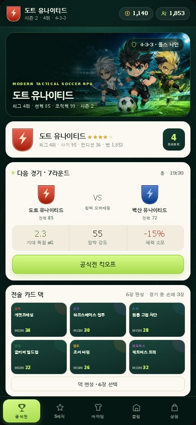
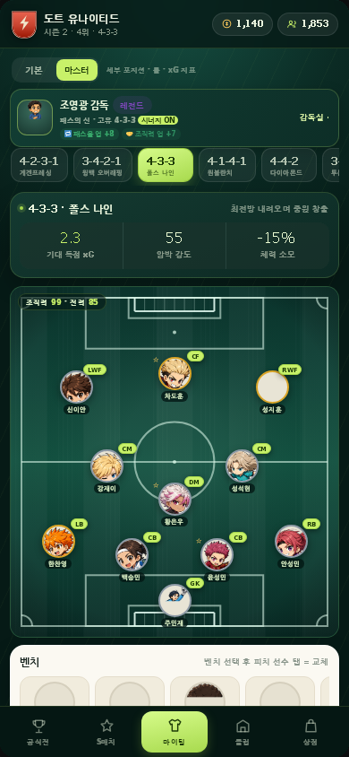
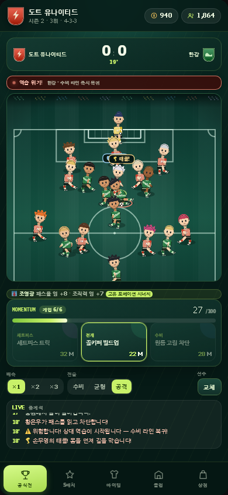
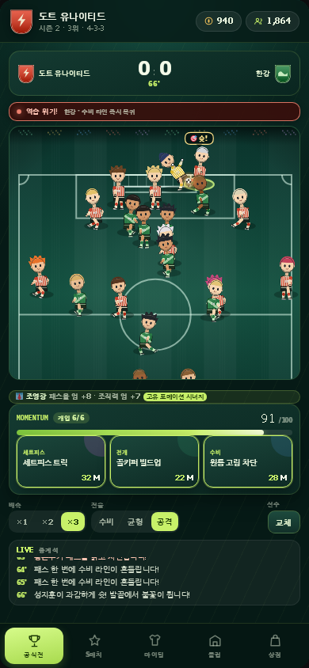
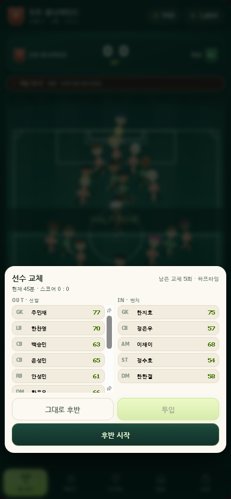
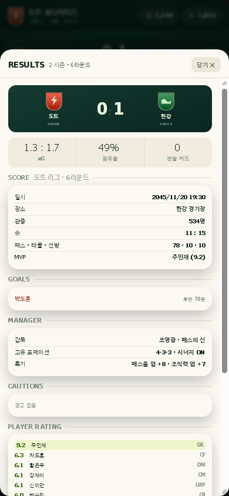
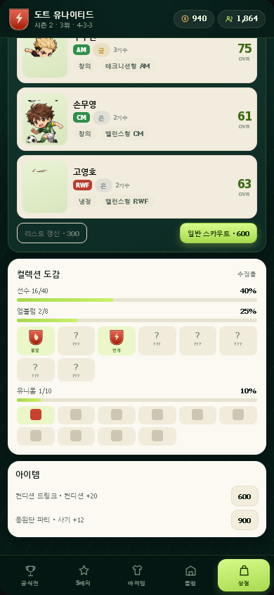
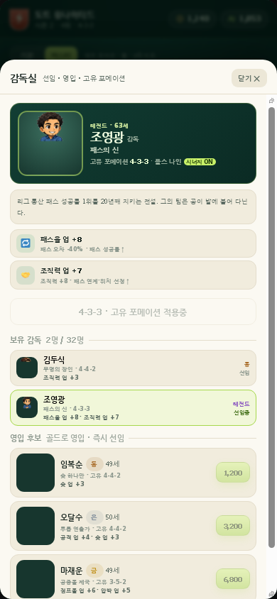

# ⚽ 도트싸커 v6 — 필드 플레이 진화 · 사진 잘림 0 · 뒤로가기 가드

100% 한국어 · 100% 오리지널 가상 선수·감독으로 즐기는 **현대 전술 축구 구단 RPG**입니다.
v6는 호진님이 v5 라이브를 직접 플레이하며 짚은 세 가지 — **① 필드 플레이가 아직 어색하다 ② 사진이 잘린다 ③ 뒤로가기에서 앱이 나가진다** — 를 정면으로 고친 패치입니다. 피치 위 22명이 2.5등신 SD 축구 선수로 다시 그려지고, 공이 높이를 갖고 날아가며, 팀 전체가 볼 쪽으로 압축되고 삼각 패스·뒷공간 침투가 나옵니다. 뒤로가기는 이제 앱을 지키는 장치로 동작합니다.

- 라이브: **https://hojin8811-dev.github.io/Dot-soccer/?v=6**
- 모바일 **390×844** 세로 화면 우선 설계 (가로 스크롤 없음 · 하단 5탭)
- 설치형 PWA (manifest + service worker) · 저장 키 `dot-soccer-v3-save` 그대로 이어받음 (v3·v4 세이브 자동 마이그레이션 → v5)
- 라이선스 클린: 실존 선수·구단·감독·엠블럼 없이 완전 오리지널 (선수 330명 + 감독 32명 전원 가상 창작)

| 홈 | 마이팀 (SD 얼굴 토큰) | 경기 중 — 22명 SD 플레이 |
| --- | --- | --- |
|  |  |  |

| 공 높이(로빙·슛 궤적) | 하프타임 교체 | 결과서 |
| --- | --- | --- |
|  |  |  |

| 스카우트 (전신 무크롭) | 감독실 |
| --- | --- |
|  |  |

## v6에서 달라진 것

### 1. 필드 플레이 — 피치 위 22명을 다시 그렸다 (`js/data.js`, `js/match.js`)
- **2.5등신 SD 선수 스프라이트 v6**: 어깨·카라·유니폼 패턴(세로줄/가로밴드/사시/어깨배색 — 유니폼 색에서 자동 결정)·반바지·스타킹 밴드·축구화·등번호·GK 장갑까지 벡터로 그립니다. 머리는 330종 일러스트의 **얼굴 크롭을 실측 경계로 잘라** 붙여 22명이 전부 다른 얼굴·헤어·피부를 갖습니다.
- **포즈 리그 8종**: 달리기 4프레임(팔·다리 스윙·상체 기울기·바운스), 드리블, 슛(슈팅 다리 스윙), 패스, 슬라이딩 태클(몸이 눕는 회전), GK 다이빙(회전+도약), 세리머니(팔 들고 점프), 대기(호흡).
- **공의 높이(z)**: 패스·크로스·스루·중거리 슛이 포물선을 그리고, 공은 지면 그림자에서 떨어져 뜨며 그림자가 작아집니다. 땅볼 패스와 로빙 패스가 눈으로 구분됩니다.
- **볼-사이드 압축**: 팀 전체가 공 쪽으로 좁혀지고, 반대편 윙어는 폭을 유지해 전환 패스 각을 만듭니다.
- **삼각 지원**: 공을 잡은 선수 주변 2명이 전진·후방 패스 각으로 벌어집니다.
- **오프더볼 침투**: 최전방·중원이 수비 라인 뒤 대각선 공간으로 뛰어들고(`🏃 침투!`), 그 순간 스루패스가 나옵니다.
- **원터치·백패스·컷백**: 압박받으면 무작정 뺏기지 않고 되돌리고, 측면 깊숙이 들어가면 박스로 컷백을 올립니다.

### 2. 사진 잘림 0건 (`css/style.css`, `js/data.js`)
- 스프라이트 얼굴은 330종 일러스트의 **실측 얼굴 사각형 표**로 잘라 쓰므로 정수리·턱이 잘리지 않습니다.
- 원형 토큰·벤치 카드·미니 헤드는 얼굴 크롭(`head/pNNN.png`)을 `object-position: 50% 34%`로 정렬.
- 스카우트 카드의 `object-fit: cover + scale(1.15)` 크롭을 제거해 **전신 일러스트가 잘리지 않습니다**(contain).
- 경기장: 상단 골라인 위로 **스프라이트 높이만큼 안전 여백**을 두어 최상단 선수의 머리가 절대 잘리지 않고, 상황 배너(`역습 위기!`)는 피치 밖 상단 바로 이동해 머리를 가리지 않습니다.
- `MOMENTUM` 글자는 모노스페이스 계열 + `font-variant-ligatures: none`로 깨진 글자 없이 표시되고, 중계석은 피치가 남는 세로 공간을 차지하는 플렉스 레이아웃이라 **어떤 화면 높이에서도 잘리지 않습니다**.

### 3. 뒤로가기 가드 (`js/game.js`)
- 히스토리에 가드 엔트리를 유지해 뒤로가기(popstate)가 앱을 즉시 나가지 않습니다.
- ① 시트/모달이 열려 있으면 **닫기**(하프타임 교체창은 닫으면서 후반 시작) ② 다른 탭이면 **홈 탭 복귀** ③ 경기 중이면 `"경기를 중단하고 나가시겠어요?"` 확인 ④ 홈에서는 `"한 번 더 누르면 종료됩니다"` 토스트 후 2초 안에 다시 눌러야 종료.

## v5에서 달라진 것

### 1. 선수 일러스트 330종 연동 (GK/필드 풀 정합)
- `assets/portraits/p01~p330.png`(400×400) + `head/p01~p330.png`(240×240) 를 코드에 연결. `DS.PIC_COUNT = 330`.
- **골키퍼 전용 40종** = `p06 · p15 · p20` + `p294~p330` (장갑 일러스트), **필드 전용 290종** = 나머지. `assets/portraits/pools.json`과 100% 일치(코드에서 자동 생성하므로 어긋날 수 없음).
- GK는 필드 일러스트를 절대 받지 않고, 필드 선수도 GK 일러스트를 받지 않습니다. 스쿼드·영입·스카우트·상대팀·세이브 마이그레이션 모든 경로에서 풀 준수 + 얼굴 중복 0.
- v4 세이브에 남아 있던 `pic`(예: GK였던 p33~p36, 필드가 쓰던 GK 일러스트)은 로그인 시 자동 교정됩니다.
- SD 스프라이트(피치 위 22명)의 헤어·피부 색도 `p37~p330`까지 번호 기반으로 자동 배정.

### 2. 감독 32명 — 고유 포메이션 + 특기 8종
- **동 8명 / 은 10명 / 금 9명 / 전설 5명** (전원 가상 창작, `assets/managers/m01~m32` 일러스트 매칭).
- 각 감독은 **이름 · 나이 · 등급 · 한 줄 스토리 · 고유 포메이션(현 8종 중 하나) · 특기 1~2개**를 가집니다.
- **특기 8종**: `조직력 업 · 공격 업 · 수비 업 · 패스율 업 · 슛 업 · 점프볼(공중볼) 업 · 압박 업 · 스피드 업`. 등급이 높을수록 수치가 큽니다(2~8).
- **고유 포메이션 원클릭 적용**: 감독실에서 버튼 한 번으로 감독의 포메이션으로 라인업을 재배치. 현재 포메이션이 감독의 고유 포메이션과 같으면 **시너지 ON**(전력 +3 · xG +0.08 · 실점 xG −0.06)이 붙습니다.
- **감독 고유 전술**: 특기 조합이 포메이션 지표(압박·라인·폭·템포)를 보정해, 같은 4-3-3이라도 압박형 감독과 수비형 감독의 블록 높이가 달라집니다.

### 3. 감독 특기가 실제 경기 AI에 반영
| 특기 | 경기 엔진에서 하는 일 |
| --- | --- |
| 조직력 업 | 패스 선택에서 전진·오픈된 동료를 우선, 패스 오차 소폭 감소, 조직력·전력 수치 상승 |
| 공격 업 | 슛 사거리·슈팅 시도 확률·xG 상승, 수비 라인 전진 |
| 수비 업 | 수비 라인 하강·밀착 마킹, 상대 슈팅 xG 감소, 태클 성공률 상승 |
| 패스율 업 | 패스 오차(−최대 40%)·패스 차단 확률 감소 |
| 슛 업 | 슈팅 정확도·결정력(xG) 상승 |
| 점프볼 업 | 코너킥·크로스 공중볼 xG·유효 슈팅 확률 상승 |
| 압박 업 | 압박 인원/반경, 태클 성공률, 상대 패스 차단 확률 상승 |
| 스피드 업 | 전 선수 이동 속도(최대 +12%), 역습·복귀 개선 |

실측(같은 선수단·4-2-3-1·8경기 평균, quickjs 엔진 시뮬레이션): 감독 없음 xG 1.70 → 슛/공격형 감독 2.40, 패스/조직형 2.10. 수비형 감독은 실점 2.0 → 0.88, 태클 10.2 → 16.4.

### 4. 감독 관리 UI (100% 한국어)
- **마이팀·클럽·경기 화면**에 선임 감독 카드(일러스트 · 등급 · 성향 · 고유 포메이션 · 특기 태그) 상시 표시.
- **감독실**: 현재 감독 상세(일러스트·스토리·특기 효과 수치), **보유 감독 선임/교체**(무료), **영입 후보 4명**(골드 1,200~14,000, 영입 즉시 선임), **후보 교체 300골드**.
- 시작 시 **기본 감독 1명**(김두식 · 조직력 업 +3 · 4-4-2)을 지급합니다.
- 경기 중에는 스코어보드 아래에 `👔 감독명 · 특기` 줄이, 결과서에는 **MANAGER 밴드**(감독·고유 포메이션·시너지·특기)가 표시됩니다.

### 5. 경기 엔진 수정 (v4부터 있던 '경기 멈춤' 버그)
- 아무도 받지 못한 패스가 **경기장 밖으로 무한히 날아가 경기가 정지**하던 문제를 수정했습니다(90분 내내 패스 10여 회로 끝나던 현상).
- 이제 아웃된 공은 스로인, 안쪽 루즈볼은 회수 대상으로 전환되고, 공이 월드 밖으로 크게 벗어나면 자동 회수하는 안전장치가 있습니다.
- 수정 후 16경기 연속 정지 0건 · 패스 66~100회 · 슛 5~16회/팀으로 정상 전개.

## 조작
- **모멘텀** — 패스·태클·슈팅·골로 게이지 충전 → 손패 3장 중 발동(경기당 6회).
- **배속 ×1/×2/×3 · 전술(수비/균형/공격) · 교체 5회** — 경기 중 언제든, 하프타임 자동 교체창.
- **감독실** — 마이팀 상단 감독 카드를 탭. 고유 포메이션 적용·감독 교체·영입.

## 검증 (390×844, 실제 배포본 v6)
- esprima 문법 검사 `js/data.js`·`js/match.js`·`js/game.js` **0 오류**.
- quickjs 경기 엔진 시뮬레이션 6회(4-2-3-1 / 4-3-3 × 균형·공격·수비, 카드 오토 6회) — **전 경기 90분 완주**, 정지 0건. 슛 10~22개/팀, 패스 61~90회, 점유율 47~65%, 스코어 0:0~3:2. 전술에 따라 슛·점유율이 실제로 갈립니다(공격 22슛, 수비 65% 점유).
- 뒤로가기 가드 실측(390×844 라이브):
  - 경기 중 뒤로가기 → `"경기를 중단하고 나가시겠어요?"` 확인창, 취소 시 경기 계속(43' 유지 확인).
  - 하프타임 교체창 열린 상태 뒤로가기 → 창이 닫히고 화면 유지.
  - 마이팀 탭에서 뒤로가기 → 홈 탭 복귀(탭바 활성 상태도 home으로 복귀 확인).
  - 홈에서 뒤로가기 → `"한 번 더 누르면 종료됩니다"` 토스트, **앱 이탈 없음**(URL 유지).
  - 선수 상세 시트 열고 뒤로가기 → 시트만 닫힘.
- 라이브 390×844: 콘솔 오류 0, 세로 오버플로 0(플렉스 레이아웃), 상단 골라인 선수 머리 잘림 0, `MOMENTUM` 깨진 글자 0, 중계석 4줄 온전히 표시.
- 라이브 공식전 2경기 완주(0:1 · 0:1) — 결과서·평점·MVP·CAREER·보상 정상 지급, 스크린샷 8장 `preview/v6/`.
