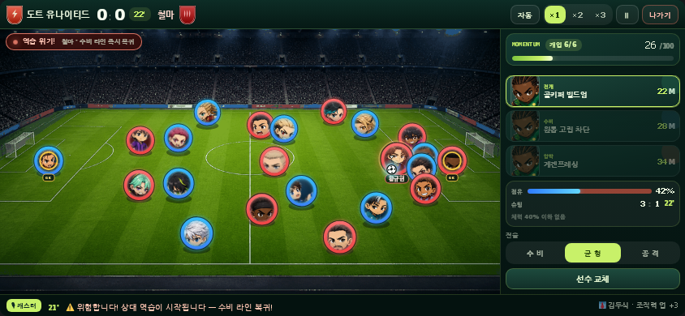
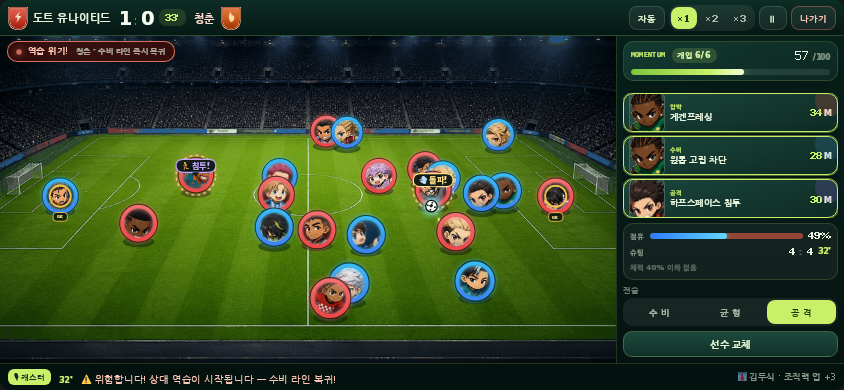
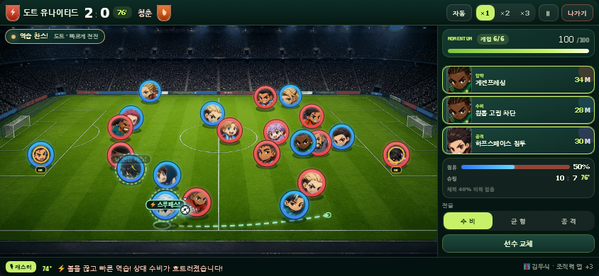
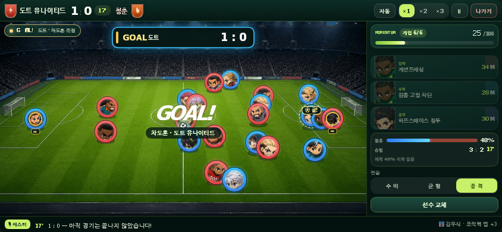
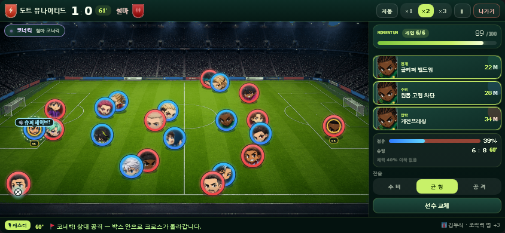
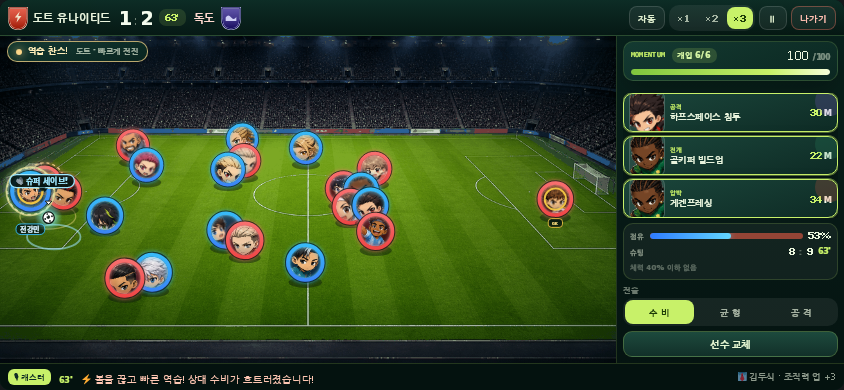
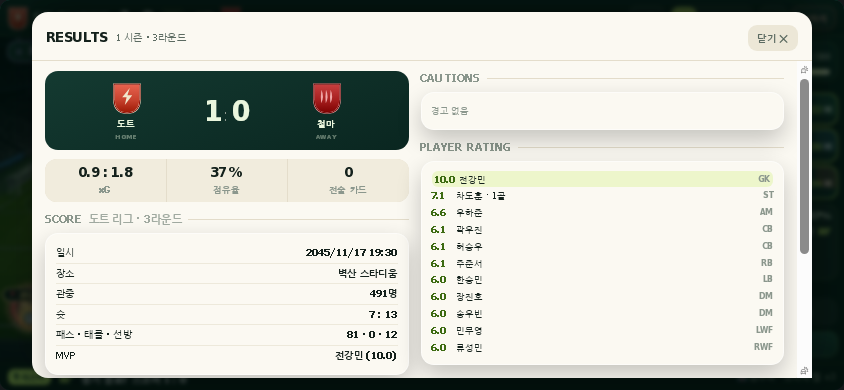
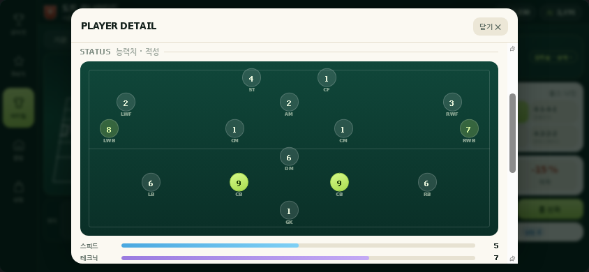
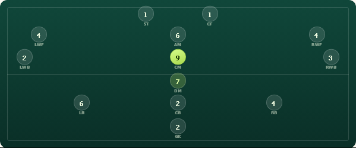

# ⚽ 도트싸커 v12 — 적성 피치맵 CM·CB 좌우 2자리 + DM 후방 배치

100% 한국어 · 100% 오리지널 가상 선수·감독으로 즐기는 **현대 전술 축구 구단 RPG**입니다.
v10은 호진님이 초상화 시안을 보내며 확정한 **"몸통 그냥 지우고 이렇게 경기하는걸로 바꾸자 원 바깥으로 파란색, 빨간색 나눠서 팀 구별하고"** 를 그대로 구현한 패치입니다. 피치 위 22명의 몸통을 지우고 **고유 얼굴을 담은 원형 토큰**으로 바꿨습니다. 원 바깥 두꺼운 링이 **홈 파랑(`#3b82f6`~`#38bdf8`) / 원정 빨강(`#ef4444`~`#f87171`)** 으로 편을 나누고, 골키퍼는 금색 이중 링 + `GK` 뱃지로 한눈에 구분됩니다. 여기에 **전술(수비·균형·공격)에 따라 대형이 눈에 띄게 달라지는 두 줄 블록/오버래핑**, **삼각 패스 각 표시**, **골 전광판·카메라 흔들림·선방 파동**까지 얹어 "메이저 매니저 게임" 느낌의 경기 화면을 만들었습니다.

- 라이브: **https://hojin8811-dev.github.io/Dot-soccer/?v=12**
- **844×390 가로 뷰포트** 기준 설계 (경기·마이팀 화면은 스크롤 없이 한 화면, 나머지 탭은 가로 다단 대시보드)
- 세로로 열면 **가로 회전 안내**가 뜨고, `manifest.orientation = landscape`
- 설치형 PWA · 저장 키 `dot-soccer-v3-save` 그대로 (v3~v9 세이브 자동 이어받기)
- 라이선스 클린: 실존 선수·구단·감독·엠블럼 없이 완전 오리지널 (선수 330명 + 감독 32명)

| 22명 원형 토큰 — 파랑 11 vs 빨강 11 · 공 1개 | 공격 전술 — 라인 상승 · 풀백 오버래핑 | 수비 전술 — 두 줄 블록 · 패스 각 |
| --- | --- | --- |
|  |  |  |

| 골 — 전광판 + 컷인 | 코너킥 — 박스 안 토큰 | 수비 블록 · 태클 접촉 |
| --- | --- | --- |
|  |  |  |

90분 완주 결과 화면(패스·태클·선방 80·14·13): 

## v12 패치 — 적성 피치맵 `CM`·`CB` 좌우 2자리, `DM`은 `CM` 뒤쪽 정중앙

호진님이 v11을 보고 **"Cm도 좌우 2자리 cb도 좌우 2자리"** 라고 지시한 것을 반영했습니다. 적성 피치맵이 실제 축구처럼 **좌·우 한 자리씩 짝을 이뤄** 그려집니다.

- **`CM` 좌우 2자리**: 왼쪽 `CM` x=37% · 오른쪽 `CM` x=63% (`LWB`·`RWB` 줄, y=40%) — 두 원 모두 해당 선수의 `CM` 적성 수치를 표시합니다.
- **`CB` 좌우 2자리**: 왼쪽 `CB` x=38% · 오른쪽 `CB` x=62% (`LB`·`RB` 줄, y=71%) — 두 원 모두 `CB` 적성 수치입니다. `LB`는 17%, `RB`는 83%로 벌려 겹침을 없앴습니다.
- **`DM` 후방 배치**: `DM`은 `CM` 두 자리 **뒤쪽 정중앙** x=50%, y=56% — 중앙축(`AM` 25 → `DM` 56 → `GK` 87)이 그대로 한 줄로 섭니다.
- **최전방/측면**: `ST` 41% / `CF` 59%, `LWF` 11% / `RWF` 89%, `LWB` 7% / `RWB` 93% (v11 좌표 유지).
- 구현은 `js/data.js`에 **표시용 슬롯 `APT_MAP_SLOTS`(15칸)** 를 추가하고 `js/game.js`의 `aptMap()`이 그 슬롯을 그리게 했습니다. 오른쪽 자리는 `side:'R'`로 x를 100 기준 뒤집어 그리므로 좌우가 항상 정대칭입니다. **포지션 목록(`APT_LIST`)·적성 계산은 13종 그대로**라 스카우트·포메이션·성장 로직에는 영향이 없습니다.
- `?v=12` · 캐시 버스터 `b=38` (`index.html`·`sw.js`·`manifest.webmanifest` 동시 갱신).

| 844×390 라이브 — CM 강재이 | 적성 피치맵 확대 (CM 2자리·CB 2자리·DM 후방) | CB 백승민 — CB 두 자리 모두 9 |
| --- | --- | --- |
|  |  |  |

## v11 패치 — 선수 상세 적성 피치맵 정렬

호진님이 `PLAYER DETAIL` 스크린샷을 보내며 **"Cm cb 좌우 cd는 cm 뒤쪽"** 이라고 짚은 것을 반영했습니다. 중앙 포지션이 한 축에 서지 않고 `CM` 왼쪽·`DM` 오른쪽으로 나란히 어긋나 있던 적성 피치맵을 **중앙 세로축(x=50%) 한 줄**로 다시 배치했습니다.

- **중앙축**: `AM` → `CM` → `DM` → `CB` → `GK` 다섯 개를 모두 `x=50%`에 세로로 세우고, `DM`은 `CM` **뒤쪽(우리 골대 쪽)** 에 놓았습니다. 세로 간격은 15~16%(37.5~40픽셀)씩 고르게 배분해 원·라벨이 서로 겹치지 않습니다.
- **좌우 대칭**: `ST/CF`(41/59), `LWF/RWF`(11/89), `LWB/RWB`(7/93), `LB/RB`(23/77)를 `x=50%` 기준 정대칭으로 맞추고, `CM`은 `LWB·RWB` 줄, `CB`는 `LB·RB` 줄, `AM`은 `LWF·RWF` 줄에 정확히 올렸습니다.
- **여백**: `ST/CF`를 1% 내려 상단 테두리를 침범하지 않게, `GK`를 2% 올려 라벨이 피치 안쪽에 들어오게 정돈했습니다. 하프라인(50%)과 `DM` 원 사이도 1.5픽셀 띄웠습니다.
- `?v=11` · 캐시 버스터 `b=37`(`js/data.js` `APT_LAYOUT` 한 곳만 수정 — 13개 포지션 전부 같은 렌더러가 씁니다).

| 844×390 라이브 — PLAYER DETAIL | 적성 피치맵 확대 |
| --- | --- |
|  |  |

## v10에서 달라진 것

### 1. 몸통 삭제 → 원형 초상화 토큰 (`js/match.js`)
- 피치 위 22명의 `pitch-bodies` 스프라이트 렌더링을 **전부 제거**하고, `assets/portraits/head/pNN.png`(330종 고유 두상)를 **원형 클립** 안에 그리는 토큰 렌더러로 교체했습니다. 반지름 `SPR_H × 0.55`(844×390에서 28px), 원근 스케일 자동 적용, 정면 유지.
- **얼굴 중심 크롭**: 두상 PNG마다 다른 프레임을 정규화했습니다. 알파 상단 띠의 무게중심으로 **머리 가로 중심(fx)** 을 찾고, 세로는 `min(가로,세로) × 0.86`·`+0.17` 오프셋으로 **눈·얼굴이 원 가운데** 오게 잘라 330명 전원이 같은 비율로 보입니다(팔·몸통이 섞인 그림도 OK).
- 토큰 구성: 지면 그림자 → 팀 톤 원판 → 초상화(원형 클립 + 안쪽 입체 음영) → 흰 하이라이트 선 → **팀 링** → 바깥 경계선. 링 두께 `r × 0.26`, 발광은 은은하게(`r × 0.30`) 줄여 이웃 토큰과 뭉개지지 않습니다.

### 2. 파랑/빨강 팀 구분 + GK 뱃지
- **홈 = 파랑**, **원정 = 빨강** 두꺼운 링(위→아래 그라디언트)에 같은 색 글로우. 잔디·관중 위에서도 0.1초 안에 편이 갈립니다.
- **골키퍼**: 링 안쪽 **금색 이중 포인트** + 발밑 **`GK` 금색 뱃지**. 필드 선수와 절대 헷갈리지 않습니다.
- **공 소유자**: 토큰 `1.12×` 확대 + **시안/골드 펄스 링** 두 겹 + 발밑 이름표.
- **체력 40% 이하**: 링 바깥 **노랑(25~40%) / 빨강(25% 미만)** 게이지 아크 + 우상단 경고 점.

### 3. 전술이 대형을 바꾼다 — 두 줄 블록 vs 오버래핑 (`shapeOf`)
| 전술 | 수비 라인 | 두 줄 간격 | 폭 | 압박 인원 | 침투 러닝 |
| --- | --- | --- | --- | --- | --- |
| **수비** | 낮게(자기 골 쪽 −12) | **9.4**(컴팩트) | 0.84(좁게) | 1명 | 3.0~5.6초 간격 · 1명 |
| **균형** | 중간 | 12.6 | 1.0 | 2명 | 2.0~4.2초 · 1명 |
| **공격** | 높게(+10) | 16.2 | 1.10(넓게) | **3명** | **1.1~2.5초 · 2명 동시** |

- **수비**: 수비 라인을 기준으로 중원·최전방을 일정 간격에 다시 세워 **4-4 / 5-3 두 줄 블록**을 만듭니다. 마킹에 끌려 라인이 무너지지 않도록 블록 라인을 마지막에 재적용하고, 폭도 함께 좁힙니다.
- **공격**: **풀백·윙백이 터치라인을 타고 하프라인을 넘어 오버래핑**하고, AM/CM이 **2선에서 박스 앞까지 침투**합니다. 압박 인원 3명 고정, 침투 러닝 2명 동시.
- 엔진 계측(수비 시점 평균): 수비 라인 **95 → 86 → 72**, 압박 인원 **1 → 2 → 3명**, 침투 러닝 시작 **6 → 5 → 23회**(수비→균형→공격). 같은 포메이션이라도 전술만 바꾸면 화면이 확 달라집니다.

### 4. 오프더볼 — 삼각 패스 각 · 뒷공간 침투
- 볼 소유자 주변에 **좌·우·앞 3방향 지원 선수**를 골라 각각 다른 각도로 벌립니다(가장 가까운 2명 → 방향이 겹치지 않는 3명). 피치에 **얇은 점선 패스 각**과 지원 선수 발밑 표식이 뜹니다.
- 전방 공격수·중원은 상대 수비 라인 뒤 대각선 공간으로 **침투 러닝**(공격 전술이면 2명 동시, 러닝 시간 1.9초)을 반복합니다.

### 5. 경기 연출 — 패스 궤적 · 슛 트레일 · 골 전광판
- **패스**: 짧은 패스는 거의 직선, 긴 패스만 잔잔한 커브. 시작이 투명한 그라디언트 + 발광 + 점선 + **받는 선수 자리 원 · 화살촉**.
- **슈팅**: 트레일 반경 3.2→**4.4**(장거리 6.0), 황금/주황 2단 그라디언트로 강렬하게. 골문을 벗어나면 작게, **선방 순간엔 세게** 카메라가 흔들립니다(`kickCam`).
- **골**: 화면 흔들림(3.6) + 기존 컷인/배너 + **상단 전광판** — `GOAL / 팀 / 스코어`가 위에서 슬라이드 인 했다가 2.4초 뒤 사라집니다.
- **선방·태클·패스 순간** 해당 토큰이 **가볍게 튀어 오르고**(`fxPop`) 발밑에서 팀 컬러 **원형 파동**(`fxRing`)이 퍼집니다.

### 6. 태클이 실제로 일어난다 (v10 수정)
- v9까지 **태클 0회**였습니다. 원인은 화면 기준 분리(separation)가 수비수를 볼 소유자에게서 5유닛 이상 떼어 놓아, 태클 판정 반경(3.1)에 닿지 못한 것입니다.
- **볼 소유자 ↔ 수비수 쌍만 이격을 풀고**(최소 26%), 판정 반경을 5.2·거리 가중으로 바꿨습니다. 결과: 경기당 **태클 9~14회**, 파울·경고도 함께 발생합니다(RESULTS의 `패스 · 태클 · 선방`에 표시).

### 7. 로딩 게이트 정리
- 전신 일러스트 프리로드를 경기 시작 경로에서 제거하고 **두상 22장만** 기다립니다(최대 9초). 인원 표시도 `원형 초상화 n / 22명 준비`로 바뀌어, 느린 회선에서도 얼굴이 먼저 뜹니다.

## v9에서 달라진 것

### 1. 피치 전용 '공 없는 팀 통일 유니폼 몸통' 스프라이트 (`assets/pitch-bodies/`)
- `images` CLI로 **머리 없이 카라에서 잘린 2.5등신 치비 축구 몸통**을 6포즈 생성: **달리기 A/B · 킥 · 태클 · GK 대기 · GK 다이빙**. 프롬프트에서 공·머리·그림자를 빼고 크로마 그린 배경으로 뽑은 뒤, 초록 키잉(디스필)으로 알파를 뽑아 **공 0개 · 배경 투명**을 확인했습니다.
- 흰 유니폼만 팀 컬러로 염색(명암은 셀 셰이딩 그대로 살림)해 **4세트 = 24장**: 홈 필드 **파랑** · 원정 필드 **빨강** · 홈 GK **형광 라임** · 원정 GK **보라**(GK는 오렌지 장갑 유지).
- 결과: 피치 위 22명이 **같은 편끼리 완전히 같은 유니폼**을 입고, 일러스트에 그려져 있던 공이 사라져 **경기 공이 정확히 1개**만 보입니다.

### 2. 고유 얼굴 전수 재크롭 + 합성 (`js/match.js`)
- 기존 `head/` 크롭은 프레임이 제각각이라 몸통·공이 섞여 들어갔습니다. **기하학 두상 크롭**(머리카락 덩어리 중심 + 턱선 0.55)으로 330명 전원을 다시 잘라 **같은 비율**로 정규화하고, 딸려온 **축구공 자동 탐지·삭제**(흰 원판 채움/침식) + **주먹·팔 덩어리 제거**를 적용했습니다(7.1MB, 128색 양자화).
- 그리기는 `몸통(앵커=발) → 턱을 카라에 0.07 겹쳐 머리` 순서로 합성하고, 좌우 반전 시 **몸통과 머리가 함께** 뒤집힙니다. 머리 높이 47% · 몸통 60%로 v8의 절반 크기(`H × 0.084`)를 유지합니다.
- 포즈가 상태에 따라 바뀝니다: `run` 프레임 교대(run-a/run-b) · `kick`/`pass` · `tackle` · GK `dive`/`idle` · 대기.

### 3. 0.1초 피아 식별 — 오라 링 강화
- 발밑 링을 **두 겹**(팀 컬러 스트로크 + 안쪽 링)으로 그리고, 팀 컬러 발광(shadowBlur)과 진한 채움(17~34%)을 더해 잔디 위에서도 또렷합니다. 공 소유자는 굵은 점선 링 + 이름표.
- 몸통 스프라이트에도 팀 컬러 림 라이트를 넣어 같은 편이 한눈에 묶여 보입니다.

### 4. 실시간 미니 스탯 + 체력/피로 시스템 (`js/match.js`, `js/game.js`, `css/style.css`)
- 사이드바 전술 카드와 수비/균형/공격 사이에 **점유율 바 · 슈팅(홈:원정) · 경기 시계 · 체력 경고** 블록을 넣어 빈 공간을 채우고, 세로 오버플로 없이 딱 맞춥니다.
- 선수마다 **체력(stamina)** 이 생겼습니다. 달린 양·지구력·압박 성향으로 소모되고(GK는 절반), 하프타임에 +11 회복합니다. 90분 기준 주전 대부분이 30~45%까지 떨어집니다.
- **체력 40% 이하**가 되면 머리 위에 작은 게이지 배지: **노랑(25~40%) / 빨강(25% 미만, 깜빡임)**. 사이드바에는 `체력 경고 n명`과 이름·% 칩(최대 3명 + 나머지 인원)이 뜹니다.

### 5. 가로 UI 2건 정돈
- **하프타임 교체창**: 폭 `min(760px, 96%)`로 넓히고 OUT/IN 목록을 **2열 그리드**로 바꿔 11명 전원이 스크롤 없이 보입니다(행 높이 17px).
- **공식전 대시보드**: 카드 패딩·히어로 높이·KPI를 줄여 844×390에서 한 화면에 더 들어가고, 클럽 요약 카드가 행 높이를 채워 빈 구멍을 없앴습니다.

## v8에서 달라진 것

### 1. 피치 위 선수 크기 정확히 절반 (`js/match.js`)
- 스프라이트 높이 계수 `H × 0.168` → **`H × 0.084`** (844×390 가로에서 52px → 26px). 그림자·팀 오라 링·공 소유자 점선 링·이름표·말풍선·림 라이트까지 같은 비율로 줄여 잔디 공간과 패스 레인이 시원하게 드러납니다.
- 일러스트가 아직 도착하지 않았을 때의 폴백도 팀 컬러 **2.5등신 미니 실루엣**(머리·몸통·다리)으로 바꿔, 작아진 크기에서도 핀처럼 보이지 않습니다. 입장 대기 게이트는 9초까지.

### 2. 선수 겹침 0 · 포메이션 대형 유지
- **화면 픽셀 기준 분리(separation)**: 사다리꼴 원근 때문에 월드 단위 간격은 화면에서 왜곡됩니다. `sepRates()`로 화면 x/y 환산비를 구해 **선수 크기에 비례한 최소 이격(0.56×스프라이트 높이)** 을 2회 반복 적용합니다. 뭉침 페어 측정 7.5 → **0.1**, 최소 이격 3 → **8px 이상**.
- **포메이션 대형**: 볼 쪽 압축 계수(kx 0.34→0.17, ky 0.16→0.08)를 줄이고, 공에서 먼 선수는 자기 구역을 지키도록 `hold` 가중을 넣었습니다. 윙어·윙백(LWF/RWF/LWB/RWB)은 공격·수비 전 구간에서 터치라인(x≈3.5 / 96.5)을 넓게 쓰고, 수비 시에도 폭을 버티며, 수비 라인 마크 가중은 낮춰 라인이 무너지지 않습니다.

### 3. 공 시인성 · 패스 전개 템포
- **실제 경기 공 전용 렌더러**: 흰 공 + 진한 검은 외곽선 + 시안 네온 발광 링 + 지면 그림자 + **공 위치 표식(작은 흰 삼각)**. 일러스트에 그려진 공과 한눈에 구분됩니다. 슈팅 순간엔 황금빛으로 번쩍입니다.
- 패스/슈팅 궤적 트레일 16→22프레임, 패스 라인 굵기·불투명도 상향.
- **패스 템포**: 패스 속도 `dist×2.4`(32~74) → **`dist×2.9`(40~90)**, 다음 플레이 판단 간격 0.32→0.26초, 전환 패스 조건 완화(`|Δx|>20` + 62%)와 반대편 오픈 선수 가점으로 공이 경기장 전체를 시원하게 오갑니다.

## v7에서 달라진 것

### 1. 입체 스타디움 피치 (`assets/stadium-pitch.png`)
- AI로 생성한 **선수·공이 없는 16:9 브로드캐스트 앵글 잔디**를 새로 만들고, 모바일 용량을 위해 960×540·287KB로 경량화했습니다.
- 캔버스에 `cover`로 깔고 그 위에 **사다리꼴 원근 투영**(`DS.Art.PROJ`)으로 선수를 배치합니다. 먼 쪽 0.85배 ~ 가까운 쪽 1.12배로 커지고, 좌우 골대가 100% 보입니다.
- 이미지가 아직 도착하지 않아도 같은 투영으로 그린 **폴백 피치**가 즉시 대신 그려집니다.

### 2. 도트 인형 제거 → 2.5등신 전신 일러스트가 직접 주행 (`js/match.js`)
- 벡터 도트 몸통 + 얼굴 오려붙이기 방식을 **완전히 제거**했습니다. 피치 위 22명 전원이 `assets/portraits/p01~p330.png`(400×400 투명 전신)를 Canvas에 직접 그립니다.
- **프리로드 풀 + 입장 게이트**: 22명 일러스트가 준비될 때까지 "선수단 입장 중 n/22" 진행 바를 보여 주고 킥오프합니다(최대 6초 후엔 먼저 시작). 이미 받아 둔 그림은 브라우저/서비스워커 캐시로 다음 경기부터 즉시 뜹니다.
- **동작 연출**: 좌우 반전(`scale(-1,1)`), 달리기 상하 바운스 + 전방 기울기, 패스/슈팅 킥 기울기, 슬라이딩 태클 회전, GK 다이빙 회전·도약, 골 세리머니 점프, 대기 시 호흡 스쿼시.
- **발밑 그림자 + 발광 팀 오라 링**(홈 시안/블루 · 원정 레드/오렌지) + **팀 컬러 림 라이트**(일러스트 유니폼 색이 제각각이어도 편이 한눈에 구분) + 공 소유자 점선 링·이름표.
- **가로 좌표계**: 홈은 화면 왼쪽 골대 → 오른쪽 골대, 원정은 오른쪽 → 왼쪽으로 공격합니다. 포메이션 앵커·압박·윙 폭·크로스·오프사이드·슛 방향이 모두 이 가로 공격축에서 동작합니다.

### 3. 게임 전체 가로 2단 레이아웃 (`index.html`, `css/style.css`, `js/game.js`, `manifest.webmanifest`)
- **경기**: 상단 슬림 바(엠블럼·팀명·스코어·시계·자동/배속/일시정지/나가기) + 좌측 72% 입체 피치 + 우측 28% 사이드바(모멘텀·전술 카드 3장(얼굴 썸네일+효과+코스트)·수비/균형/공격·교체) + 하단 1줄 티커(캐스터 중계 + 감독 버프).
- **마이팀**: 좌 60% 가로 전술판(2.5등신 원형 초상화, 좌↔우 배치) + 하단 벤치 스트립, 우 40% 감독 카드·포메이션 8종·`xG/압박/체력` 3칸·자동배치/역할/롤진화/감독실.
- **공식전·S매치·클럽·상점**: 가로 다단 카드 대시보드로 재배치. 결과서·교체·모달은 가로 2단 흐름.
- **뒤로가기 가드**, **v3~v6 세이브 하위 호환**, **330종 선수 + 32종 감독 자산** 그대로.

## v6에서 달라진 것 (요약)
## v6에서 달라진 것

### 1. 필드 플레이 — 피치 위 22명을 다시 그렸다 (`js/data.js`, `js/match.js`)
- **2.5등신 SD 선수 스프라이트 v6**: 어깨·카라·유니폼 패턴(세로줄/가로밴드/사시/어깨배색 — 유니폼 색에서 자동 결정)·반바지·스타킹 밴드·축구화·등번호·GK 장갑까지 벡터로 그립니다. 머리는 330종 일러스트의 **얼굴 크롭을 실측 경계로 잘라** 붙여 22명이 전부 다른 얼굴·헤어·피부를 갖습니다.
- **포즈 리그 8종**: 달리기 4프레임(팔·다리 스윙·상체 기울기·바운스), 드리블, 슛(슈팅 다리 스윙), 패스, 슬라이딩 태클(몸이 눕는 회전), GK 다이빙(회전+도약), 세리머니(팔 들고 점프), 대기(호흡).
- **공의 높이(z)**: 패스·크로스·스루·중거리 슛이 포물선을 그리고, 공은 지면 그림자에서 떨어져 뜨며 그림자가 작아집니다. 땅볼 패스와 로빙 패스가 눈으로 구분됩니다.
- **볼-사이드 압축**: 팀 전체가 공 쪽으로 좁혀지고, 반대편 윙어는 폭을 유지해 전환 패스 각을 만듭니다.
- **삼각 지원**: 공을 잡은 선수 주변 2명이 전진·후방 패스 각으로 벌어집니다.
- **오프더볼 침투**: 최전방·중원이 수비 라인 뒤 대각선 공간으로 뛰어들고(`🏃 침투!`), 그 순간 스루패스가 나옵니다.
- **원터치·백패스·컷백**: 압박받으면 무작정 뺏기지 않고 되돌리고, 측면 깊숙이 들어가면 박스로 컷백을 올립니다.

### 2. 사진 잘림 0건 (`css/style.css`, `js/data.js`)
- 스프라이트 얼굴은 330종 일러스트의 **실측 얼굴 사각형 표**로 잘라 쓰므로 정수리·턱이 잘리지 않습니다.
- 원형 토큰·벤치 카드·미니 헤드는 얼굴 크롭(`head/pNNN.png`)을 `object-position: 50% 34%`로 정렬.
- 스카우트 카드의 `object-fit: cover + scale(1.15)` 크롭을 제거해 **전신 일러스트가 잘리지 않습니다**(contain).
- 경기장: 상단 골라인 위로 **스프라이트 높이만큼 안전 여백**을 두어 최상단 선수의 머리가 절대 잘리지 않고, 상황 배너(`역습 위기!`)는 피치 밖 상단 바로 이동해 머리를 가리지 않습니다.
- `MOMENTUM` 글자는 모노스페이스 계열 + `font-variant-ligatures: none`로 깨진 글자 없이 표시되고, 중계석은 피치가 남는 세로 공간을 차지하는 플렉스 레이아웃이라 **어떤 화면 높이에서도 잘리지 않습니다**.

### 3. 뒤로가기 가드 (`js/game.js`)
- 히스토리에 가드 엔트리를 유지해 뒤로가기(popstate)가 앱을 즉시 나가지 않습니다.
- ① 시트/모달이 열려 있으면 **닫기**(하프타임 교체창은 닫으면서 후반 시작) ② 다른 탭이면 **홈 탭 복귀** ③ 경기 중이면 `"경기를 중단하고 나가시겠어요?"` 확인 ④ 홈에서는 `"한 번 더 누르면 종료됩니다"` 토스트 후 2초 안에 다시 눌러야 종료.

## v5에서 달라진 것

### 1. 선수 일러스트 330종 연동 (GK/필드 풀 정합)
- `assets/portraits/p01~p330.png`(400×400) + `head/p01~p330.png`(240×240) 를 코드에 연결. `DS.PIC_COUNT = 330`.
- **골키퍼 전용 40종** = `p06 · p15 · p20` + `p294~p330` (장갑 일러스트), **필드 전용 290종** = 나머지. `assets/portraits/pools.json`과 100% 일치(코드에서 자동 생성하므로 어긋날 수 없음).
- GK는 필드 일러스트를 절대 받지 않고, 필드 선수도 GK 일러스트를 받지 않습니다. 스쿼드·영입·스카우트·상대팀·세이브 마이그레이션 모든 경로에서 풀 준수 + 얼굴 중복 0.
- v4 세이브에 남아 있던 `pic`(예: GK였던 p33~p36, 필드가 쓰던 GK 일러스트)은 로그인 시 자동 교정됩니다.
- SD 스프라이트(피치 위 22명)의 헤어·피부 색도 `p37~p330`까지 번호 기반으로 자동 배정.

### 2. 감독 32명 — 고유 포메이션 + 특기 8종
- **동 8명 / 은 10명 / 금 9명 / 전설 5명** (전원 가상 창작, `assets/managers/m01~m32` 일러스트 매칭).
- 각 감독은 **이름 · 나이 · 등급 · 한 줄 스토리 · 고유 포메이션(현 8종 중 하나) · 특기 1~2개**를 가집니다.
- **특기 8종**: `조직력 업 · 공격 업 · 수비 업 · 패스율 업 · 슛 업 · 점프볼(공중볼) 업 · 압박 업 · 스피드 업`. 등급이 높을수록 수치가 큽니다(2~8).
- **고유 포메이션 원클릭 적용**: 감독실에서 버튼 한 번으로 감독의 포메이션으로 라인업을 재배치. 현재 포메이션이 감독의 고유 포메이션과 같으면 **시너지 ON**(전력 +3 · xG +0.08 · 실점 xG −0.06)이 붙습니다.
- **감독 고유 전술**: 특기 조합이 포메이션 지표(압박·라인·폭·템포)를 보정해, 같은 4-3-3이라도 압박형 감독과 수비형 감독의 블록 높이가 달라집니다.

### 3. 감독 특기가 실제 경기 AI에 반영
| 특기 | 경기 엔진에서 하는 일 |
| --- | --- |
| 조직력 업 | 패스 선택에서 전진·오픈된 동료를 우선, 패스 오차 소폭 감소, 조직력·전력 수치 상승 |
| 공격 업 | 슛 사거리·슈팅 시도 확률·xG 상승, 수비 라인 전진 |
| 수비 업 | 수비 라인 하강·밀착 마킹, 상대 슈팅 xG 감소, 태클 성공률 상승 |
| 패스율 업 | 패스 오차(−최대 40%)·패스 차단 확률 감소 |
| 슛 업 | 슈팅 정확도·결정력(xG) 상승 |
| 점프볼 업 | 코너킥·크로스 공중볼 xG·유효 슈팅 확률 상승 |
| 압박 업 | 압박 인원/반경, 태클 성공률, 상대 패스 차단 확률 상승 |
| 스피드 업 | 전 선수 이동 속도(최대 +12%), 역습·복귀 개선 |

실측(같은 선수단·4-2-3-1·8경기 평균, quickjs 엔진 시뮬레이션): 감독 없음 xG 1.70 → 슛/공격형 감독 2.40, 패스/조직형 2.10. 수비형 감독은 실점 2.0 → 0.88, 태클 10.2 → 16.4.

### 4. 감독 관리 UI (100% 한국어)
- **마이팀·클럽·경기 화면**에 선임 감독 카드(일러스트 · 등급 · 성향 · 고유 포메이션 · 특기 태그) 상시 표시.
- **감독실**: 현재 감독 상세(일러스트·스토리·특기 효과 수치), **보유 감독 선임/교체**(무료), **영입 후보 4명**(골드 1,200~14,000, 영입 즉시 선임), **후보 교체 300골드**.
- 시작 시 **기본 감독 1명**(김두식 · 조직력 업 +3 · 4-4-2)을 지급합니다.
- 경기 중에는 스코어보드 아래에 `👔 감독명 · 특기` 줄이, 결과서에는 **MANAGER 밴드**(감독·고유 포메이션·시너지·특기)가 표시됩니다.

### 5. 경기 엔진 수정 (v4부터 있던 '경기 멈춤' 버그)
- 아무도 받지 못한 패스가 **경기장 밖으로 무한히 날아가 경기가 정지**하던 문제를 수정했습니다(90분 내내 패스 10여 회로 끝나던 현상).
- 이제 아웃된 공은 스로인, 안쪽 루즈볼은 회수 대상으로 전환되고, 공이 월드 밖으로 크게 벗어나면 자동 회수하는 안전장치가 있습니다.
- 수정 후 16경기 연속 정지 0건 · 패스 66~100회 · 슛 5~16회/팀으로 정상 전개.

## 조작
- **모멘텀** — 패스·태클·슈팅·골로 게이지 충전 → 손패 3장 중 발동(경기당 6회).
- **배속 ×1/×2/×3 · 전술(수비/균형/공격) · 교체 5회** — 경기 중 언제든, 하프타임 자동 교체창.
- **감독실** — 마이팀 상단 감독 카드를 탭. 고유 포메이션 적용·감독 교체·영입.

## 검증 (390×844, 실제 배포본 v6)
- esprima 문법 검사 `js/data.js`·`js/match.js`·`js/game.js` **0 오류**.
- quickjs 경기 엔진 시뮬레이션 6회(4-2-3-1 / 4-3-3 × 균형·공격·수비, 카드 오토 6회) — **전 경기 90분 완주**, 정지 0건. 슛 10~22개/팀, 패스 61~90회, 점유율 47~65%, 스코어 0:0~3:2. 전술에 따라 슛·점유율이 실제로 갈립니다(공격 22슛, 수비 65% 점유).
- 뒤로가기 가드 실측(390×844 라이브):
  - 경기 중 뒤로가기 → `"경기를 중단하고 나가시겠어요?"` 확인창, 취소 시 경기 계속(43' 유지 확인).
  - 하프타임 교체창 열린 상태 뒤로가기 → 창이 닫히고 화면 유지.
  - 마이팀 탭에서 뒤로가기 → 홈 탭 복귀(탭바 활성 상태도 home으로 복귀 확인).
  - 홈에서 뒤로가기 → `"한 번 더 누르면 종료됩니다"` 토스트, **앱 이탈 없음**(URL 유지).
  - 선수 상세 시트 열고 뒤로가기 → 시트만 닫힘.
- 라이브 390×844: 콘솔 오류 0, 세로 오버플로 0(플렉스 레이아웃), 상단 골라인 선수 머리 잘림 0, `MOMENTUM` 깨진 글자 0, 중계석 4줄 온전히 표시.
- 라이브 공식전 2경기 완주(0:1 · 0:1) — 결과서·평점·MVP·CAREER·보상 정상 지급, 스크린샷 8장 `preview/v6/`.
