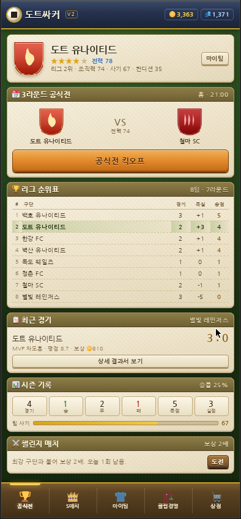
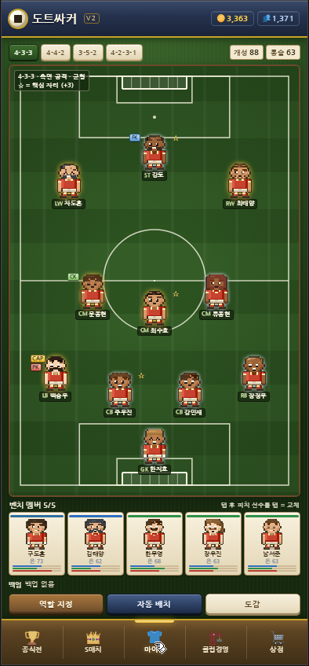
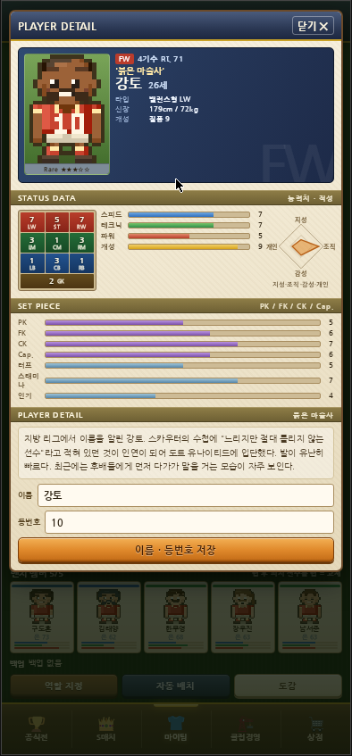
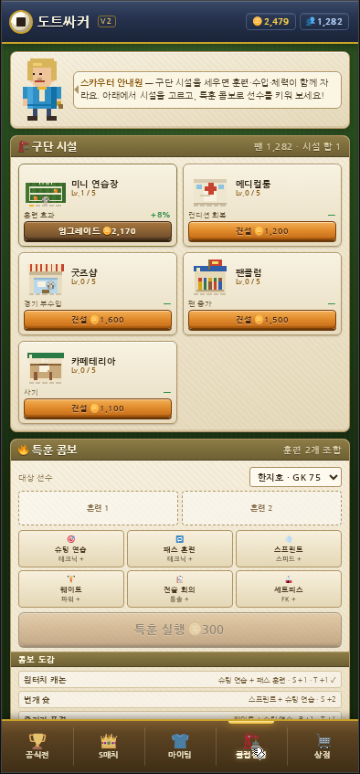
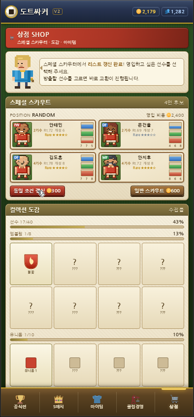
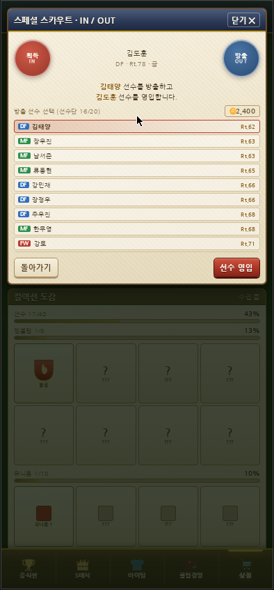
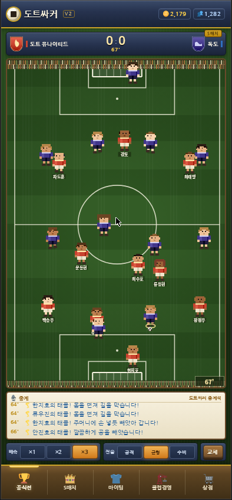
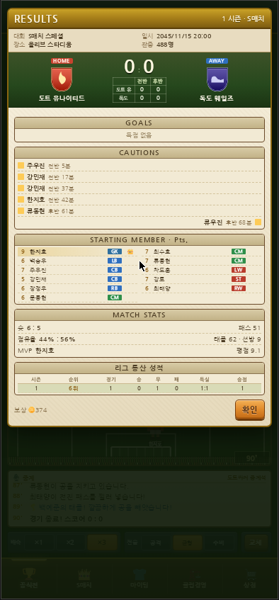

# ⚽ 도트싸커 × 포켓리그 v2

100% 한국어 UI의 **도트 축구 구단주 시뮬레이션**입니다.
원작 《도트싸커》의 전술·카드 시스템에 《포켓리그스토리》식 구단 경영·육성 루프를 얹고,
양피지 카드 · 짙은 올리브 잔디 · 2.5등신 캐리커처 도트 일러스트로 전면 리뉴얼했습니다.

- 라이브: https://hojin8811-dev.github.io/Dot-soccer/?v=2
- 모바일 **390×844** 세로 화면 우선 설계 (가로 스크롤 없음, 하단 5탭)
- 설치형 PWA (manifest + service worker) · 저장 키 `dot-soccer-v2-save`
- 100% 라이선스 클린: 실존 선수·구단·엠블럼 없이 완전 오리지널 가상 선수/구단/문양

| 공식전 | 마이팀 | 선수 상세 | 클럽경영 |
| --- | --- | --- | --- |
|  |  |  |  |

| 상점 (스페셜 스카우트) | IN / OUT | 도트 경기장 | RESULTS |
| --- | --- | --- | --- |
|  |  |  |  |

## 5개 탭

| 탭 | 내용 |
| --- | --- |
| 🏆 **공식전** | 구단 카드(전력·조직력·사기·컨디션), 8팀 리그 순위표, 라운드 VS 카드·킥오프, 최근 경기 결과서, 시즌 기록, 챌린지 매치 |
| 👑 **S매치** | 리그와 별개인 스페셜 매치 3단계(★1~★3), 이용권·연승 보너스, 실시간 경기 |
| 👕 **마이팀** | 포메이션 4종(4-3-3/4-4-2/3-5-2/4-2-3-1), ☆ 핵심 자리 보너스, 개성·통솔 총합, 스타팅 11 + 벤치 5 + 백업, CAP/FK/CK/PK 역할 지정, 선수 상세(3×4 적성 히트맵·사각 차트·이름/등번호 편집) |
| 🏗️ **클럽경영** | 구단 시설 5종(미니 연습장·메디컬룸·굿즈샵·팬클럽·카페테리아) 건설/업그레이드, 특훈 콤보(훈련 2개 조합 → S/T/P 추가 상승 + 스킬 해금), 스폰서 계약, 구단 꾸미기 |
| 🛒 **상점** | 스페셜 스카우트 4인 후보 + 동일 조건 갱신 + IN/OUT 교환, 일반 스카우트, 컬렉션 도감(선수·엠블럼·유니폼 수집률), 아이템 |

## 선수 카드 & 경기

- 선수 카드: `S(스피드)/T(테크닉)/P(파워)` 1~10 게이지 + `개성` + `기수` + `Rt.(평점)` + `Rare ★`(동/은/금/레전드)
- 선수 상세: 포지션 적성 3×4 히트맵, 지성/조직/감성/개인 사각 차트, `PK/FK/CK/Cap.`, 별명·스토리, 이름·등번호 편집
- 도트 경기장: 잔디·관중석·골대, 22명 캐리커처 도트 선수, 코믹 한국어 중계, ×1/×2/×3 배속, 전술 실시간 전환, 하프타임 일시정지 + 벤치 교체(최대 5회)
- RESULTS: 전·후반 스코어, GOALS, CAUTIONS(경고 누적 퇴장), STARTING MEMBER Pts., MATCH STATS, 리그 통산 성적

## 기술

- 순수 HTML / CSS / Vanilla JS + HTML5 Canvas 2D (프레임워크·빌드 없음)
- 픽셀 아트는 전부 코드로 생성 (외부 이미지 0개, 오프스크린 캔버스 캐시)
- `localStorage` 자동 저장 — 키 `dot-soccer-v2-save` (v1 세이브와 안전 분리)
- 서비스워커는 네트워크 우선 + `no-cache` 재검증, 등록 시 `update()`로 항상 최신 배포 반영

```
index.html
css/style.css
js/data.js    게임 데이터 · 선수 생성 · 픽셀 아트(초상화/시설/스태프/엠블럼)
js/game.js    상태/저장 · 5탭 UI · 모달 · 스카우트/특훈/시설 · 정산
js/match.js   경기 시뮬레이션 · 교체 · 경고 · 중계 · 그리기
manifest.webmanifest
sw.js
preview/v2/   검증 스크린샷 · 검증 프레임(frame.html) · 일러스트 시트(art.html)
preview/v1/   v1 기록(아카이브)
```

## 조작

1. 공식전 탭에서 `공식전 킥오프` → 도트 경기장에서 실시간 중계
2. 경기 중 `×2`/`×3` 배속, 전술 버튼, `교체`로 벤치 투입 (하프타임에는 자동으로 교체 창이 열립니다)
3. 종료 후 `RESULTS` 결과서 확인 → `확인`을 누르면 공식전 탭으로 복귀
4. 마이팀 탭에서 벤치 선수 → 피치 선수 순서로 눌러 교체, 피치 선수를 누르면 선수 상세
5. 클럽경영 탭에서 시설 건설 · 특훈 콤보 · 스폰서 계약

## 개발 메모

- 문법 검사: `esprima`(ES2017) 파싱 오류 0
- 라이브 검증: `preview/v2/README.md` (390×844, 콘솔 오류 0, 5탭 전환, 선수 상세·이름 편집, 역할 지정, 시설 건설, 특훈 콤보, 스카우트 IN/OUT, 실제 경기 3판 + 교체 + RESULTS)
