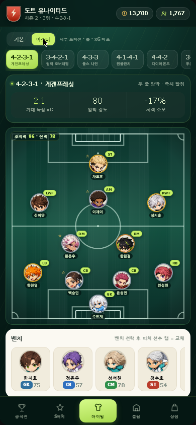
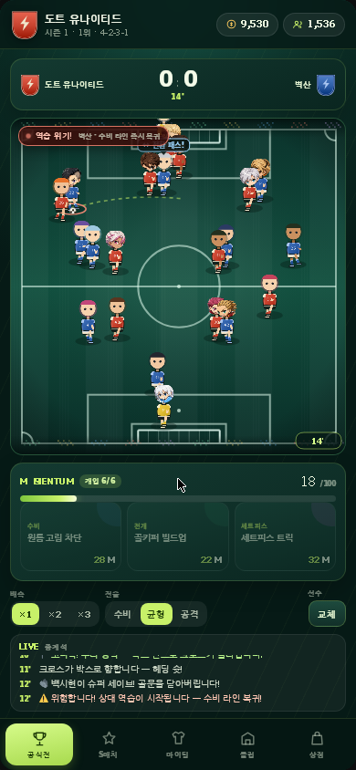
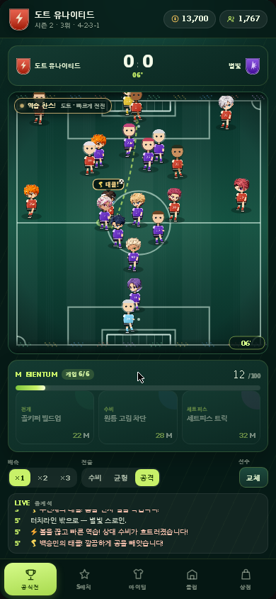
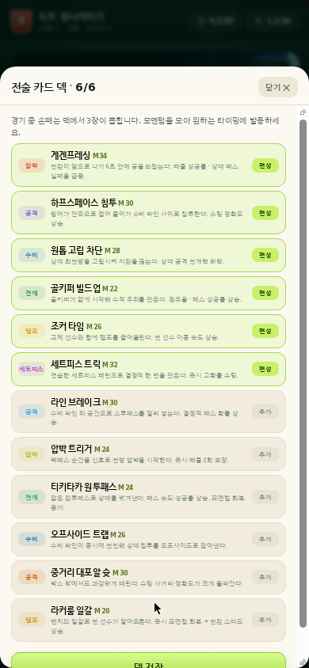
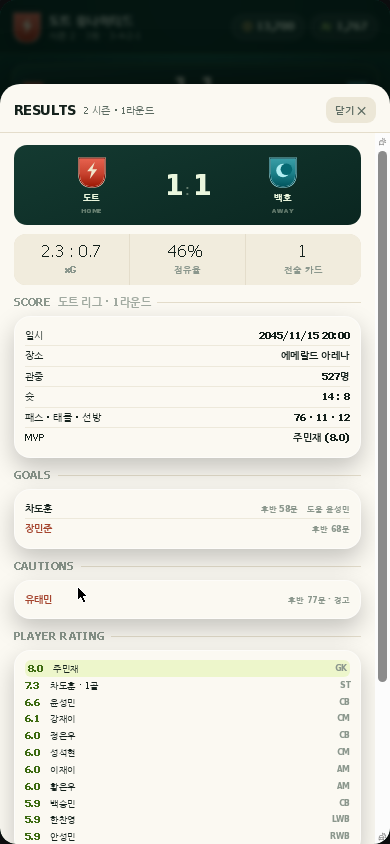
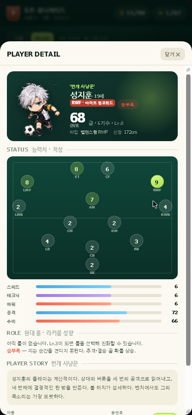
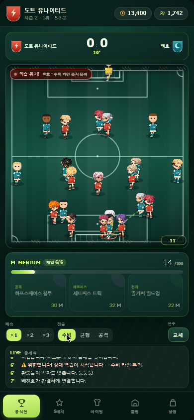
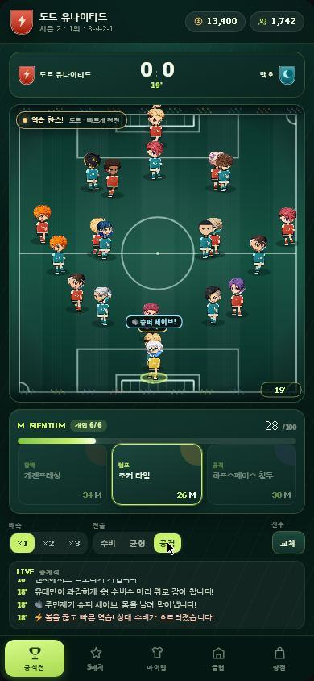
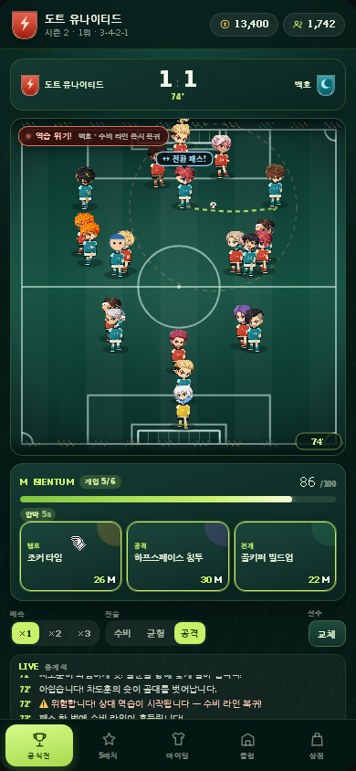

# ⚡ 도트싸커 v4 — 진짜 축구 AI · 전술이 움직이는 경기

100% 한국어 · 100% 오리지널 가상 선수로 즐기는 **현대 전술 축구 구단 RPG**입니다.
v4는 v3 실플레이 피드백("왔다 갔다만 한다", "언제 기술을 쓰는지 모르겠다", "필드 캐릭터가 조잡하다")을 반영해 **경기 엔진을 실제 축구 전개(State Machine)로 다시 짰고**, 피치 위 22명을 **일러스트 얼굴 + 벡터 유니폼 바디**의 2.5등신 SD로 통일했습니다.

- 라이브: **https://hojin8811-dev.github.io/Dot-soccer/?v=4**
- 모바일 **390×844** 세로 화면 우선 설계 (가로 스크롤 없음 · 하단 5탭)
- 설치형 PWA (manifest + service worker) · 저장 키 `dot-soccer-v3-save` 그대로 이어받음 (v3 세이브 자동 마이그레이션)
- 라이선스 클린: 실존 선수·구단·엠블럼 없이 완전 오리지널. 일러스트는 전용 제작 시트에서 슬라이스(32종) + v4에서 골키퍼 전용 4종 추가.

| 마이팀 · 마스터 | 경기 전개 | 기술 발동 |
| --- | --- | --- |
|  |  |  |

| 전술 카드 덱 12종 | 결과서 | 선수 상세 · 적성맵 |
| --- | --- | --- |
|  |  |  |

| 5-3-2 로우 블록 (수비) | 3-4-2-1 윙백 오버래핑 (공격) | 게겐프레싱 압박 반경 |
| --- | --- | --- |
|  |  |  |

## v4에서 달라진 것

### 1. 진짜 축구 AI — 구역 기반 전개 + 상황 배너
- **포메이션대로 서고, 포메이션대로 움직입니다.** 8종 포메이션의 슬롯 좌표를 그대로 앵커로 쓰고, 각 포지션의 구역(전후/좌우 한계) 안에서만 볼에 반응합니다. 22명이 공을 따라 우르르 몰리지 않습니다.
- **수비 라인 높이 = 포메이션 `line` 지표 + 전술 + 카드.** 5-3-2(라인 40)는 5명이 낮게 블록을 쌓고, 4-2-3-1(라인 78)은 하프라인 근처까지 올라섭니다. 여기에 `공격/균형/수비` 전술과 `오프사이드 트랩·게겐프레싱·원톱 고립` 카드가 라인을 더 밀거나 내립니다.
- **공격 전개 단계**: 후방 빌드업(GK→CB→DM) → 중원 전개(짧은 패스·전환) → 측면 돌파(윙어 폭, 윙백 오버래핑) 또는 하프스페이스 침투 → 박스 안 1:1 슈팅 → GK 다이빙 선방/골. 공을 잃으면 수비 라인이 즉시 복귀하고 **가장 가까운 1~2명(게겐프레싱 시 최대 4명)만** 볼에 붙습니다.
- **실시간 상황 배너**: 피치 상단에 `후방 빌드업 / 중원 전개 / 측면 돌파 중 / 슈팅 찬스! / 역습 위기! / 코너킥 / 프리킥 / 전방 압박` 이 지금 팀과 함께 표시됩니다. 감독은 이 배너를 보고 카드를 타이밍에 맞춰 씁니다.
- **세트피스**: 코너킥(박스 크로스→헤딩), 프리킥(직접 슛 또는 크로스), 오프사이드 트랩 판정까지 실제로 벌어집니다.

### 2. 기술 발동이 눈에 보인다
- **머리 위 스킬 태그 말풍선**: `⚡ 스루패스!` `🔥 중거리 슛!` `🛡️ 압박!` `🧤 슈퍼 세이브!` `🚩 오프사이드!` `👟 원투패스!` `💨 돌파!` — 겹치면 위로 쌓여 잘리지 않습니다.
- **발밑 아우라 링**, **패스 연결선(점선 화살표)**, **슈팅 불꽃 트레일 + 중거리 슛 번개 궤적**, **GK 다이빙 회전 연출**.
- **전술 카드 ↔ 피치 AI 직접 연동**: 게겐프레싱(압박 인원·반경 확대, 피치에 압박 반경 표시), 하프스페이스(AM/WF 대각선 침투), 원톱 고립(CB 밀착 마크), 라인 브레이크(뒷공간 스루패스), 티키타카(원투패스 속도·정확도), 오프사이드 트랩(라인 전진), 중거리 대포알(사거리+), 라커룸 일갈(즉시 모멘텀+).

### 3. 전술 카드 12종 · 6장 편성
`게겐프레싱 · 하프스페이스 침투 · 원톱 고립 차단 · 골키퍼 빌드업 · 조커 타임 · 세트피스 트릭 · 라인 브레이크 · 압박 트리거` + **신규** `티키타카 원투패스 · 오프사이드 트랩 · 중거리 대포알 슛 · 라커룸 일갈`.
경기 중 손패는 덱에서 3장, 개입은 전·후반 합산 6회.

### 4. 일러스트 헤드 SD 스프라이트 · 골키퍼 전용 일러스트
- 피치 위 22명 전원이 **일러스트 얼굴(assets/portraits/head) + 벡터 유니폼 바디**(반바지·스타킹·부츠·등번호)로 달립니다. 그림자, 공 소유 링, 스킬 아우라 포함.
- **골키퍼 일러스트 풀 분리**: 장갑 낀 일러스트(p06·p15·p20 + 신규 p33~p36)는 **GK 전용**, 나머지는 **필드 전용**. GK는 필드 일러스트를 절대 받지 않고, 필드 선수도 GK 일러스트를 받지 않습니다. 홈 GK는 하늘색, 원정 GK는 노란색 유니폼으로 구분.

### 5. 마이팀 UI 수정
- **선발 11 + 벤치 5 = 16명 얼굴 중복 0**: 스쿼드 생성·영입·스카우트·상대팀·v3 세이브 마이그레이션까지 모든 경로에서 고유 `pic` 배정(포지션 풀 준수).
- **포지션 뱃지 잘림 해결**: `LWF/RWF/LWB/RWB/AM/DM` 등이 토큰 원에 가려지지 않도록 `overflow: visible` + 뱃지 z-index/위치/패딩 조정. 390px에서 잘림 0건.
- **적성 피치맵 재정렬**: 13 포지션 전부(누락됐던 `RWF` 포함)를 실제 축구장 구도로 좌우 대칭 배치.
- 포메이션을 바꿔도 벤치가 비지 않도록 자동 재구성.

## 조작
- **모멘텀** — 패스·태클·슈팅·골로 게이지 충전 → 손패 3장 중 발동.
- **배속 ×1/×2/×3 · 전술(수비/균형/공격) · 교체 5회** — 경기 중 언제든, 하프타임 자동 교체창.
- **덱 편성** — 홈 화면 `덱 편성`에서 12종 중 6장 선택.

## 검증 (390×844, 실제 배포본)
- esprima 문법 검사 3파일 0 오류.
- 마이팀 마스터 모드: 선발 11명 얼굴 중복 0 · 16명 풀 위반 0 · 뱃지 잘림 0 (`LWF/RWF/AM/DM/…` 전부 표시) · RWF 등 13 포지션 적성맵 표시.
- 경기 완주: 전·후반 90분 진행, 카드 발동·재장전·`개입 6/6` 제한 정상, 상황 배너 8종 노출, 패스/슈팅 궤적·스킬 태그·GK 다이빙 확인, 콘솔 오류 0.
- 같은 상대·전술에서 포메이션별 수비 라인 실측: 4-2-3-1 공격 시 DF 평균 y≈72, 5-3-2 수비 시 y≈106 (피치 120 기준, 약 34유닛 차이).
