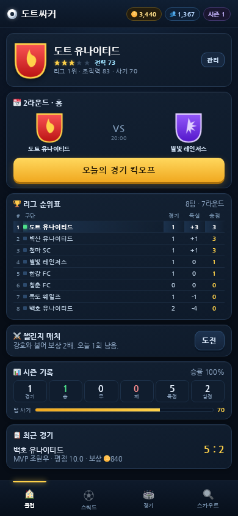
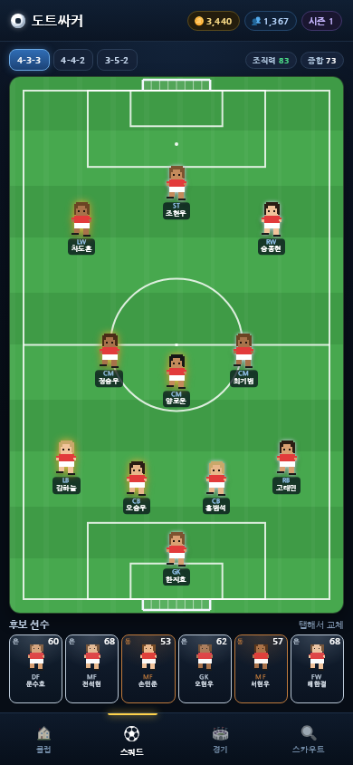
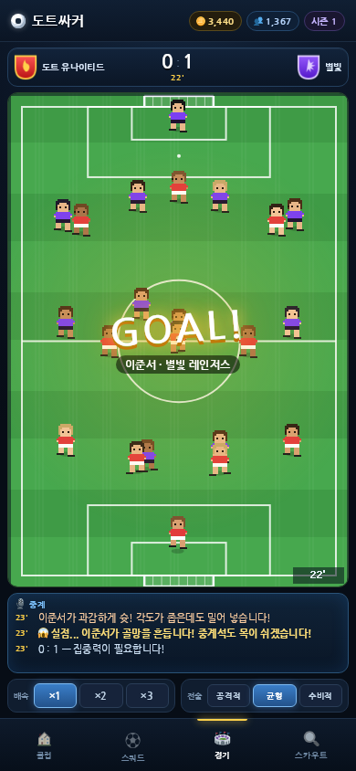

# ⚽ 도트싸커 (Dot Soccer) v1

100% 한국어 UI의 **도트 축구 구단주 시뮬레이션** 1차 프로토타입입니다.
픽셀 잔디 위에서 2.5등신 도트 선수들이 실제로 뛰고, 코믹한 한국어 중계가 흐릅니다.

- 라이브: https://hojin8811-dev.github.io/Dot-soccer/
- 모바일 **390×844** 세로 화면 우선 설계 (가로 스크롤 없음)
- 설치형 PWA (manifest + service worker)

| 클럽 홈 | 스쿼드 | 경기 + 골 연출 |
| --- | --- | --- |
|  |  |  |

## 4개 탭

| 탭 | 내용 |
| --- | --- |
| 🏠 **클럽** | 구단명·엠블럼·유니폼, 8팀 리그 순위표, 자금/팬/사기, 오늘의 경기 킥오프, 챌린지 매치 |
| ⚽ **스쿼드** | 4-3-3 / 4-4-2 / 3-5-2 포메이션, 피치 위 도트 선수, 탭-투-스왑 교체, 동·은·금·레전드 카드, 조직력·종합 전력 |
| 🏟️ **경기** | Canvas 2D 픽셀 피치 실시간 경기, 스코어보드, 코믹 중계창, ×1/×2/×3 배속, 공격적·균형·수비적 전술, 골 연출, 종료 후 MVP·평점·승점·보상 |
| 🔍 **스카우트** | 일반/스페셜 스카우트, 선수 훈련, 구단명·유니폼 색·엠블럼 커스터마이즈 |

## 기술

- 순수 HTML / CSS / Vanilla JS + HTML5 Canvas 2D (프레임워크·빌드 없음)
- 픽셀 아트는 전부 코드로 생성 (외부 이미지 파일 0개, 스프라이트는 오프스크린 캔버스 캐시)
- `localStorage` 자동 저장 — 키 `dot-soccer-v1-save`

```
index.html
css/style.css
js/data.js    게임 데이터 · 선수 생성 · 픽셀 아트
js/game.js    상태/저장 · 4탭 UI · 스카우트/훈련 · 정산
js/match.js   경기 시뮬레이션 엔진 · 중계 · 그리기
manifest.webmanifest
sw.js
preview/v1/   검증 스크린샷
```

## 조작

1. 클럽 탭에서 `오늘의 경기 킥오프` → 경기 탭에서 실시간 중계
2. 경기 중 `×2` / `×3`으로 배속, 전술 버튼으로 실시간 지시
3. 종료 후 MVP·평점 확인 → `확인`을 누르면 리그 순위표에 승점 반영
4. 스쿼드 탭에서 피치의 선수 → 후보 선수 순서로 눌러 교체

## 개발 메모

- 저장 데이터는 브라우저별로 유지됩니다. 스카우트 탭 하단 `게임 초기화`로 새 게임.
- 문법 검사: `esprima`(ES2017) 파싱 오류 0 — 검증 내역은 `preview/v1/` 참고.
- 라이브 검증: `preview/v1/` 의 390×844 스크린샷과 `preview/v1/README.md` (콘솔 오류 0, 4탭 전환, 교체·스카우트·훈련, 실제 경기 1판 결산까지)
