# ⚡ 도트싸커 v3 — 우리만의 현대 전술 축구 RPG

100% 한국어 · 100% 오리지널 가상 선수로 즐기는 **현대 전술 축구 구단 RPG**입니다.
v2의 양피지 도트 UI를 벗고, **2.5등신 고퀄 일러스트 선수 + 현대 모바일 전술 RPG UI + 실시간 모멘텀 전술 카드**로 전면 리뉴얼했습니다.

- 라이브: **https://hojin8811-dev.github.io/Dot-soccer/?v=3**
- 모바일 **390×844** 세로 화면 우선 설계 (가로 스크롤 없음 · 하단 5탭)
- 설치형 PWA (manifest + service worker) · 저장 키 `dot-soccer-v3-save`
- 라이선스 클린: 실존 선수·구단·엠블럼 없이 완전 오리지널 선수/구단/문양. 일러스트는 전용 제작 시트에서 슬라이스.

| 공식전 (홈) | 마이팀 · 기본 모드 | 마이팀 · 마스터 모드 | 선수 상세 |
| --- | --- | --- | --- |
| 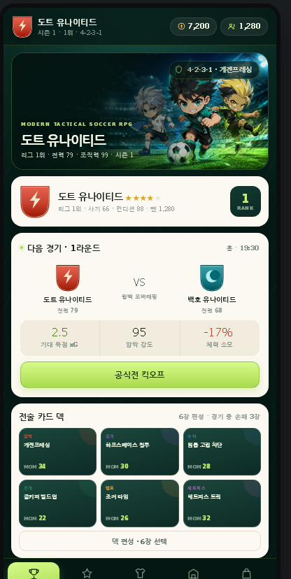 | 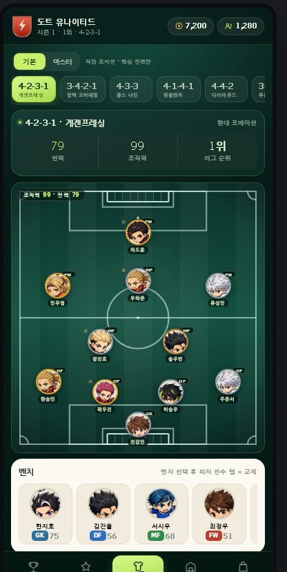 | 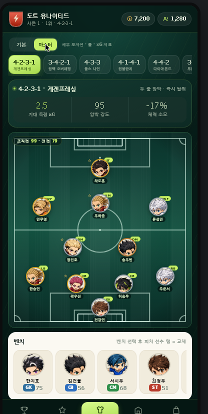 | 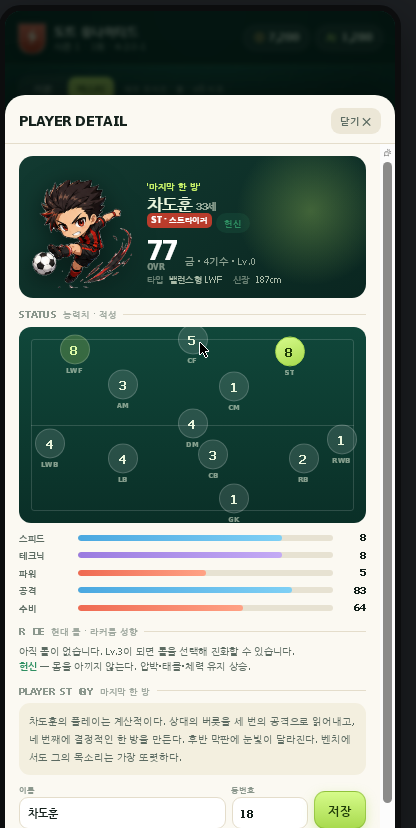 |

| 전술 카드 덱 편성 | 클럽 하우스 | 스페셜 스카우트 | S매치 |
| --- | --- | --- | --- |
| 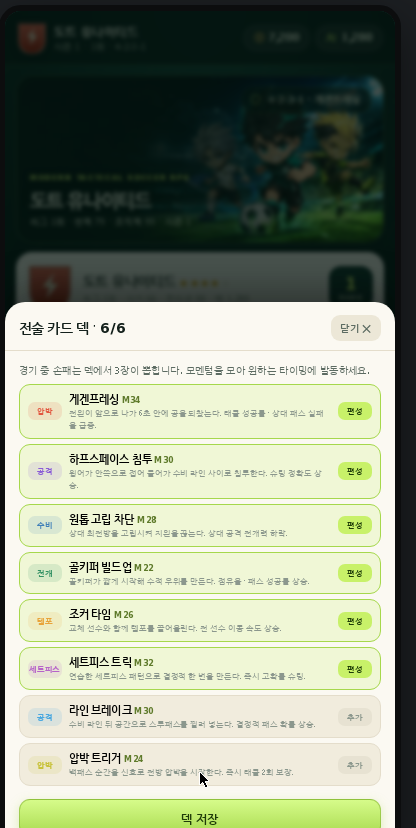 | 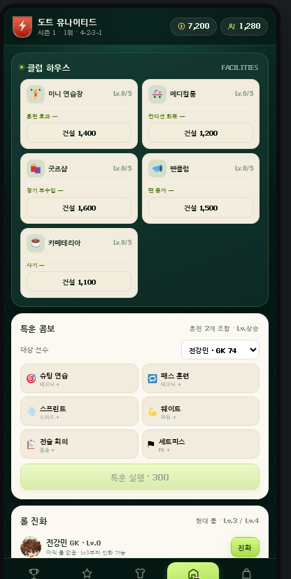 | 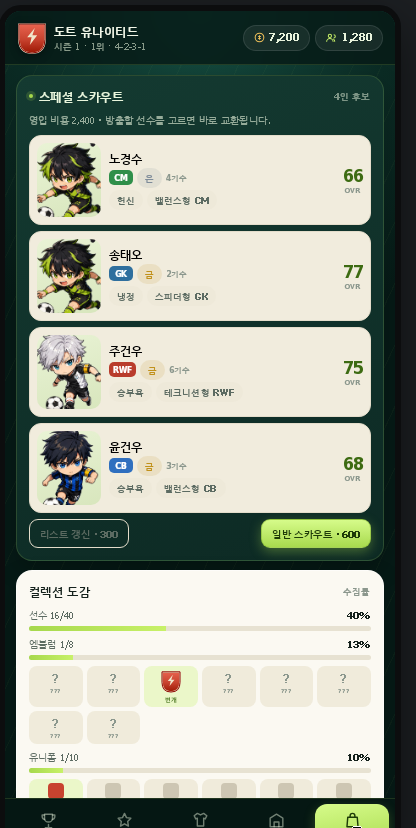 | 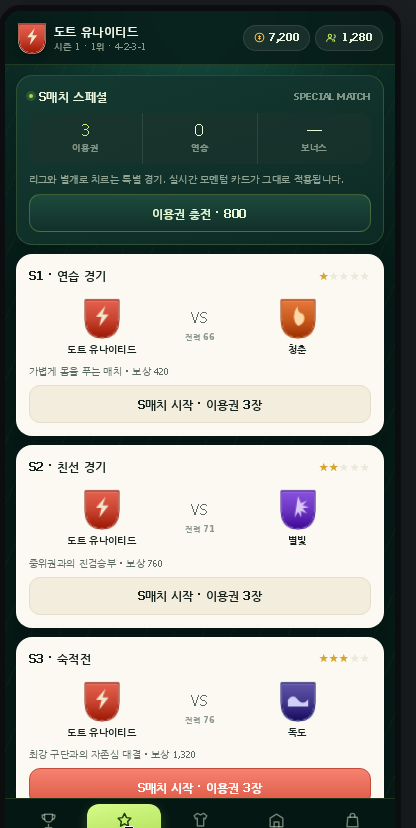 |

| 실시간 경기 | 모멘텀 카드 컷인 | RESULTS |
| --- | --- | --- |
| 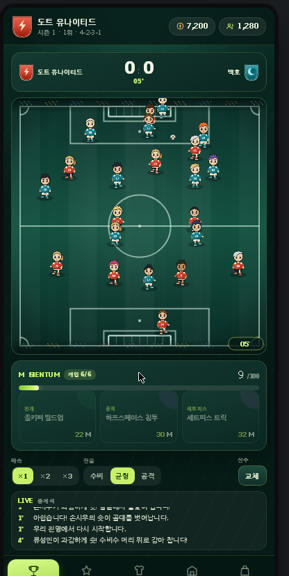 | 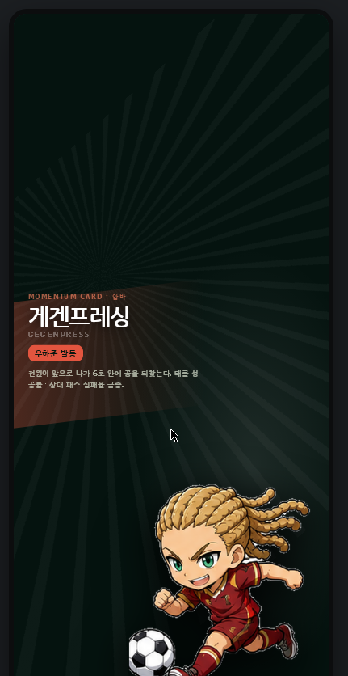 | 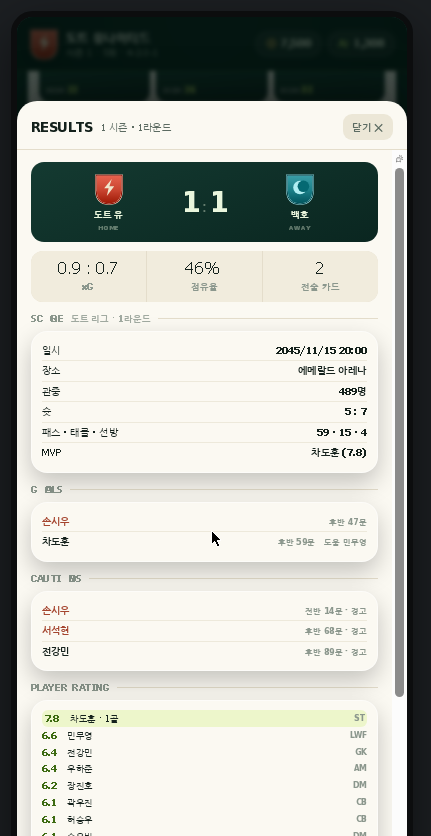 |

## v3에서 달라진 것

1. **2.5등신 일러스트 에셋 32종** — 4×4 시트 2장을 배경 제거·개별 크롭해 `assets/portraits/`(전신 400px)와 `assets/portraits/head/`(얼굴 240px)로 슬라이스. 전술판 토큰, 선수 카드, 선수 상세, 골/전술카드 컷인, 스카우트 목록까지 모두 실제 일러스트로 표시.
2. **피치 위 SD 스프라이트** — 22명 전원이 각자 일러스트의 헤어 스타일·헤어 컬러·피부 톤 + 구단 유니폼 색 + 등번호를 매칭한 2.5등신 SD 스프라이트로 달리기 4프레임 애니메이션.
3. **현대 모바일 전술 RPG UI** — 크림/라이트 카드 + 짙은 에메랄드 피치 + 선명한 상태 칩/뱃지, 다크 상단 바, 5탭 하단 내비게이션.
4. **현대 포지션 13종** — `GK, CB, LB, RB, LWB, RWB, DM, CM, AM, LWF, RWF, CF, ST` (주 포지션 + 멀티 포지션 적성 1~9 히트맵).
5. **현대 포메이션 8종** — `4-2-3-1(게겐프레싱)`, `3-4-2-1(윙백 오버래핑)`, `4-3-3(폴스 나인)`, `4-1-4-1(원볼란치)`, `4-4-2(다이아몬드)`, `3-5-2(투톱 압박)`, `5-3-2(카운터)`, `4-2-2-2(하프스페이스)`.
6. **실시간 모멘텀 전술 카드** — 경기 중 패스·태클·슈팅으로 모멘텀 충전 → 하단 손패 3장 중 원하는 타이밍에 발동 → **에이스 일러스트 컷인** + 피치 AI·득점 확률 즉시 변화.
7. **전술 카드 덱 6장 편성** — 8종 중 6장을 골라 덱 구성(경기 전 홈에서 편성). 경기 중 손패는 덱에서 3장이 뽑히고, 사용하면 재장전 후 다음 카드가 들어옵니다.
8. **경기당 개입 6회 제한** — 전·후반 합산 최대 6회(`개입 6/6` 표시). 다 쓰면 `이번 경기 개입 완료`로 잠깁니다. (조작 피로도 방지)
9. **롤(Role) 진화** — 포처 / 폴스 나인 / 타겟맨 / 인버티드 윙어 / 박스 투 박스 / 레지스타 / 메짤라 / 볼플레잉 수비수 / 인버티드 풀백 / 공격형 윙백 / 스위퍼 키퍼.
10. **라커룸 성향 시너지** — 승부욕 / 창의 / 헌신 / 냉정. 선발에 같은 성향 3명 이상이면 발동(5명이면 2단계).
11. **기본 / 마스터 UX 2트랙** — 전술판 상단 토글. `기본`은 FW/MF/DF/GK 직관 라벨 + 전력·조직력·순위, `마스터`는 세분화 포지션·롤·xG·압박 강도·체력 소모까지.
12. **결과서 v3** — xG·점유율·전술 카드 사용 수, 전·후반 스코어, GOALS/CAUTIONS, 선수 평점, 리그 통산 성적.

## 5개 탭

| 탭 | 내용 |
| --- | --- |
| 🏆 **공식전** | 히어로 배너, 구단 카드(전력·조직력·순위), 다음 경기 VS + **xG·압박·체력 소모 예측**, 전술 카드 덱, 리그 순위표, 최근 경기, 시즌 기록, 챌린지 매치 |
| ⭐ **S매치** | 스페셜 매치 3단계(★1~★3), 이용권·연승 보너스, 실시간 모멘텀 카드 적용 |
| 👕 **마이팀** | 포메이션 8종 · 기본/마스터 토글 · 전술판(일러스트 토큰) · 벤치 5 · 라커룸 성향 시너지 · CAP/FK/CK/PK 역할 · 롤 진화 |
| 🏟 **클럽** | 시설 5종 건설/강화, 특훈 콤보(2개 조합), 롤 진화, 스폰서 계약, 구단명·유니폼·엠블럼 꾸미기 |
| 🛍 **상점** | 스페셜 스카우트 4인(일러스트 카드) · IN/OUT 교환 · 일반 스카우트 · 도감(선수/엠블럼/유니폼) · 아이템 |

## 경기 조작

1. 공식전 → `공식전 킥오프`
2. 경기 중: **×1/×2/×3 배속**, **수비/균형/공격** 전술, **교체**(하프타임 자동 오픈, 최대 5회)
3. 하단 **모멘텀 게이지**가 차면 손패 3장이 활성화 → 탭해서 발동(경기당 6회)
4. 종료 후 **RESULTS** → `확인`을 누르면 공식전 탭으로 복귀

## 기술

- 순수 HTML / CSS / Vanilla JS + Canvas 2D (프레임워크·빌드 없음)
- 일러스트는 PNG 에셋, 경기 스프라이트·엠블럼·피치·UI 게이지는 코드로 생성
- `localStorage` 자동 저장 — `dot-soccer-v3-save` (v2 세이브와 분리)
- 서비스워커 네트워크 우선 + `no-cache` 재검증, 등록 시 `update()`
- 에셋 버전 `?v=3` (index.html · manifest · sw.js · css/js) + 빌드 토큰 `&b=` (캐시 무효화)

```
index.html
css/style.css
js/data.js    포지션 13 · 포메이션 8 · 롤 · 라커룸 성향 · 전술 카드 · 선수 생성 · 아트(엠블럼/피치/SD 스프라이트)
js/game.js    상태/저장 · 5탭 UI · 모달 · 스카우트/특훈/롤 진화 · 결과서 · 기본/마스터 모드
js/match.js   실시간 경기 엔진 · 모멘텀/전술 카드 · 컷인 · 교체 · 중계
assets/portraits/       전신 400px 32종 (+ head/ 얼굴 240px 32종)
assets/hero-banner.jpg  홈 히어로 키 비주얼
preview/v3/             390×844 검증 스크린샷 · verify-390.html(검증 하네스)
preview/v2/, preview/v1/  이전 버전 아카이브
```
