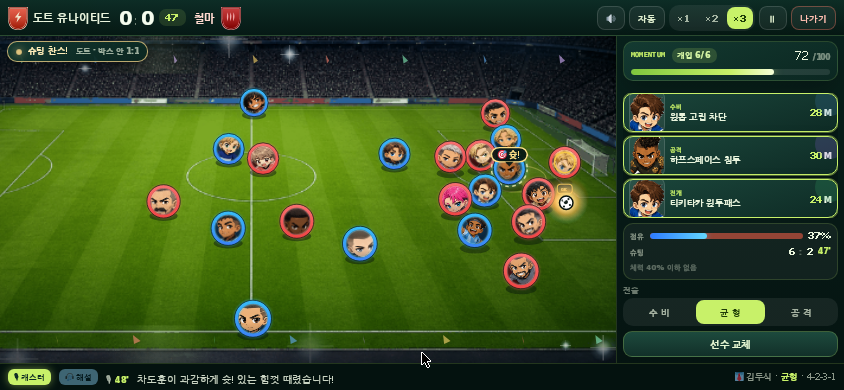
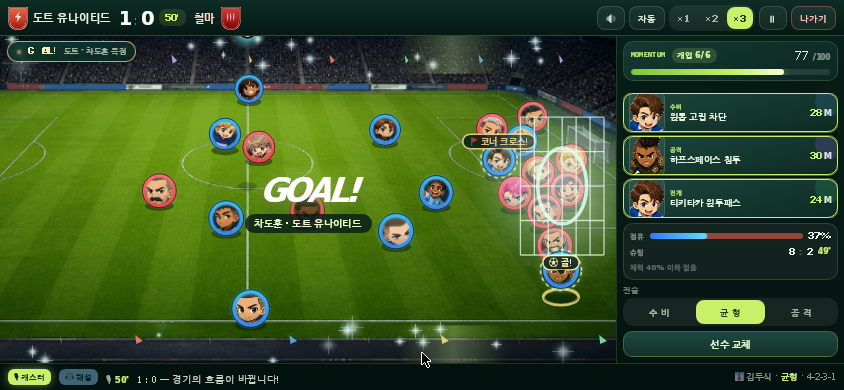
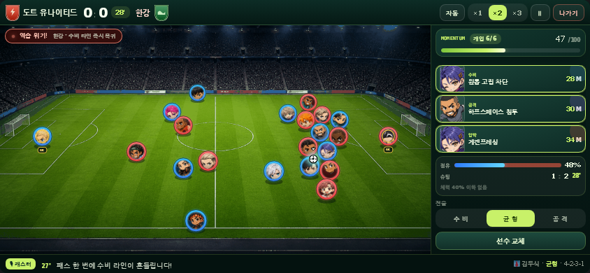
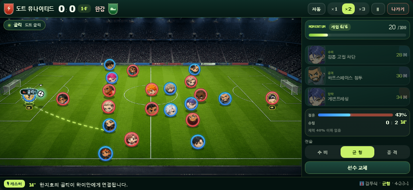
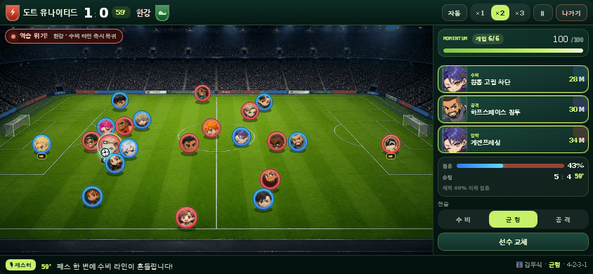
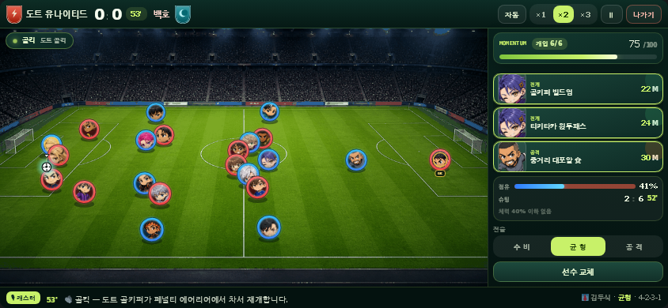
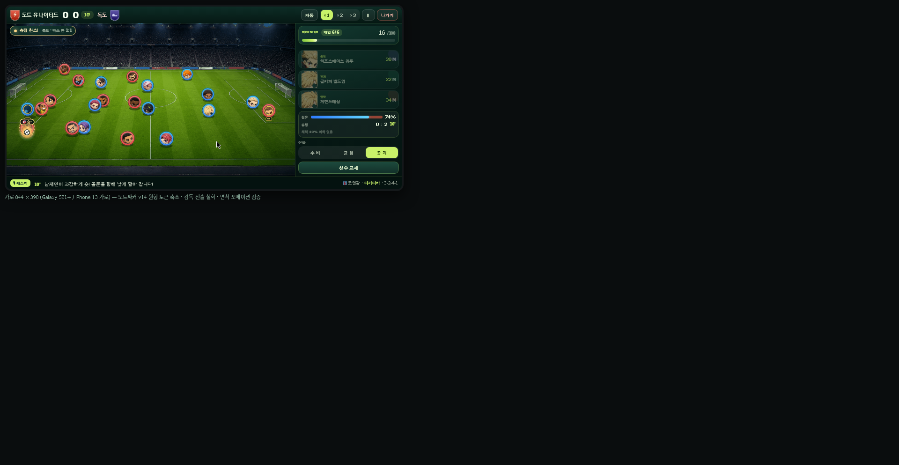
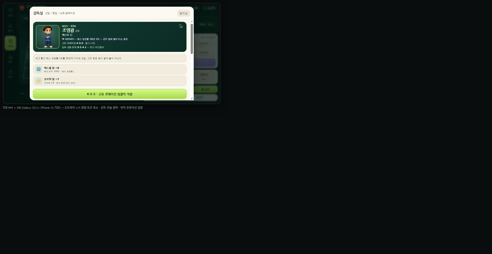
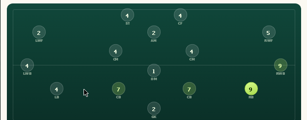
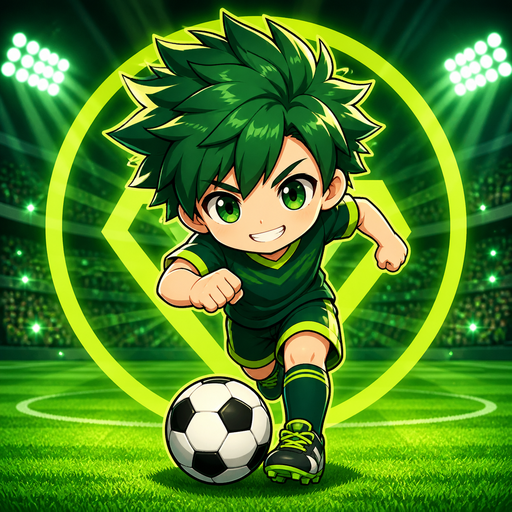

# ⚽ 도트싸커 v17 — TV 생중계 관람 업그레이드 (방송 카메라 · 골 세리모니·리플레이 · 경기장 사운드 · 2인 중계)

100% 한국어 · 100% 오리지널 가상 선수·감독으로 즐기는 **현대 전술 축구 구탄 RPG**입니다.
v17은 호진님의 **"정밸 축구 경기를 관람하는 듯한 TV 생중계 느낌"** 요창을 그대로 구현했습니다. 공을 따라 부드럽게 패닝하고 찬스마다 골문으로 1.2배 줌인하는 **방송 카메라**, 골 직후 골망이 출렁이고 득점자가 코너로 달려가는 **세리모니 + 0.5배속 3초 `📺 REPLAY`**, 외부 mp3 없이 Web Audio로 합성한 **관중 웅성거림·휘슬·공 차기·함성**과 `🔊/🔇` 토글, 그리고 슈팅 찬스에 카메라 플래시가 터지는 **관중석**과 **캐스터·해설위원 2인 티키타카**까지 — 피치 위에서 벌어지는 일이 "중계되는 경기"처럼 읽힙니다.

- 라이브: **https://hojin8811-dev.github.io/Dot-soccer/?v=17**
- **844×390 가로 뷰포트** 기준 설계 (경기·마이팀 화면은 스크롤 없이 한 화면, 나머지 탭은 가로 다단 대시보드)
- 세로로 열면 **가로 회전 안내**가 뜨고, `manifest.orientation = landscape`
- 설치형 PWA · 저장 키 `dot-soccer-v3-save` 그대로 (v3~v9 세이브 자동 이어받기)
- 라이선스 클린: 실존 선수·구단·감독·엠블럼 없이 완전 오리지널 (선수 330명 + 감독 32명)

| 방송 카메라 — 평소엔 공을 따라 살짝 패닝 | 찬스 줌인 — 골문으로 1.18배 · 관중 깃발·플래시 | 골 — 골망 출렁임 + 코너 세리모니 |
| --- | --- | --- |
|  |  |  |

| 0.5배속 `📺 REPLAY` — 득점자·도움·xG 자막 + 건너뛰기 | 2인 중계 — 🎙 캐스터 / 🎧 해설 + 🔊 음소거 토글 |
| --- | --- |
|  |  |

## v17 패치 — TV 생중계 관람 업그레이드

호진님이 v16 화면을 보며 **"넣자"** 고 고른 넷을 한 번에 구현한 관람 패치입니다. 경기 엔진(AI·규칙·판정)은 v16 그대로 두고, **보는 경험만** 바꿨습니다.

### 1. 동적 중계 카메라 (`js/match.js updateCamera()`)
- 공의 화면 좌표를 초점으로 삼아 `1.035`배 기본 프레임에서 부드럽게 따라가는 **패닝**을 깔았습니다(초점 보간 지수 3.6/s).
- **찬스 줌인**: 박스 진입 `final` 단계 **1.17배**, 측면 돌파 1.085배, 역습 1.10배, 슈팅 순간 **1.20배**(슛 목표 지점 가중 60%), 코너·PK **1.22배**, 프리킥 1.14배, 골 세리모니 **1.24배**.
- 초점은 항상 `W/(2z) … W−W/(2z)` 로 클램프해서 **844×390 프레임 밖으로 골대·공이 잘리지 않습니다**. 줌은 `ctx.scale` 하나로 피치·선수·공·이팩트에 동시에 걸리고, 카메라 흔들림도 같은 변환에 합쳐 카메라 전체가 울립니다.

### 2. 골 세리모니 · Net Ripple · 3초 리플레이
- **Net Ripple**: 골 순간 골문 위치에 그물 격자와 충격 링을 1.15초 그립니다. 그물이 공에 밀려 들어갔다 돌아오는 모양입니다(`drawNetRipple()`).
- **세리모니 1.8초**: 득점자가 가장 가까운 코너로 달려가고 동료 3명이 반경 4~5단위로 따라붙어 뛰었습니다(`applyCelebration()`).
- **리플레이**: 20fps(0.05초)로 최근 **3.6초 / 73프레임**의 선수 좌표·포즈·카메라를 링 버퍼에 담고, 골 순간 직전 **1.6초(33프레임)를 3.0초 동안 0.5배속**으로 되감습니다. 화면 캡처가 아니라 **좌표를 다시 그리는 방식**이라 844×390에서도 선명하고 메모리를 거의 쓰지 않습니다.
- 자막은 `⚽ 득점자 n' · 도움 어시스트 · xG 0.74`, 배지는 `📺 REPLAY` + `0.5×`, 하단 진행바와 **[건너뛰기 ›]** 버튼.
- 배속×무관하게 리플레이는 실제 시간 3초로 흘러가고, **×2/×3에서도 건너뛰기가 즉시 먹히며** 끝나는 순간 카메라·포지션·경기 시계가 깔끔하게 복귀합니다(90분 완주 3경기에서 시계·포지션 오차 0).

### 3. Web Audio 경기장 사운드 + 🔊/🔇 토글
- 외부 음원 없이 **노이즈 버퍼 + 바이쿠아드 필터 + 엔벨로프**로 합성했습니다. 단순 사인 삑삑이가 아니라 대역을 건 잡음을 얹어 자연스럽게 만들었습니다.
- **관중 웅성거림**: 갈색잡음 2초 루프 → 520Hz 로우패스 + 0.09Hz LFO로 숨쉬는 앰비언스(별도 2.4kHz 하이패스 레이어 추가).
- **주심 휘슬**: 2,080Hz 사인 + 2,860Hz 트라이앵글 + 27Hz 비브라토 + 노이즈 퍼프. 킥오프·파울·오프사이드·PK·하프타임·경기 종료.
- **공 차기**: 118→58Hz 몸통음 + 1,150~2,100Hz 밴드패스 노이즈(패스 0.22 / 태클 0.34 / 슛 1.0으로 강도 구분).
- **골포스트·크로스바 팅**: 1,046·1,568·2,093Hz 3중 감쇠.
- **함성·탄식**: 슈팅 순간 함성이 올라오고(밴드패스 380→1,800Hz 스윕), 골에는 2.6초 폭발, 빗나감·선방에는 내려가는 탄식.
- 모바일 정책 대응: `AudioContext`는 **킥오프 클릭(사용자 제스처)** 에서 열고 `resume()`하며, 상단 바 `🔊/🔇` 토글은 `localStorage('dot-soccer-mute')`에 저장됩니다.

### 4. 살아있는 관중석 · 캐스터/해설 2인 중계
- 찬스·골에서 관중 에너지가 올라가면 **카메라 플래시**(스프라이트 1장을 재사용해 44개까지), **응원 깃발 16개**가 좌우로 흔들리고, 에너지 0.42 이상에서는 **사람 파도**가 관중석을 가로지릅니다.
- 하단 티커를 `🎙 캐스터` + `🎧 해설` 2인으로 나우고, 말하는 쪽 라벨만 밝아집니다. 해설은 캐스터 라인 **0.95초 뒤**에 들어가 티키타카가 됩니다 — 슈팅·선방·골·코너·오프사이드·퇴장·하프타임마다 전술 코멘트가 붙고, 잠잠한 시간에도 11종 전술 읽기를 섞습니다.
- 부수 수정: 새 경기를 시작하면 이전 경기의 배속(×2/×3)이 남던 버그를 고쳐 **항상 ×1로 시작**합니다.

### 검증 (844×390 가로 뷰포트 · 실플레이 3경기)
| 항목 | 실측 |
| --- | --- |
| JS 콘솔 오류 | **0건** (3경기 완주, `window.__DS_ERRS` 빈 배열) |
| 카메라 줌 범위 | 기본 **1.035** → 찬스 **1.179** → 슈팅 1.20 → 코너/PK **1.22** → 세리모니 **1.24** |
| 리플레이 링 버퍼 | **73프레임** 상주(3.6초) · 재생 **33프레임 / 3.0초 / 0.5×** |
| 골 세리모니 | 득점자 1명 + 동료 **3명** · 1.8초 · Net Ripple 1.15초 |
| 관중석 피크 | 에너지 **1.00** · 플래시 동시 **31~34개** |
| 가로·세로 오버플로 | **0px** (`scrollWidth 844 / clientWidth 844`, `scrollHeight 390 / clientHeight 390`) |
| 리플레이 스킵 후 상태 | 시계 53' 그대로 · 포지션 킥오프 리셋 · 카메라 1.035 복귀 · 오버레이 DOM 제거 |

## v16 패치 — 피치 위 22명 '겹침 0' · 박스 슬롯 분산 · 수비 복귀 정상화

호진님이 v15 실플레이 화면을 보내며 **"골키퍼랑.. 공격수3명이 달라붙어있네ㅡㅡ 상대편도 이게 너가 말한 움직임 축구야?"** 라고 지적한 장면을 근본부터 고친 패치입니다. 원인은 세 가지였습니다.

1. **분리 로직이 애초에 겹침을 허용**했다 — v8~v15의 최소 간격은 화면에서 `토큰 지름 × 0.70`, **공을 가진 선수 쌍은 × 0.26**이었습니다. 지름보다 가까이 붙는 게 정상값이었던 셈입니다.
2. **공격수 전원이 같은 좌표를 향했다** — 파이널 서드에서 최전방이 모두 `골문 - 13` 한 점을 노려 GK·수비와 한 덩어리가 됐습니다.
3. **공을 잃어도 수비 라인이 볼 뒤로 돌아오지 않았다** — 역습을 맞으면 DF가 볼보다 골문 쪽에 서 있어야 하는데 목표 자체가 없었습니다.

| 전 프레임 Hard Separation — 9명 경합도 겹침 0 | 4배 확대 — 원이 닿기만 하고 겹치지 않는다 |
| --- | --- |
|  |  |

| 킥오프 전체 대형 | 골킥 빌드업 | 역습 전환 — 수비 라인 복귀 |
| --- | --- | --- |
|  |  |  |

### 1. 전 프레임 Hard Separation — 겹침 0 (`js/match.js separate()`)
- 모든 필드 플레이어·GK 쌍(공 소유자 포함)에 **최소 중심 거리 = 토큰 지름 × 1.18**을 매 틱 끝에서 **4회 relaxation**으로 강제합니다. 화면 픽셀 기준으로 재고, 원근 투영(`sepRates`)으로 피치 좌표계 `dx·dy`에 되돌려 밀어냅니다.
- 포메이션 기본 좌표가 미러링으로 겹치는 경우(예: 4-2-3-1 AM ↔ 4-4-2 DM이 같은 지점)는 킥오프 전에 `relaxBases()`가 기본 좌표 자체를 한 번 떼어 놓습니다.
- 코너킥·PK·스로인처럼 여러 명이 한 곳에 서는 세트피스는 **3×3 격자**(가로 15단위·깊이 6단위)에 앉혀 처음부터 겹치지 않게 배치하고, 키커가 공 위치로 순간이동하는 순간에도 분리를 한 번 더 돌립니다.

### 2. 박스 타겟 슬롯 · GK 보호 · 오프사이드 라인
- 박스에 들어가는 무명 공격수는 **니어 포스트 / 페널티 스팟 / 파 포스트 / 아크 정면** 네 자리로 고정 배정(기본 위치 순, 프레임마다 자리가 바뀌지 않음)됩니다. 공을 몬 1명만 자유롭게 슈팅 각을 잡습니다.
- **GK 보호 반경**: 공을 몬 선수 외에는 상대 GK 중심 **1.6 지름** 안에 들어가지 못합니다(목표 좌표 + 실제 위치 양쪽에서 강제). 6야드 박스 안으로 빨려 들어가는 것도 막습니다.
- **오프사이드 라인 준수**: 위치 기준선을 '상대 최후방 2번째 선수(GK 포함)'로 잡아, 오프볼 공격수는 라인에서 1.8단위 안쪽에 머뭅니다. 라인을 넘는 것은 침투 러닝이 걸린 순간뿐입니다.
- `뒷공간!`·`침투!` 말풍선은 **문구당 한 번에 1명**만 뜨고, 그려질 때 겹치면 위로 쌓입니다.

### 3. 공수 전환 · 수비 복귀
- 볼 소유가 바뀌면 그 팀 **CB·DM·FB의 목표가 '볼보다 자기 골문 쪽 3.2단위'**로 강제되고(골라인 4.5단위 앞까지), 복귀 중에는 **1.26배 속도**로 달려옵니다. 복귀 유예도 1.4초 → 2.1초로 늘렸습니다.
- 태클 판정은 월드 거리 5.2에서 **화면 거리 1.30 지름**으로 바꿨습니다(겹치지 않는 새 간격에서도 어깨를 댈 수 있게). 성공 확률 계수를 낮춰 경기당 태클 8~14회로 v15(11회)와 비슷하게 유지했습니다.

### 검증 (844×390 라이브 · `?v=16&b=48`)
| 항목 | 실측 |
| --- | --- |
| 90분 전 프레임 토큰 겹침 | **0쌍 / 2,422,497쌍 (0.0000%)** · 최악 중심거리 1.08 지름 (10,487프레임) |
| 라이브 브라우저 84분 | **0쌍 / 1,772,925쌍** · 최악 1.089 지름 (7,675프레임) |
| 상대 GK 반경(1.5 지름) 내 공격수 2명+ | **0프레임** (오픈 플레이·코너 포함, 동시 최대 1명) |
| 6야드 박스 안 비소유 공격수 | **0프레임** |
| PK·코너 등 세트피스 격자 | 2명+ GK 밀집 0프레임 |
| 볼을 잃은 뒤 DF/DM 4명이 볼 뒤로 복귀 | 중간 **0.0초** · 최대 2.8초 (34회 전환) |
| 경기 밸런스 | 슈팅 7~11 · 태클 7~14 · 4경기 0-0~3-1 |

## v15 패치 — 진짜 축구 규칙(오프사이드 · 세트피스 · 추가시간) + 대진표 수정 + 스카우트 확률

호진님이 v14를 보고 **"업사이드도 안들어가 있는데 이게 축구인가..ㅜㅜ"**, **"진짜 축구 규칙을 따르고 전술 변화. 그에따른 각기다른 움직임"**, **"경기가 너무 빨리 끝나 지켜보는 맛도 있어야지"** 라고 한 지시를 한 번에 반영한 패치입니다. 앞서 킵해 둔 **대진표 중복 매칭 버그 수정**과 **스카우트 확률 피라미드 개편안**도 함께 들어갔습니다.

| 🚩 오프사이드 — 부심 깃발·점선 라인·간접 프리킥 | 🧤 골킥 — GK + CB 벌리기 | 스카우트 확률 공개 + 천장 N/30 |
| --- | --- | --- |
|  |  |  |

| 리그 순위 — 1라운드 후 8팀 전원 1경기 | 90+ 추가시간 · 오프사이드 | 결과서 (카드·퇴장 반영) |
| --- | --- | --- |
|  |  |  |

### 1. 진짜 축구 규칙 (`js/match.js`)
- **오프사이드**: 패스 출발 순간 공격수가 ①상대 진영 ②공보다 앞 ③상대 골키퍼를 뺀 최후방 수비수보다 앞서면 판정. **부심 깃발 + 점선 라인 2.8초 표시**, 그 선수가 공에 관여하는 순간 휘슬 → **상대 간접 프리킥**으로 그 자리에서 재개. 스로인·골킥·코너킥 재개 패스는 면제.
- **세트피스 실제 위치 정렬**: 스로인(터치라인 밖 투척 · 주변 동료 접근) · 골킥(GK가 페널티 에어리어, CB 양옆 벌리기, 상대 최전방 압박 준비) · 코너킥(코너 플래그 키커 + 양 팀 박스 헤더 대형, 수비는 골대 쪽에 정렬) · 직접 프리킥(3인 수비벽 + 키커) · 간접 프리킥(연결) · **페널티킥(키커 vs 골키퍼 1:1, xG 0.74)**. 대기 1.1~2.9초 동안 대형이 눈에 보입니다.
- **카드·퇴장**: 다이렉트 레드(박스 안 10%·위험 지역 7%·일반 3%)와 경고 누적. 퇴장 선수는 실제로 피치에서 빠져 **10명 대 11명**으로 경기가 이어지고, GK 퇴장 시 야수가 장갑을 낍니다.
- **추가시간**: 세트피스·골·카드로 쌓인 지연 시간으로 전반 `45+1'~3'`, 후반 `90+2'~4'`를 산정해 **경기 시계에 표시하고 실제로 그만큼 더 진행**합니다.

### 2. 공 없는 움직임 · 전술 체감
- 빌드업: **CB 좌우 벌리기 · DM 내려와 삼각 각 · 윙백 전진**.
- 측면 돌파: 볼 쪽 **윙백 오버래핑**(터치라인까지), 반대편 윙어는 **박스 먼 쪽으로 침투**해 컷백·세컨볼 대기.
- 스트라이커: **오프사이드 라인을 타며 좌우로 흔들다가** 뒷공간 대각선 침투(가끔 오프사이드, 성공하면 1:1).
- 수비는 라인을 넘어서지 않고(라인 존중), AI는 이미 오프사이드인 동료에게 패스를 넣지 않습니다(타이밍).
- 전술 버튼(수비/균형/공격)·감독 전술 변경 시 라인·폭·압박이 즉시 달라집니다.

### 3. 경기 호흡 (×1 배속)
- `MATCH_SECONDS` **96 → 168** — ×1 배속 한 경기 **약 189초(3분 9초)**, ×2/×3은 그대로 빠르게.
- 패스 `d*2.9(40~90) → d*2.15(30~66)`, 슛은 거리 기반 비행시간(0.34~0.95초), 액션 간격 0.34~0.60초, 스태미나 소모는 경기 길이에 맞춰 보정.

### 4. 리그 대진표 라운드 로빈 버그 수정 (`js/game.js`)
- 원인: 회전 배열(7개)에서 `arr[j] vs arr[n-2-j]` 페어링이 한 팀을 매 라운드 누락 → 그 팀 대신 플레이어가 늘 홈, 특정 팀 2경기.
- **표준 Circle Method**로 교체 — 8팀 **7라운드 × 4경기 = 28경기**, 매 라운드 전 팀 정확히 1경기, 중복 페어 0, **홈/원정 3~4회 균형**(도트 3홈/4원정).
- **기존 세이브 마이그레이션**: `fixturesValid()` 검사로 깨진 대진표를 감지해 자동 재생성(라운드·순위표 보존, 로그 기록). 결과서의 HOME/AWAY 라벨도 원정 경기에 맞게 표시.

### 5. 스카우트 확률 피라미드 + 30회 천장 (`js/data.js`, `js/game.js`)
- **일반(600)**: 🥉동 75% · 🥈은 22% · 🥇금 3% · 👑레전드 0%
- **스페셜(2,200)**: 🥈은 79% · 🥇금 20% · 👑레전드 1%
- **천장**: 스페셜 영입 1회당 +1 → **30 도달 시 다음 후보 1장이 레전드 100% 확정**(👑 천장 확정 칩), 영입 후 0으로 리셋. 4만 회 시뮬레이션 검증(일반 75.3/21.8/3.0/0, 스페셜 78.9/20.1/1.0).
- **확률·천장 UI 공개**: 스페셜 카드 헤더에 `천장 N/30`, 버튼 아래에 일반/스페셜 등급별 실제 확률과 천장 룰 문구를 항상 표시합니다(구글 플레이 심사 대응).

### 6. 헤드리스 계측 (6경기 평균 · 4-2-3-1 vs 4-4-2)
| 항목 | 값 |
| --- | --- |
| 득점 | 2.3 (홈 1.3 / 원정 1.0) |
| 슈팅 | 9.0 / 7.7 · xG 1.4 / 0.8 |
| 패스 / 태클 / 선방 | 116 / 13 / 8 |
| 오프사이드 | 5.0 (양 팀 합) |
| 스로인 / 골킥 / 코너 / 프리킥 / PK | 2.8 / 12.3 / 2.0 / 0.8 / 0.7 |
| 퇴장 | 0.2 |
| 경기 시간 (×1) | 189초 · 추가시간 45+1~3 / 90+2~4 |

## v14 패치 — 원형 토큰 한 단계 더 축소 · 감독 전략전술 + 변칙 포메이션

호진님이 v13을 보고 **"원을 조금만 더 줄이고 감독에 따른 전략전술 그리고 감독마다 똑같은 포메이션보다 변칙 포메이션도 또 그에따른 움직임이 달라지면 좋을거 같아"** 라고 지시한 패치입니다.

### 1. 피치 원형 토큰 추가 축소 (`js/match.js`)
- 토큰 반지름 비율 `TOKEN_R` **0.55 → 0.43**. 844×390 라이브 실측 **지름 20.0~25.8px** (v13은 25.6~33.0px) — 약 22% 축소.
- 팀 링 두께 `r*0.26 → r*0.22`, 글로우 `r*0.30 → r*0.22`, 공 소유자 펄스 링 `1.16/1.34 → 1.15/1.29`, GK 이중 링·`GK` 뱃지·이름표·체력 게이지·말풍선 글자까지 같은 비율로 슬림하게 다시 맞췄습니다.
- 결과: 잔디가 넓게 보이고 패스 레인·삼각 지원 각이 토큰에 가리지 않습니다.

### 2. 감독 전용 변칙 포메이션 6종 (`js/data.js`)
정통 8종(`4-2-3-1`·`3-4-2-1`·`4-3-3`·`4-1-4-1`·`4-4-2`·`3-5-2`·`5-3-2`·`4-2-2-2`) 옆에 **`anom` 포메이션 6종**을 추가했습니다. 각 포메이션은 `morph` 값으로 **공격 시 대형 변형**을 지시합니다.

| 키 | 이름 | morph (공격 시) | press/line/width/tempo |
| --- | --- | --- | --- |
| `3-2-4-1` | 박스 미드필더 | DM·풀백이 중앙 4각으로 좁힘 + 윙백 하이 | 82 / 76 / 58 / 82 |
| `3-4-1-2` | 더블 볼란테 | 두 6번이 중앙으로, 윙백 전진 | 70 / 64 / 66 / 72 |
| `4-1-3-2` | 전방 다이아 | 2선 다이아 · 풀백 인버티드 | 72 / 68 / 50 / 76 |
| `5-2-2-1` | 더블 10번 | 두 10번 하프스페이스 · 윙백 하이 | 58 / 52 / 64 / 66 |
| `3-3-1-3` | 비엘사식 초공격 | 윙 3명 최전방 고정 | 94 / 88 / 84 / 92 |
| `4-2-4` | 클래식 초공격 | 윙 2 + 투톱 폭주 | 80 / 74 / 96 / 88 |

### 3. 감독 32명 — 전술 철학(`tacticStyle`) + 1줄 특징 + 두 번째 포메이션
- 7종 철학: **게겐프레싱 · 티키타카 · 질식 역습 · 측면 오버래핑 · 가변 3-2-4-1 · 직선 롱볼 · 균형**.
- 32명 전원이 `formation`(고유) + `alt`(두 번째) + `tacticStyle` + `tacticLine`(1줄 특징)을 가집니다. 변칙 포메이션을 고유로 가진 감독 8명(예: 한지예·윤소라 `3-2-4-1`, 하태봉 `5-2-2-1`, 남궁혁 `3-3-1-3`, 백만호·유일한 `4-2-4`), 나머지는 `alt`로 변칙을 보유합니다.
- **마이팀 포메이션 목록**: 정통 8종 + 현재 감독이 보유한 변칙 포메이션 칩이 **보라색 `감독 전용`** 으로 추가되고, 감독 고유 포메이션이면 `감독 고유`로 표시됩니다. 고유 포메이션 적용 시 기존 시너지(`시너지 ON`)가 그대로 붙습니다.
- **상대 팀에도 감독이 있습니다**: 7개 구단에 감독을 배정해 상대 포메이션·전술이 고정됩니다 — 벽산 강태오(게겐프레싱 4-2-3-1) · 한강 윤소라(가변 3-2-4-1) · 독도 남궁혁(비엘사 3-3-1-3) · 청춘 노경필(질식 역습 5-3-2) · 철마 하태봉(질식 역습 5-2-2-1) · 별빛 문세진(측면 오버래핑 3-4-2-1) · 백호 백인호(게겐프레싱 4-2-3-1).

### 4. 전술 철학이 실제 좌표·패스·압박을 바꾼다 (`js/match.js`)
| 철학 | 라인 | 패스 | 압박 | 전환 |
| --- | --- | --- | --- | --- |
| 게겐프레싱 | 라인 +8 | 짧은 종패스 | **볼 상실 직후 3명 즉시 압박**(반경 무시) | 탈취 후 빠른 전진 |
| 티키타카 | 라인 +4 | 삼각 지원 7.4 · 최대 패스 42 · 짧은 패스 가중 +1.7 | 압박 -4 | — |
| 질식 역습 | 라인 **-10** · 두 줄 간격 8.2 | 롱패스 · 스루 +1.9 | 압박 -10 | **탈취 직후 전방 롱패스 60%** |
| 측면 오버래핑 | 폭 +14 | 크로스 ×2.3 | — | 윙어 터치라인 고정 |
| 가변 3-2-4-1 | 라인 +6 | 짧은 패스 +0.9 | 즉시 압박 2명 | **공격 시 DM·풀백 중앙 4각 / 수비 시 3-2 두 줄** |
| 직선 롱볼 | — | 최대 패스 66 · 롱볼 가중 +1.7 | — | 탈취 후 롱패스 40% |
- 경기 화면 하단 캐스터 바 우측에 **`👔 감독명 · 전술 철학 · 포메이션`** 이 항상 떠 있습니다.

### 5. 844×390 라이브 계측 (감독 전술별 실제 플레이 차이)
헤드리스 엔진으로 **철학별 2경기씩**(상대는 균형 4-4-2 고정) 돌린 평균입니다.

| 철학 (포메이션) | 평균 수비 라인 y | 짧은 패스 비중 | 평균 패스 거리 | 스루패스/경기 | 크로스/경기 | 압박 이벤트 | 높은 압박 | 즉시 압박 | 탈취 후 롱패스 | 슈팅 | xG |
| --- | --- | --- | --- | --- | --- | --- | --- | --- | --- | --- | --- |
| 게겐프레싱 (4-2-3-1) | **73** | 17% | 35.6 | 4.5 | 3.5 | 31.5 | 16.5 | **25.0** | 1.5 | 15.0 | 1.7 |
| 질식 역습 (5-2-2-1) | **96** | 16% | **46.7** | 11.5 | 0 | 26.0 | 7.0 | 0 | **7.5** | 8.0 | 1.2 |
| 티키타카 (4-3-3) | 82 | **65%** | **20.8** | 4.0 | 2.0 | 26.0 | 20.0 | 0 | 0 | 10.0 | 1.3 |
| 측면 오버래핑 (3-4-2-1) | 77 | 16% | 36.2 | 5.0 | **9.0** | 23.0 | 12.0 | 0 | 2.5 | 6.5 | 0.8 |
| 가변 3-2-4-1 (3-2-4-1) | **77** | 60% | 24.4 | 8.0 | 0 | 32.0 | 17.0 | **33.5** | 2.0 | 7.5 | 0.9 |
| 직선 롱볼 (4-2-4) | 81 | **1%** | **53.5** | 11.0 | 7.5 | 20.0 | 12.0 | 0 | 4.0 | 15.5 | 1.8 |
| 균형 (4-4-2) | 86 | 55% | 28.8 | 3.5 | 0.5 | 34.5 | 19.0 | 0 | 1.5 | 14.0 | 2.4 |

- 수비 라인 y는 홈 골문(120)에서 얼마나 깊게 내려앉았는지 — **역습 96 vs 게겐프레싱 73 = 23월드 단위(피치 길이의 약 19%)** 차이.
- 철학별 2경기 평균이라 편차가 있지만(슈팅·xG), **라인·패스 거리·즉시 압박 수**는 매 경기 같은 방향으로 갈립니다.
- 라이브 실경기(844×390, v14, 3-2-4-1 티키타카 vs 3-3-1-3 게겐프레싱) 계측: 패스 평균 거리 **19.0 vs 37.7**, 압박 이벤트 **28 vs 62**, 높은 압박 **15 vs 52**, 즉시 압박 **0 vs 39**, 수비 라인 **71 vs 68**, 슈팅 **5 vs 12** — 2:1 승. 콘솔 오류 **0**, 90분 완주.

| 3-2-4-1 · 감독 전용 칩 | 경기 — 토큰 축소 + 캐스터 바 `조영광 · 티키타카 · 3-2-4-1` | 감독실 — 전술 철학 + 변칙 포메이션 | 90분 결과 |
| --- | --- | --- | --- |
|  |  |  |  |

- 검증 랩: `preview/verify-844x390-v14.html` · 캐시 버스터 `?v=14&b=46` · 서비스워커 캐시 `dot-soccer-v14a`.

## v13 패치 — `LWB`·`RWB` 하프라인 정렬 · 주발(왼발/오른발/양발) 좌우 적성 · 새 앱 아이콘

호진님이 v12를 보고 **"LWB . RWB 는 중앙선에 맞추고 왼쪽은 왼발잡이 오른쪽은 오른발잡이들 한테 적성 주기"** 라고 지시했고, 이어서 **"아이콘 이미지도 이쁘게 만들기"** 요청까지 함께 반영한 패치입니다.

### 1. `LWB`·`RWB`를 하프라인 위로 (`js/data.js` `APT_LAYOUT`)
- 두 윙백의 세로 위치를 **`y=50%`(피치 절반 선)** 로 올렸습니다. `CM`(y=40%)과 `DM`(y=56%) 사이, 즉 `CM` 두 자리와 `DM` 사이의 중앙선에 정확히 걸립니다.
- 원(27px)은 라벨 높이 때문에 상자 중심이 선보다 3.8px 위로 떠 있었습니다. `aptcell halfline` 클래스를 두어 **원 중심이 하프라인에 0.16px 오차로 앉도록** 보정했습니다(측정값).
- 다른 원과의 겹침 없음: `LWB`(7%, 50%) — `CM`(37%, 40%) / `LB`(17%, 71%) 사이, `RWB`(93%, 50%) — `CM`(63%, 40%) / `RB`(83%, 71%) 사이.

### 2. 주발 `왼발` / `오른발` / `양발`
- 모든 선수에게 `foot` 속성을 부여합니다. 새 선수는 주 포지션에 맞춰 뽑습니다.
  - `LWF·LWB·LB` → 왼발 72% / 양발 18% / 오른발 10%
  - `RWF·RWB·RB` → 오른발 72% / 양발 18% / 왼발 10%
  - 중앙·`GK` → 오른발 68% / 왼발 22% / 양발 10% (현실 축구 비율)
- **적성 반영**: 왼발잡이는 `LWF·LWB·LB` +2, 오른발잡이는 `RWF·RWB·RB` +2. 반대쪽은 -2, 인버티드 윙어(`RWF`/`LWF`)만 -1로 살짝 허용. 양발은 좌우 모두 +1.
- **좌우 순서 보장**: 왼발잡이는 같은 줄에서 **왼쪽 적성 ≥ 오른쪽 적성**, 오른발잡이는 그 반대가 항상 성립합니다(어울리지 않는 반대쪽만 내림). 3,000명 생성 + 800명 마이그레이션 검증에서 위반 0건.
- **기존 세이브**: `id + 이름` 시드로 **결정적** 배정(새로고침해도 주발이 바뀌지 않음). 측면 선수는 주 발·양발만 받아 주 포지션 적성과 어긋나 보이지 않게 했고, 저장된 좌우 적성은 한 번만 보정한 뒤 로드 때마다 순서만 정돈합니다.
- **PLAYER DETAIL**: 포지션 뱃지·성향 옆에 주발 뱃지 — 왼발 파랑 · 오른발 빨강 · 양발 초록.

### 3. 새 앱 아이콘 (`icons/`)
- 2.5등신 축구 에이스 + 짙은 에메랄드/라임 스타디움 + 라임 엠블럼 링, 텍스트 없음.
- `icons/icon-512.png` · `icons/icon-192.png` · `icons/apple-touch-icon.png`(180) · `icons/icon-maskable-512.png`(안전 영역 80%, manifest `purpose: maskable`).
- `?v=13` · 캐시 버스터 `b=42` (`index.html`·`sw.js`·`manifest.webmanifest` 동시 갱신, 서비스워커 캐시 `dot-soccer-v13d`).

| 844×390 라이브 — RWB 안성민 (`오른발`) | 적성 피치맵 — LWB·RWB가 하프라인 위 | LWB 한찬영 (`양발`) — 좌우 모두 준수 |
| --- | --- | --- |
|  |  |  |

| 새 앱 아이콘 512 |
| --- |
|  |

## v12 패치 — 적성 피치맵 `CM`·`CB` 좌우 2자리, `DM`은 `CM` 뒤쪽 정중앙

호진님이 v11을 보고 **"Cm도 좌우 2자리 cb도 좌우 2자리"** 라고 지시한 것을 반영했습니다. 적성 피치맵이 실제 축구처럼 **좌·우 한 자리씩 짝을 이뤄** 그려집니다.

- **`CM` 좌우 2자리**: 왼쪽 `CM` x=37% · 오른쪽 `CM` x=63% (`LWB`·`RWB` 줄, y=40%) — 두 원 모두 해당 선수의 `CM` 적성 수치를 표시합니다.
- **`CB` 좌우 2자리**: 왼쪽 `CB` x=38% · 오른쪽 `CB` x=62% (`LB`·`RB` 줄, y=71%) — 두 원 모두 `CB` 적성 수치입니다. `LB`는 17%, `RB`는 83%로 벌려 겹침을 없앴습니다.
- **`DM` 후방 배치**: `DM`은 `CM` 두 자리 **뒤쪽 정중앙** x=50%, y=56% — 중앙축(`AM` 25 → `DM` 56 → `GK` 87)이 그대로 한 줄로 섭니다.
- **최전방/측면**: `ST` 41% / `CF` 59%, `LWF` 11% / `RWF` 89%, `LWB` 7% / `RWB` 93% (v11 좌표 유지).
- 구현은 `js/data.js`에 **표시용 슬롯 `APT_MAP_SLOTS`(15칸)** 를 추가하고 `js/game.js`의 `aptMap()`이 그 슬롯을 그리게 했습니다. 오른쪽 자리는 `side:'R'`로 x를 100 기준 뒤집어 그리므로 좌우가 항상 정대칭입니다. **포지션 목록(`APT_LIST`)·적성 계산은 13종 그대로**라 스카우트·포메이션·성장 로직에는 영향이 없습니다.
- `?v=12` · 캐시 버스터 `b=38` (`index.html`·`sw.js`·`manifest.webmanifest` 동시 갱신).

| 844×390 라이브 — CM 강재이 | 적성 피치맵 확대 (CM 2자리·CB 2자리·DM 후방) | CB 백승민 — CB 두 자리 모두 9 |
| --- | --- | --- |
|  |  |  |

## v11 패치 — 선수 상세 적성 피치맵 정렬

호진님이 `PLAYER DETAIL` 스크린샷을 보내며 **"Cm cb 좌우 cd는 cm 뒤쪽"** 이라고 짚은 것을 반영했습니다. 중앙 포지션이 한 축에 서지 않고 `CM` 왼쪽·`DM` 오른쪽으로 나란히 어긋나 있던 적성 피치맵을 **중앙 세로축(x=50%) 한 줄**로 다시 배치했습니다.

- **중앙축**: `AM` → `CM` → `DM` → `CB` → `GK` 다섯 개를 모두 `x=50%`에 세로로 세우고, `DM`은 `CM` **뒤쪽(우리 골대 쪽)** 에 놓았습니다. 세로 간격은 15~16%(37.5~40픽셀)씩 고르게 배분해 원·라벨이 서로 겹치지 않습니다.
- **좌우 대칭**: `ST/CF`(41/59), `LWF/RWF`(11/89), `LWB/RWB`(7/93), `LB/RB`(23/77)를 `x=50%` 기준 정대칭으로 맞추고, `CM`은 `LWB·RWB` 줄, `CB`는 `LB·RB` 줄, `AM`은 `LWF·RWF` 줄에 정확히 올렸습니다.
- **여백**: `ST/CF`를 1% 내려 상단 테두리를 침범하지 않게, `GK`를 2% 올려 라벨이 피치 안쪽에 들어오게 정돈했습니다. 하프라인(50%)과 `DM` 원 사이도 1.5픽셀 띄웠습니다.
- `?v=11` · 캐시 버스터 `b=37`(`js/data.js` `APT_LAYOUT` 한 곳만 수정 — 13개 포지션 전부 같은 렌더러가 씁니다).

| 844×390 라이브 — PLAYER DETAIL | 적성 피치맵 확대 |
| --- | --- |
|  |  |

## v10에서 달라진 것

### 1. 몸통 삭제 → 원형 초상화 토큰 (`js/match.js`)
- 피치 위 22명의 `pitch-bodies` 스프라이트 렌더링을 **전부 제거**하고, `assets/portraits/head/pNN.png`(330종 고유 두상)를 **원형 클립** 안에 그리는 토큰 렌더러로 교체했습니다. 반지름 `SPR_H × 0.55`(844×390에서 28px), 원근 스케일 자동 적용, 정면 유지.
- **얼굴 중심 크롭**: 두상 PNG마다 다른 프레임을 정규화했습니다. 알파 상단 띠의 무게중심으로 **머리 가로 중심(fx)** 을 찾고, 세로는 `min(가로,세로) × 0.86`·`+0.17` 오프셋으로 **눈·얼굴이 원 가운데** 오게 잘라 330명 전원이 같은 비율로 보입니다(팔·몸통이 섞인 그림도 OK).
- 토큰 구성: 지면 그림자 → 팀 톤 원판 → 초상화(원형 클립 + 안쪽 입체 음영) → 흰 하이라이트 선 → **팀 링** → 바깥 경계선. 링 두께 `r × 0.26`, 발광은 은은하게(`r × 0.30`) 줄여 이웃 토큰과 뭉개지지 않습니다.

### 2. 파랑/빨강 팀 구분 + GK 뱃지
- **홈 = 파랑**, **원정 = 빨강** 두꺼운 링(위→아래 그라디언트)에 같은 색 글로우. 잔디·관중 위에서도 0.1초 안에 편이 갈립니다.
- **골키퍼**: 링 안쪽 **금색 이중 포인트** + 발밑 **`GK` 금색 뱃지**. 필드 선수와 절대 헷갈리지 않습니다.
- **공 소유자**: 토큰 `1.12×` 확대 + **시안/골드 펄스 링** 두 겹 + 발밑 이름표.
- **체력 40% 이하**: 링 바깥 **노랑(25~40%) / 빨강(25% 미만)** 게이지 아크 + 우상단 경고 점.

### 3. 전술이 대형을 바꾼다 — 두 줄 블록 vs 오버래핑 (`shapeOf`)
| 전술 | 수비 라인 | 두 줄 간격 | 폭 | 압박 인원 | 침투 러닝 |
| --- | --- | --- | --- | --- | --- |
| **수비** | 낮게(자기 골 쪽 −12) | **9.4**(컴팩트) | 0.84(좁게) | 1명 | 3.0~5.6초 간격 · 1명 |
| **균형** | 중간 | 12.6 | 1.0 | 2명 | 2.0~4.2초 · 1명 |
| **공격** | 높게(+10) | 16.2 | 1.10(넓게) | **3명** | **1.1~2.5초 · 2명 동시** |

- **수비**: 수비 라인을 기준으로 중원·최전방을 일정 간격에 다시 세워 **4-4 / 5-3 두 줄 블록**을 만듭니다. 마킹에 끌려 라인이 무너지지 않도록 블록 라인을 마지막에 재적용하고, 폭도 함께 좁힙니다.
- **공격**: **풀백·윙백이 터치라인을 타고 하프라인을 넘어 오버래핑**하고, AM/CM이 **2선에서 박스 앞까지 침투**합니다. 압박 인원 3명 고정, 침투 러닝 2명 동시.
- 엔진 계측(수비 시점 평균): 수비 라인 **95 → 86 → 72**, 압박 인원 **1 → 2 → 3명**, 침투 러닝 시작 **6 → 5 → 23회**(수비→균형→공격). 같은 포메이션이라도 전술만 바꾸면 화면이 확 달라집니다.

### 4. 오프더볼 — 삼각 패스 각 · 뒷공간 침투
- 볼 소유자 주변에 **좌·우·앞 3방향 지원 선수**를 골라 각각 다른 각도로 벌립니다(가장 가까운 2명 → 방향이 겹치지 않는 3명). 피치에 **얇은 점선 패스 각**과 지원 선수 발밑 표식이 뜹니다.
- 전방 공격수·중원은 상대 수비 라인 뒤 대각선 공간으로 **침투 러닝**(공격 전술이면 2명 동시, 러닝 시간 1.9초)을 반복합니다.

### 5. 경기 연출 — 패스 궤적 · 슛 트레일 · 골 전광판
- **패스**: 짧은 패스는 거의 직선, 긴 패스만 잔잔한 커브. 시작이 투명한 그라디언트 + 발광 + 점선 + **받는 선수 자리 원 · 화살촉**.
- **슈팅**: 트레일 반경 3.2→**4.4**(장거리 6.0), 황금/주황 2단 그라디언트로 강렬하게. 골문을 벗어나면 작게, **선방 순간엔 세게** 카메라가 흔들립니다(`kickCam`).
- **골**: 화면 흔들림(3.6) + 기존 컷인/배너 + **상단 전광판** — `GOAL / 팀 / 스코어`가 위에서 슬라이드 인 했다가 2.4초 뒤 사라집니다.
- **선방·태클·패스 순간** 해당 토큰이 **가볍게 튀어 오르고**(`fxPop`) 발밑에서 팀 컬러 **원형 파동**(`fxRing`)이 퍼집니다.

### 6. 태클이 실제로 일어난다 (v10 수정)
- v9까지 **태클 0회**였습니다. 원인은 화면 기준 분리(separation)가 수비수를 볼 소유자에게서 5유닛 이상 떼어 놓아, 태클 판정 반경(3.1)에 닿지 못한 것입니다.
- **볼 소유자 ↔ 수비수 쌍만 이격을 풀고**(최소 26%), 판정 반경을 5.2·거리 가중으로 바꿨습니다. 결과: 경기당 **태클 9~14회**, 파울·경고도 함께 발생합니다(RESULTS의 `패스 · 태클 · 선방`에 표시).

### 7. 로딩 게이트 정리
- 전신 일러스트 프리로드를 경기 시작 경로에서 제거하고 **두상 22장만** 기다립니다(최대 9초). 인원 표시도 `원형 초상화 n / 22명 준비`로 바뀌어, 느린 회선에서도 얼굴이 먼저 뜹니다.

## v9에서 달라진 것

### 1. 피치 전용 '공 없는 팀 통일 유니폼 몸통' 스프라이트 (`assets/pitch-bodies/`)
- `images` CLI로 **머리 없이 카라에서 잘린 2.5등신 치비 축구 몸통**을 6포즈 생성: **달리기 A/B · 킥 · 태클 · GK 대기 · GK 다이빙**. 프롬프트에서 공·머리·그림자를 빼고 크로마 그린 배경으로 뽑은 뒤, 초록 키잉(디스필)으로 알파를 뽑아 **공 0개 · 배경 투명**을 확인했습니다.
- 흰 유니폼만 팀 컬러로 염색(명암은 셀 셰이딩 그대로 살림)해 **4세트 = 24장**: 홈 필드 **파랑** · 원정 필드 **빨강** · 홈 GK **형광 라임** · 원정 GK **보라**(GK는 오렌지 장갑 유지).
- 결과: 피치 위 22명이 **같은 편끼리 완전히 같은 유니폼**을 입고, 일러스트에 그려져 있던 공이 사라져 **경기 공이 정확히 1개**만 보입니다.

### 2. 고유 얼굴 전수 재크롭 + 합성 (`js/match.js`)
- 기존 `head/` 크롭은 프레임이 제각각이라 몸통·공이 섞여 들어갔습니다. **기하학 두상 크롭**(머리카락 덩어리 중심 + 턱선 0.55)으로 330명 전원을 다시 잘라 **같은 비율**로 정규화하고, 딸려온 **축구공 자동 탐지·삭제**(흰 원판 채움/침식) + **주먹·팔 덩어리 제거**를 적용했습니다(7.1MB, 128색 양자화).
- 그리기는 `몸통(앵커=발) → 턱을 카라에 0.07 겹쳐 머리` 순서로 합성하고, 좌우 반전 시 **몸통과 머리가 함께** 뒤집힙니다. 머리 높이 47% · 몸통 60%로 v8의 절반 크기(`H × 0.084`)를 유지합니다.
- 포즈가 상태에 따라 바뀝니다: `run` 프레임 교대(run-a/run-b) · `kick`/`pass` · `tackle` · GK `dive`/`idle` · 대기.

### 3. 0.1초 피아 식별 — 오라 링 강화
- 발밑 링을 **두 겹**(팀 컬러 스트로크 + 안쪽 링)으로 그리고, 팀 컬러 발광(shadowBlur)과 진한 채움(17~34%)을 더해 잔디 위에서도 또렷합니다. 공 소유자는 굵은 점선 링 + 이름표.
- 몸통 스프라이트에도 팀 컬러 림 라이트를 넣어 같은 편이 한눈에 묶여 보입니다.

### 4. 실시간 미니 스탯 + 체력/피로 시스템 (`js/match.js`, `js/game.js`, `css/style.css`)
- 사이드바 전술 카드와 수비/균형/공격 사이에 **점유율 바 · 슈팅(홈:원정) · 경기 시계 · 체력 경고** 블록을 넣어 빈 공간을 채우고, 세로 오버플로 없이 딱 맞춥니다.
- 선수마다 **체력(stamina)** 이 생겼습니다. 달린 양·지구력·압박 성향으로 소모되고(GK는 절반), 하프타임에 +11 회복합니다. 90분 기준 주전 대부분이 30~45%까지 떨어집니다.
- **체력 40% 이하**가 되면 머리 위에 작은 게이지 배지: **노랑(25~40%) / 빨강(25% 미만, 깜빡임)**. 사이드바에는 `체력 경고 n명`과 이름·% 칩(최대 3명 + 나머지 인원)이 뜹니다.

### 5. 가로 UI 2건 정돈
- **하프타임 교체창**: 폭 `min(760px, 96%)`로 넓히고 OUT/IN 목록을 **2열 그리드**로 바꿔 11명 전원이 스크롤 없이 보입니다(행 높이 17px).
- **공식전 대시보드**: 카드 패딩·히어로 높이·KPI를 줄여 844×390에서 한 화면에 더 들어가고, 클럽 요약 카드가 행 높이를 채워 빈 구멍을 없앴습니다.

## v8에서 달라진 것

### 1. 피치 위 선수 크기 정확히 절반 (`js/match.js`)
- 스프라이트 높이 계수 `H × 0.168` → **`H × 0.084`** (844×390 가로에서 52px → 26px). 그림자·팀 오라 링·공 소유자 점선 링·이름표·말풍선·림 라이트까지 같은 비율로 줄여 잔디 공간과 패스 레인이 시원하게 드러납니다.
- 일러스트가 아직 도착하지 않았을 때의 폴백도 팀 컬러 **2.5등신 미니 실루엣**(머리·몸통·다리)으로 바꿔, 작아진 크기에서도 핀처럼 보이지 않습니다. 입장 대기 게이트는 9초까지.

### 2. 선수 겹침 0 · 포메이션 대형 유지
- **화면 픽셀 기준 분리(separation)**: 사다리꼴 원근 때문에 월드 단위 간격은 화면에서 왜곡됩니다. `sepRates()`로 화면 x/y 환산비를 구해 **선수 크기에 비례한 최소 이격(0.56×스프라이트 높이)** 을 2회 반복 적용합니다. 뭉침 페어 측정 7.5 → **0.1**, 최소 이격 3 → **8px 이상**.
- **포메이션 대형**: 볼 쪽 압축 계수(kx 0.34→0.17, ky 0.16→0.08)를 줄이고, 공에서 먼 선수는 자기 구역을 지키도록 `hold` 가중을 넣었습니다. 윙어·윙백(LWF/RWF/LWB/RWB)은 공격·수비 전 구간에서 터치라인(x≈3.5 / 96.5)을 넓게 쓰고, 수비 시에도 폭을 버티며, 수비 라인 마크 가중은 낮춰 라인이 무너지지 않습니다.

### 3. 공 시인성 · 패스 전개 템포
- **실제 경기 공 전용 렌더러**: 흰 공 + 진한 검은 외곽선 + 시안 네온 발광 링 + 지면 그림자 + **공 위치 표식(작은 흰 삼각)**. 일러스트에 그려진 공과 한눈에 구분됩니다. 슈팅 순간엔 황금빛으로 번쩍입니다.
- 패스/슈팅 궤적 트레일 16→22프레임, 패스 라인 굵기·불투명도 상향.
- **패스 템포**: 패스 속도 `dist×2.4`(32~74) → **`dist×2.9`(40~90)**, 다음 플레이 판단 간격 0.32→0.26초, 전환 패스 조건 완화(`|Δx|>20` + 62%)와 반대편 오픈 선수 가점으로 공이 경기장 전체를 시원하게 오갑니다.

## v7에서 달라진 것

### 1. 입체 스타디움 피치 (`assets/stadium-pitch.png`)
- AI로 생성한 **선수·공이 없는 16:9 브로드캐스트 앵글 잔디**를 새로 만들고, 모바일 용량을 위해 960×540·287KB로 경량화했습니다.
- 캔버스에 `cover`로 깔고 그 위에 **사다리꼴 원근 투영**(`DS.Art.PROJ`)으로 선수를 배치합니다. 먼 쪽 0.85배 ~ 가까운 쪽 1.12배로 커지고, 좌우 골대가 100% 보입니다.
- 이미지가 아직 도착하지 않아도 같은 투영으로 그린 **폴백 피치**가 즉시 대신 그려집니다.

### 2. 도트 인형 제거 → 2.5등신 전신 일러스트가 직접 주행 (`js/match.js`)
- 벡터 도트 몸통 + 얼굴 오려붙이기 방식을 **완전히 제거**했습니다. 피치 위 22명 전원이 `assets/portraits/p01~p330.png`(400×400 투명 전신)를 Canvas에 직접 그립니다.
- **프리로드 풀 + 입장 게이트**: 22명 일러스트가 준비될 때까지 "선수단 입장 중 n/22" 진행 바를 보여 주고 킥오프합니다(최대 6초 후엔 먼저 시작). 이미 받아 둔 그림은 브라우저/서비스워커 캐시로 다음 경기부터 즉시 뜹니다.
- **동작 연출**: 좌우 반전(`scale(-1,1)`), 달리기 상하 바운스 + 전방 기울기, 패스/슈팅 킥 기울기, 슬라이딩 태클 회전, GK 다이빙 회전·도약, 골 세리머니 점프, 대기 시 호흡 스쿼시.
- **발밑 그림자 + 발광 팀 오라 링**(홈 시안/블루 · 원정 레드/오렌지) + **팀 컬러 림 라이트**(일러스트 유니폼 색이 제각각이어도 편이 한눈에 구분) + 공 소유자 점선 링·이름표.
- **가로 좌표계**: 홈은 화면 왼쪽 골대 → 오른쪽 골대, 원정은 오른쪽 → 왼쪽으로 공격합니다. 포메이션 앵커·압박·윙 폭·크로스·오프사이드·슛 방향이 모두 이 가로 공격축에서 동작합니다.

### 3. 게임 전체 가로 2단 레이아웃 (`index.html`, `css/style.css`, `js/game.js`, `manifest.webmanifest`)
- **경기**: 상단 슬림 바(엠블럼·팀명·스코어·시계·자동/배속/일시정지/나가기) + 좌측 72% 입체 피치 + 우측 28% 사이드바(모멘텀·전술 카드 3장(얼굴 썸네일+효과+코스트)·수비/균형/공격·교체) + 하단 1줄 티커(캐스터 중계 + 감독 버프).
- **마이팀**: 좌 60% 가로 전술판(2.5등신 원형 초상화, 좌↔우 배치) + 하단 벤치 스트립, 우 40% 감독 카드·포메이션 8종·`xG/압박/체력` 3칸·자동배치/역할/롤진화/감독실.
- **공식전·S매치·클럽·상점**: 가로 다단 카드 대시보드로 재배치. 결과서·교체·모달은 가로 2단 흐름.
- **뒤로가기 가드**, **v3~v6 세이브 하위 호환**, **330종 선수 + 32종 감독 자산** 그대로.

## v6에서 달라진 것 (요약)
## v6에서 달라진 것

### 1. 필드 플레이 — 피치 위 22명을 다시 그렸다 (`js/data.js`, `js/match.js`)
- **2.5등신 SD 선수 스프라이트 v6**: 어깨·카라·유니폼 패턴(세로줄/가로밴드/사시/어깨배색 — 유니폼 색에서 자동 결정)·반바지·스타킹 밴드·축구화·등번호·GK 장갑까지 벡터로 그립니다. 머리는 330종 일러스트의 **얼굴 크롭을 실측 경계로 잘라** 붙여 22명이 전부 다른 얼굴·헤어·피부를 갖습니다.
- **포즈 리그 8종**: 달리기 4프레임(팔·다리 스윙·상체 기울기·바운스), 드리블, 슛(슈팅 다리 스윙), 패스, 슬라이딩 태클(몸이 눕는 회전), GK 다이빙(회전+도약), 세리머니(팔 들고 점프), 대기(호흡).
- **공의 높이(z)**: 패스·크로스·스루·중거리 슛이 포물선을 그리고, 공은 지면 그림자에서 떨어져 뜨며 그림자가 작아집니다. 땅볼 패스와 로빙 패스가 눈으로 구분됩니다.
- **볼-사이드 압축**: 팀 전체가 공 쪽으로 좁혀지고, 반대편 윙어는 폭을 유지해 전환 패스 각을 만듭니다.
- **삼각 지원**: 공을 잡은 선수 주변 2명이 전진·후방 패스 각으로 벌어집니다.
- **오프더볼 침투**: 최전방·중원이 수비 라인 뒤 대각선 공간으로 뛰어들고(`🏃 침투!`), 그 순간 스루패스가 나옵니다.
- **원터치·백패스·컷백**: 압박받으면 무작정 뺏기지 않고 되돌리고, 측면 깊숙이 들어가면 박스로 컷백을 올립니다.

### 2. 사진 잘림 0건 (`css/style.css`, `js/data.js`)
- 스프라이트 얼굴은 330종 일러스트의 **실측 얼굴 사각형 표**로 잘라 쓰므로 정수리·턱이 잘리지 않습니다.
- 원형 토큰·벤치 카드·미니 헤드는 얼굴 크롭(`head/pNNN.png`)을 `object-position: 50% 34%`로 정렬.
- 스카우트 카드의 `object-fit: cover + scale(1.15)` 크롭을 제거해 **전신 일러스트가 잘리지 않습니다**(contain).
- 경기장: 상단 골라인 위로 **스프라이트 높이만큼 안전 여백**을 두어 최상단 선수의 머리가 절대 잘리지 않고, 상황 배너(`역습 위기!`)는 피치 밖 상단 바로 이동해 머리를 가리지 않습니다.
- `MOMENTUM` 글자는 모노스페이스 계열 + `font-variant-ligatures: none`로 깨진 글자 없이 표시되고, 중계석은 피치가 남는 세로 공간을 차지하는 플렉스 레이아웃이라 **어떤 화면 높이에서도 잘리지 않습니다**.

### 3. 뒤로가기 가드 (`js/game.js`)
- 히스토리에 가드 엔트리를 유지해 뒤로가기(popstate)가 앱을 즉시 나가지 않습니다.
- ① 시트/모달이 열려 있으면 **닫기**(하프타임 교체창은 닫으면서 후반 시작) ② 다른 탭이면 **홈 탭 복귀** ③ 경기 중이면 `"경기를 중단하고 나가시겠어요?"` 확인 ④ 홈에서는 `"한 번 더 누르면 종료됩니다"` 토스트 후 2초 안에 다시 눌러야 종료.

## v5에서 달라진 것

### 1. 선수 일러스트 330종 연동 (GK/필드 풀 정합)
- `assets/portraits/p01~p330.png`(400×400) + `head/p01~p330.png`(240×240) 를 코드에 연결. `DS.PIC_COUNT = 330`.
- **골키퍼 전용 40종** = `p06 · p15 · p20` + `p294~p330` (장갑 일러스트), **필드 전용 290종** = 나머지. `assets/portraits/pools.json`과 100% 일치(코드에서 자동 생성하므로 어긋날 수 없음).
- GK는 필드 일러스트를 절대 받지 않고, 필드 선수도 GK 일러스트를 받지 않습니다. 스쿼드·영입·스카우트·상대팀·세이브 마이그레이션 모든 경로에서 풀 준수 + 얼굴 중복 0.
- v4 세이브에 남아 있던 `pic`(예: GK였던 p33~p36, 필드가 쓰던 GK 일러스트)은 로그인 시 자동 교정됩니다.
- SD 스프라이트(피치 위 22명)의 헤어·피부 색도 `p37~p330`까지 번호 기반으로 자동 배정.

### 2. 감독 32명 — 고유 포메이션 + 특기 8종
- **동 8명 / 은 10명 / 금 9명 / 전설 5명** (전원 가상 창작, `assets/managers/m01~m32` 일러스트 매칭).
- 각 감독은 **이름 · 나이 · 등급 · 한 줄 스토리 · 고유 포메이션(현 8종 중 하나) · 특기 1~2개**를 가집니다.
- **특기 8종**: `조직력 업 · 공격 업 · 수비 업 · 패스율 업 · 슛 업 · 점프볼(공중볼) 업 · 압박 업 · 스피드 업`. 등급이 높을수록 수치가 큽니다(2~8).
- **고유 포메이션 원클릭 적용**: 감독실에서 버튼 한 번으로 감독의 포메이션으로 라인업을 재배치. 현재 포메이션이 감독의 고유 포메이션과 같으면 **시너지 ON**(전력 +3 · xG +0.08 · 실점 xG −0.06)이 붙습니다.
- **감독 고유 전술**: 특기 조합이 포메이션 지표(압박·라인·폭·템포)를 보정해, 같은 4-3-3이라도 압박형 감독과 수비형 감독의 블록 높이가 달라집니다.

### 3. 감독 특기가 실제 경기 AI에 반영
| 특기 | 경기 엔진에서 하는 일 |
| --- | --- |
| 조직력 업 | 패스 선택에서 전진·오픈된 동료를 우선, 패스 오차 소폭 감소, 조직력·전력 수치 상승 |
| 공격 업 | 슛 사거리·슈팅 시도 확률·xG 상승, 수비 라인 전진 |
| 수비 업 | 수비 라인 하강·밀착 마킹, 상대 슈팅 xG 감소, 태클 성공률 상승 |
| 패스율 업 | 패스 오차(−최대 40%)·패스 차단 확률 감소 |
| 슛 업 | 슈팅 정확도·결정력(xG) 상승 |
| 점프볼 업 | 코너킥·크로스 공중볼 xG·유효 슈팅 확률 상승 |
| 압박 업 | 압박 인원/반경, 태클 성공률, 상대 패스 차단 확률 상승 |
| 스피드 업 | 전 선수 이동 속도(최대 +12%), 역습·복귀 개선 |

실측(같은 선수단·4-2-3-1·8경기 평균, quickjs 엔진 시뮬레이션): 감독 없음 xG 1.70 → 슛/공격형 감독 2.40, 패스/조직형 2.10. 수비형 감독은 실점 2.0 → 0.88, 태클 10.2 → 16.4.

### 4. 감독 관리 UI (100% 한국어)
- **마이팀·클럽·경기 화면**에 선임 감독 카드(일러스트 · 등급 · 성향 · 고유 포메이션 · 특기 태그) 상시 표시.
- **감독실**: 현재 감독 상세(일러스트·스토리·특기 효과 수치), **보유 감독 선임/교체**(무료), **영입 후보 4명**(골드 1,200~14,000, 영입 즉시 선임), **후보 교체 300골드**.
- 시작 시 **기본 감독 1명**(김두식 · 조직력 업 +3 · 4-4-2)을 지급합니다.
- 경기 중에는 스코어보드 아래에 `👔 감독명 · 특기` 줄이, 결과서에는 **MANAGER 밴드**(감독·고유 포메이션·시너지·특기)가 표시됩니다.

### 5. 경기 엔진 수정 (v4부터 있던 '경기 멈춤' 버그)
- 아무도 받지 못한 패스가 **경기장 밖으로 무한히 날아가 경기가 정지**하던 문제를 수정했습니다(90분 내내 패스 10여 회로 끝나던 현상).
- 이제 아웃된 공은 스로인, 안쪽 루즈볼은 회수 대상으로 전환되고, 공이 월드 밖으로 크게 벗어나면 자동 회수하는 안전장치가 있습니다.
- 수정 후 16경기 연속 정지 0건 · 패스 66~100회 · 슛 5~16회/팀으로 정상 전개.

## 조작
- **모멘텀** — 패스·태클·슈팅·골로 게이지 충전 → 손패 3장 중 발동(경기당 6회).
- **배속 ×1/×2/×3 · 전술(수비/균형/공격) · 교체 5회** — 경기 중 언제든, 하프타임 자동 교체창.
- **감독실** — 마이팀 상단 감독 카드를 탭. 고유 포메이션 적용·감독 교체·영입.

## 검증 (390×844, 실제 배포본 v6)
- esprima 문법 검사 `js/data.js`·`js/match.js`·`js/game.js` **0 오류**.
- quickjs 경기 엔진 시뮬레이션 6회(4-2-3-1 / 4-3-3 × 균형·공격·수비, 카드 오토 6회) — **전 경기 90분 완주**, 정지 0건. 슛 10~22개/팀, 패스 61~90회, 점유율 47~65%, 스코어 0:0~3:2. 전술에 따라 슛·점유율이 실제로 갈립니다(공격 22슛, 수비 65% 점유).
- 뒤로가기 가드 실측(390×844 라이브):
  - 경기 중 뒤로가기 → `"경기를 중단하고 나가시겠어요?"` 확인창, 취소 시 경기 계속(43' 유지 확인).
  - 하프타임 교체창 열린 상태 뒤로가기 → 창이 닫히고 화면 유지.
  - 마이팀 탭에서 뒤로가기 → 홈 탭 복귀(탭바 활성 상태도 home으로 복귀 확인).
  - 홈에서 뒤로가기 → `"한 번 더 누르면 종료됩니다"` 토스트, **앱 이탈 없음**(URL 유지).
  - 선수 상세 시트 열고 뒤로가기 → 시트만 닫힘.
- 라이브 390×844: 콘솔 오류 0, 세로 오버플로 0(플렉스 레이아웃), 상단 골라인 선수 머리 잘림 0, `MOMENTUM` 깨진 글자 0, 중계석 4줄 온전히 표시.
- 라이브 공식전 2경기 완주(0:1 · 0:1) — 결과서·평점·MVP·CAREER·보상 정상 지급, 스크린샷 8장 `preview/v6/`.
